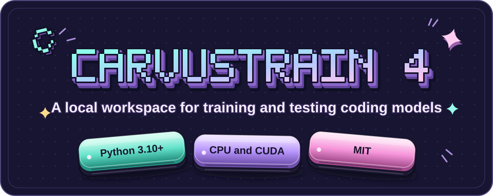
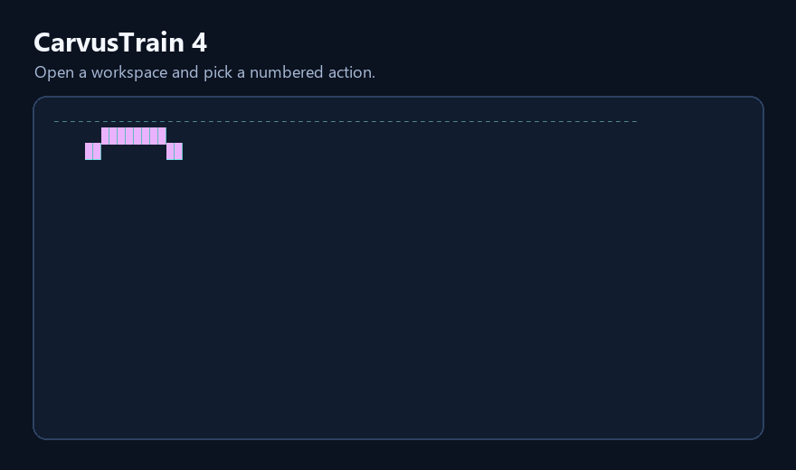

  <h1></h1>
  
<a href="#your-first-run">First run</a> · <a href="#inside-the-workspace">Workspace</a> · <a href="#training-and-inference">Training</a> · <a href="#evaluating-a-model">Evaluation</a> · <a href="#animation-gallery">Animations</a> · <a href="#evaluation-workbook">Workbook</a> · <a href="#diagrams-and-guides">Guides</a>

  

## 

CarvusTrain brings together the parts of a local training experiment. You
can start with a small CPU model, move to a compatible base model, and compare
answers from different points in a run. Each workspace keeps the model
settings, teaching examples, job history, and notes for one experiment.

- **Check your setup.** Build a tiny CPU test model and verify that you can
  save and reopen its checkpoint.
- **Teach a narrow behavior.** Fine-tune a local coding model on examples of a
  convention, such as how your team documents parameters or handles file paths.
- **Compare models.** Ask the same questions of the original base model and
  one or more checkpoints. Keep a record of which settings produced each result.
- **Give the model project context.** Save a note about an API or convention
  so related questions can retrieve it during generation.

| Start here if you want to… | Use |
| --- | --- |
| Verify that training works on your machine | The built-in CPU test model |
| Fine-tune an existing local coding model | A coding workspace with a compatible base model |
| Train through the framework's general model workflow | The general trainer, which exports a CarvusTrain model artifact |
| Run repeatable jobs from an automation script | The CLI and Python interfaces described in the guides |

## 

Start with Python 3.10 or newer. The core package can create a workspace and
validate examples. Install the optional coding runtime from **Runtime setup**
in the terminal interface before training or generating model answers.
The runtime supplies PyTorch and Transformers.

1. **Build and train.** Select **Build test model** and choose a new folder.
   CarvusTrain creates a tokenizer and initializes a tiny model locally, then
   performs a real optimizer step on your CPU.
2. **Find the checkpoint.** Wait for the result to show **Completed** and
   one saved step. The result includes the job ID and checkpoint path.
3. **Reopen the saved model.** Select **Ask model** and choose the saved
   checkpoint to check that CarvusTrain can load it and generate a response.
4. **Set up your own project.** Open a new workspace, select a compatible
   local base model, and replace the starter examples with your own.

The tiny test model learns from a single example. Use it to verify that
training and checkpoint loading work. For installation details and a
complete first-run walkthrough, open the [CarvusTrain handbook](docs/handbook.md).

  

## 

A workspace keeps model settings, examples, training progress, and notes
together. The dashboard shows which model and device you're working with.

| Area | What you can do |
| --- | --- |
| **Workspace** | Create a project or reopen an existing one. |
| **Model settings** | Select a compatible local base model, device, and context limit. |
| **Training data** | Validate your examples before starting a run. |
| **Checkpoints** | Inspect saved progress and resume an eligible job. |
| **Ask model** | Compare answers from the base model and a saved checkpoint. |
| **Memory** | Save, find, and manage notes the model can use as context. |

  

### 

| Part | What it holds |
| --- | --- |
| **Project settings** | The model name, base-model location, device, and maximum context size. |
| **Brain manifests** | The files that select the learning and coding components, dataset paths, and memory settings. |
| **Basic and optional datasets** | Separate sets of paired prompts and completions. |
| **Job records** | Job IDs, the training configuration, status, progress, and final checkpoint paths derived from the recorded steps. |
| **Training output** | The model and tokenizer at each saved step, plus a loss log. |
| **Workspace notes** | Entries you add explicitly and can search, view, or delete. |

Keep the selected base model available while training and when asking the
base model questions. To move or back up an experiment, keep its workspace
files and any checkpoints you want to reuse. If the base model lives
elsewhere, preserve that model separately and update the workspace path
when needed.

### 

The coding backend expects a local, unquantized, decoder-only causal
language model that Transformers can load. The model directory needs
configuration, tokenizer files, and safetensors weights.

| Setting | What to consider |
| --- | --- |
| **CPU** | The default device and the simplest choice for a smoke test. A small base model and a short run make it easier to check your data and settings. |
| **CUDA** | Requires an available NVIDIA GPU and CUDA-enabled PyTorch in the same Python environment. The model and training working set need to fit in available memory. |
| **Context size** | The prompt and completion share the token budget in training. A long example may need to be shortened, or the workspace may need a larger supported context. |
| **Checkpoint storage** | Training saves full model weights and the tokenizer at each completed step. Free disk space matters when running many steps or using a large base model. |

## 

Pick one behavior you can recognize in an answer. For example, teach the
model to describe how your team handles paths with spaces, or to explain the
return values of your internal APIs. Give each example a direct prompt and
a completion that demonstrates the desired level of detail.

1. **Write a basic set.** Put representative examples in the main dataset.
   Include the common cases you want a short run to see first.
2. **Add variations.** Put supplemental examples in the optional dataset.
   Include different wording and edge cases that follow the same convention.
3. **Validate the selected files.** Each nonblank line must describe one
   example with a nonempty prompt and completion. The validation screen
   reports structural problems before training.
4. **Hold out evaluation questions.** Keep some prompts outside both training
   files. Use them to measure how well the checkpoint handles new wording and cases.

When you include the optional dataset, the trainer appends those examples
after the basic set. Training cycles through that order. A run shorter than
the number of selected examples may stop before it reaches the optional rows.

  

## 

### 

Choose the number of steps, learning rate, and datasets in **Train model**.
The coding backend trains one example per step and updates the base model's
weights. It masks the prompt tokens in the loss so the optimizer step learns
from the completion. The progress bar advances as each checkpoint is saved.

  

  

### 

| Job state | What it means |
| --- | --- |
| **Running** | The trainer is working through the requested steps. Saved steps may already be available. |
| **Completed** | The requested steps finished and the result points to the latest saved checkpoint. |
| **Cancelled** | Training stopped after a cancellation request. The result still points to any recorded checkpoint. |
| **Failed** | Training could not continue. The job status includes an error and reports how far training progressed. |

The loss log helps you see how the training objective changed across saved
steps. Compare model answers as well before deciding which checkpoint to keep.
To resume a cancelled or failed job, keep the original project settings, base
model, and dataset inputs available. Start a new job if those inputs change.

  
  

### 

Choose the base model or a checkpoint, ask a question, and optionally check
the syntax of a Python block in the answer. Hold out some questions from
training so you can compare how well each model handles unfamiliar examples.

  

## 

**CT Basic Memory** saves notes you add deliberately to a workspace. If a
question shares terms with a saved note, the model can receive the matching
text alongside the question. Use clear wording and the same identifiers
you expect to use in future prompts.

For example, a workspace for an internal library might store a note naming
the module that handles importing data and describing which callers use it.
When the library changes, delete the outdated note
and adding the updated guidance. Memory affects the context supplied at
generation time. Fine-tuning changes model weights and produces checkpoints.

  

## 

Start by asking the base model your held-out questions. Ask the saved
checkpoint the same questions, keeping the prompt wording and memory settings
consistent. Record the base model, dataset revision, job ID, and settings
alongside your results so you can reproduce the comparison.

| Check | What to look for |
| --- | --- |
| **Task fit** | The answer follows the requested interface and addresses the question. |
| **Correctness** | The implementation returns the expected result for typical inputs. |
| **Edge cases** | The answer handles missing values, empty inputs, or other cases your callers expect. |
| **Project conventions** | The answer follows the convention you included in the teaching examples. |
| **Python syntax** | The optional validator can compile a fenced Python block and report its diagnostics. |

The syntax check compiles the extracted Python block without executing it.
Review the behavior separately with project-specific tests. If an experiment
changes the base model, data, and settings all at once, repeat it with one
change at a time to see which change affected the answers.

## 

  
  
  

## 

| Question | Where to look |
| --- | --- |
| **Why is the terminal menu missing?** | Open CarvusTrain in a terminal with interactive input and output. The startup chapter covers launcher and color settings. |
| **Why does the demo ask for a new folder?** | Each test run creates its own workspace so it can keep a separate base model, job record, and checkpoints. |
| **Why can't CarvusTrain load my base model?** | Check the folder path and confirm it has a compatible configuration, tokenizer, and safetensors weights. |
| **Why is there no saved checkpoint to select?** | Confirm you opened the correct workspace and that the run recorded at least one saved step. |
| **What if I prefer a static terminal display?** | Enable the reduced-motion setting documented in the handbook. The handwriting SVG also respects the browser's reduced-motion preference. |

## 

| Explore | Diagrams |
| --- | --- |
| **Starting out** | [Workspace layout](docs/diagrams/workspace-topology.mmd) · [Terminal entry](docs/diagrams/terminal-entry.mmd) · [CPU test model](docs/diagrams/cpu-test-model.mmd) |
| **Training** | [Dataset validation](docs/diagrams/dataset-validation.mmd) · [Training step](docs/diagrams/training-step.mmd) · [Job lifecycle](docs/diagrams/job-lifecycle.mmd) · [General model training](docs/diagrams/general-model-training.mmd) |
| **Checkpoints** | [Publishing a checkpoint](docs/diagrams/checkpoint-publish.mmd) · [Resuming a job](docs/diagrams/checkpoint-resume.mmd) |
| **Answers** | [Local inference](docs/diagrams/coding-inference.mmd) · [Memory retrieval](docs/diagrams/memory-retrieval.mmd) · [Syntax check](docs/diagrams/syntax-check.mmd) |

The [training animation](docs/animations/training-pulse.svg) traces the
steps from encoding an example to saving a checkpoint. The
[inference animation](docs/animations/inference-signal.svg) follows a
question through generation to the model's answer.

| Guide | What you'll find |
| --- | --- |
| [CarvusTrain handbook](docs/handbook.md) | Setup, a complete fine-tuning experiment, troubleshooting, and command reference |
| [Coding workspace guide](docs/coding_workspace.md) | Project settings, dataset format, model compatibility, and job recovery |
| [Architecture](docs/architecture.md) | The framework's components and how they connect |
| [API reference](docs/api_reference.md) | Python interfaces for models, datasets, tokenizers, and evaluation |
| [Developer guide](docs/developer_guide.md) | Repository layout, development practices, and tests |
| [Changelog](CHANGELOG.md) | Release history |
| [MIT license](LICENSE) | The project's license |

## 

Pick a topic and use its eight prompts as held-out evaluation cases.
Each case has a base-model pass, a checkpoint pass, and a follow-up.
These are suggested review exercises. They contain no measured results.
Keep the same prompt and memory setting for both passes.

Portable file paths ? eight review cases

Focus on whether the joined path preserves both supplied parts.

**01.01 ? Typical request**

**Prompt**

> Explain how to join a caller-selected folder and a filename in a small Python project.

**Before running**

- Keep this portable file paths question outside the training examples.
- Select a representative input that meets the contract.
- Use the same model context and memory setting throughout the pair.

**Base-model pass**

- Ask the original base model the prompt above.
- Save the answer beside the selected input.
- Check whether the answer explains how to join a caller-selected folder and a filename.

**Checkpoint pass**

- Choose the completed training checkpoint by job and saved step.
- Ask the same question without changing its wording.
- Check the answer against this outcome: the joined path preserves both supplied parts.

**Review the pair**

- **Contract:** The answer should return the path without opening the file.
- **Edge:** Check the case where a filename containing spaces.
- **Pitfall:** Look for hard-coded path separators.
- Mark each answer as meets, partial, or misses.
- Quote the first sentence that explains each rating.

**Follow-up**

> Show how you would check that return the path without opening the file.

- Use the same follow-up for both models.
- Keep any clarification separate from the first answers.

**Record**

- Case 01.01 belongs to portable file paths.
- Note one concrete difference you observed.
- Keep the case ID with both answers.
- Record the question as it was sent.
- Record the base-model name.
- Record the checkpoint job ID.
- Record the saved step.

**01.02 ? Boundary behavior**

**Prompt**

> Explain how to join a caller-selected folder and a filename when a filename containing spaces.

**Before running**

- Keep this portable file paths question outside the training examples.
- Select the named boundary case.
- Use the same model context and memory setting throughout the pair.

**Base-model pass**

- Ask the original base model the prompt above.
- Save the answer beside the selected input.
- Check whether the answer explains how to join a caller-selected folder and a filename.

**Checkpoint pass**

- Choose the completed training checkpoint by job and saved step.
- Ask the same question without changing its wording.
- Check the answer against this outcome: the joined path preserves both supplied parts.

**Review the pair**

- **Contract:** The answer should return the path without opening the file.
- **Edge:** Check the case where a filename containing spaces.
- **Pitfall:** Look for hard-coded path separators.
- Mark each answer as meets, partial, or misses.
- Quote the first sentence that explains each rating.

**Follow-up**

> Describe evidence that the joined path preserves both supplied parts.

- Use the same follow-up for both models.
- Keep any clarification separate from the first answers.

**Record**

- Case 01.02 belongs to portable file paths.
- Note one concrete difference you observed.
- Record the question as it was sent.
- Record the base-model name.
- Record the checkpoint job ID.
- Record the saved step.
- Record the workspace context limit.
- Record the device used for the comparison.

**01.03 ? Return contract**

**Prompt**

> Describe the inputs and result needed to join a caller-selected folder and a filename. The caller expects this rule: return the path without opening the file.

**Before running**

- Keep this portable file paths question outside the training examples.
- Select an input and the required return value.
- Use the same model context and memory setting throughout the pair.

**Base-model pass**

- Ask the original base model the prompt above.
- Save the answer beside the selected input.
- Check whether the answer explains how to join a caller-selected folder and a filename.

**Checkpoint pass**

- Choose the completed training checkpoint by job and saved step.
- Ask the same question without changing its wording.
- Check the answer against this outcome: the joined path preserves both supplied parts.

**Review the pair**

- **Contract:** The answer should return the path without opening the file.
- **Edge:** Check the case where a filename containing spaces.
- **Pitfall:** Look for hard-coded path separators.
- Mark each answer as meets, partial, or misses.
- Quote the first sentence that explains each rating.

**Follow-up**

> Ask what the caller receives and whether original input changes.

- Use the same follow-up for both models.
- Keep any clarification separate from the first answers.

**Record**

- Case 01.03 belongs to portable file paths.
- Note one concrete difference you observed.
- Record the base-model name.
- Record the checkpoint job ID.
- Record the saved step.
- Record the workspace context limit.
- Record the device used for the comparison.
- Record why any result was marked inconclusive.

**01.04 ? Common mistake**

**Prompt**

> Explain how to join a caller-selected folder and a filename. Explain the consequence of hard-coded path separators.

**Before running**

- Keep this portable file paths question outside the training examples.
- Select a concrete input that exposes the mistake.
- Use the same model context and memory setting throughout the pair.

**Base-model pass**

- Ask the original base model the prompt above.
- Save the answer beside the selected input.
- Check whether the answer explains how to join a caller-selected folder and a filename.

**Checkpoint pass**

- Choose the completed training checkpoint by job and saved step.
- Ask the same question without changing its wording.
- Check the answer against this outcome: the joined path preserves both supplied parts.

**Review the pair**

- **Contract:** The answer should return the path without opening the file.
- **Edge:** Check the case where a filename containing spaces.
- **Pitfall:** Look for hard-coded path separators.
- Mark each answer as meets, partial, or misses.
- Quote the first sentence that explains each rating.

**Follow-up**

> Ask for a counterexample where the shortcut gives the wrong result.

- Use the same follow-up for both models.
- Keep any clarification separate from the first answers.

**Record**

- Case 01.04 belongs to portable file paths.
- Note one concrete difference you observed.
- Record the checkpoint job ID.
- Record the saved step.
- Record the workspace context limit.
- Record the device used for the comparison.
- Record why any result was marked inconclusive.

**01.05 ? Regression review**

**Prompt**

> Propose two behavior checks for a change that will join a caller-selected folder and a filename, including the case where a filename containing spaces.

**Before running**

- Keep this portable file paths question outside the training examples.
- Select two checks with observable outcomes.
- Use the same model context and memory setting throughout the pair.

**Base-model pass**

- Ask the original base model the prompt above.
- Save the answer beside the selected input.
- Check whether the answer explains how to join a caller-selected folder and a filename.

**Checkpoint pass**

- Choose the completed training checkpoint by job and saved step.
- Ask the same question without changing its wording.
- Check the answer against this outcome: the joined path preserves both supplied parts.

**Review the pair**

- **Contract:** The answer should return the path without opening the file.
- **Edge:** Check the case where a filename containing spaces.
- **Pitfall:** Look for hard-coded path separators.
- Mark each answer as meets, partial, or misses.
- Quote the first sentence that explains each rating.

**Follow-up**

> Ask what output would show that the joined path preserves both supplied parts.

- Use the same follow-up for both models.
- Keep any clarification separate from the first answers.

**Record**

- Case 01.05 belongs to portable file paths.
- Note one concrete difference you observed.
- Record the saved step.
- Record the workspace context limit.
- Record the device used for the comparison.
- Record why any result was marked inconclusive.
- Keep later prompt variants separate from this paired result.
- Revisit the result after a dataset revision if the failure recurs.

**01.06 ? Project convention**

**Prompt**

> Explain how a team could join a caller-selected folder and a filename while following this convention: return the path without opening the file.

**Before running**

- Keep this portable file paths question outside the training examples.
- Select the expected interface for the team.
- Use the same model context and memory setting throughout the pair.

**Base-model pass**

- Ask the original base model the prompt above.
- Save the answer beside the selected input.
- Check whether the answer explains how to join a caller-selected folder and a filename.

**Checkpoint pass**

- Choose the completed training checkpoint by job and saved step.
- Ask the same question without changing its wording.
- Check the answer against this outcome: the joined path preserves both supplied parts.

**Review the pair**

- **Contract:** The answer should return the path without opening the file.
- **Edge:** Check the case where a filename containing spaces.
- **Pitfall:** Look for hard-coded path separators.
- Mark each answer as meets, partial, or misses.
- Quote the first sentence that explains each rating.

**Follow-up**

> Ask how callers would notice if the convention were broken.

- Use the same follow-up for both models.
- Keep any clarification separate from the first answers.

**Record**

- Case 01.06 belongs to portable file paths.
- Note one concrete difference you observed.
- Record the workspace context limit.
- Record the device used for the comparison.
- Record why any result was marked inconclusive.
- Keep later prompt variants separate from this paired result.
- Revisit the result after a dataset revision if the failure recurs.
- Keep memory notes with the relevant follow-up trial.

**01.07 ? Paraphrased request**

**Prompt**

> A teammate asks how to join a caller-selected folder and a filename and mentions that a filename containing spaces. Summarize what needs to happen.

**Before running**

- Keep this portable file paths question outside the training examples.
- Select a paraphrase that preserves the original constraints.
- Use the same model context and memory setting throughout the pair.

**Base-model pass**

- Ask the original base model the prompt above.
- Save the answer beside the selected input.
- Check whether the answer explains how to join a caller-selected folder and a filename.

**Checkpoint pass**

- Choose the completed training checkpoint by job and saved step.
- Ask the same question without changing its wording.
- Check the answer against this outcome: the joined path preserves both supplied parts.

**Review the pair**

- **Contract:** The answer should return the path without opening the file.
- **Edge:** Check the case where a filename containing spaces.
- **Pitfall:** Look for hard-coded path separators.
- Mark each answer as meets, partial, or misses.
- Quote the first sentence that explains each rating.

**Follow-up**

> Ask for the expected result in plain language.

- Use the same follow-up for both models.
- Keep any clarification separate from the first answers.

**Record**

- Case 01.07 belongs to portable file paths.
- Note one concrete difference you observed.
- Record the device used for the comparison.
- Record why any result was marked inconclusive.
- Keep later prompt variants separate from this paired result.
- Revisit the result after a dataset revision if the failure recurs.
- Keep memory notes with the relevant follow-up trial.

**01.08 ? Trade-off explanation**

**Prompt**

> Explain one reasonable choice for how to join a caller-selected folder and a filename. Account for the risk of hard-coded path separators.

**Before running**

- Keep this portable file paths question outside the training examples.
- Select a stated assumption and a reason for the choice.
- Use the same model context and memory setting throughout the pair.

**Base-model pass**

- Ask the original base model the prompt above.
- Save the answer beside the selected input.
- Check whether the answer explains how to join a caller-selected folder and a filename.

**Checkpoint pass**

- Choose the completed training checkpoint by job and saved step.
- Ask the same question without changing its wording.
- Check the answer against this outcome: the joined path preserves both supplied parts.

**Review the pair**

- **Contract:** The answer should return the path without opening the file.
- **Edge:** Check the case where a filename containing spaces.
- **Pitfall:** Look for hard-coded path separators.
- Mark each answer as meets, partial, or misses.
- Quote the first sentence that explains each rating.

**Follow-up**

> Ask which assumption would change the approach.

- Use the same follow-up for both models.
- Keep any clarification separate from the first answers.

**Record**

- Case 01.08 belongs to portable file paths.
- Note one concrete difference you observed.
- Record why any result was marked inconclusive.
- Keep later prompt variants separate from this paired result.
- Revisit the result after a dataset revision if the failure recurs.
- Keep memory notes with the relevant follow-up trial.
- Mark cases whose constraints were missed by both models.
- Keep the case ID with both answers.

UTF-8 text reading ? eight review cases

Focus on whether the decoded text preserves the original characters.

**02.01 ? Typical request**

**Prompt**

> Explain how to read a local text file as Unicode in a small Python project.

**Before running**

- Keep this utf-8 text reading question outside the training examples.
- Select a representative input that meets the contract.
- Use the same model context and memory setting throughout the pair.

**Base-model pass**

- Ask the original base model the prompt above.
- Save the answer beside the selected input.
- Check whether the answer explains how to read a local text file as Unicode.

**Checkpoint pass**

- Choose the completed training checkpoint by job and saved step.
- Ask the same question without changing its wording.
- Check the answer against this outcome: the decoded text preserves the original characters.

**Review the pair**

- **Contract:** The answer should return text without changing the file.
- **Edge:** Check the case where text with accented characters.
- **Pitfall:** Look for relying on a platform-default encoding.
- Mark each answer as meets, partial, or misses.
- Quote the first sentence that explains each rating.

**Follow-up**

> Show how you would check that return text without changing the file.

- Use the same follow-up for both models.
- Keep any clarification separate from the first answers.

**Record**

- Case 02.01 belongs to utf-8 text reading.
- Note one concrete difference you observed.
- Keep later prompt variants separate from this paired result.
- Revisit the result after a dataset revision if the failure recurs.
- Keep memory notes with the relevant follow-up trial.
- Mark cases whose constraints were missed by both models.
- Keep the case ID with both answers.
- Record the question as it was sent.

**02.02 ? Boundary behavior**

**Prompt**

> Explain how to read a local text file as Unicode when text with accented characters.

**Before running**

- Keep this utf-8 text reading question outside the training examples.
- Select the named boundary case.
- Use the same model context and memory setting throughout the pair.

**Base-model pass**

- Ask the original base model the prompt above.
- Save the answer beside the selected input.
- Check whether the answer explains how to read a local text file as Unicode.

**Checkpoint pass**

- Choose the completed training checkpoint by job and saved step.
- Ask the same question without changing its wording.
- Check the answer against this outcome: the decoded text preserves the original characters.

**Review the pair**

- **Contract:** The answer should return text without changing the file.
- **Edge:** Check the case where text with accented characters.
- **Pitfall:** Look for relying on a platform-default encoding.
- Mark each answer as meets, partial, or misses.
- Quote the first sentence that explains each rating.

**Follow-up**

> Describe evidence that the decoded text preserves the original characters.

- Use the same follow-up for both models.
- Keep any clarification separate from the first answers.

**Record**

- Case 02.02 belongs to utf-8 text reading.
- Note one concrete difference you observed.
- Revisit the result after a dataset revision if the failure recurs.
- Keep memory notes with the relevant follow-up trial.
- Mark cases whose constraints were missed by both models.
- Keep the case ID with both answers.
- Record the question as it was sent.

**02.03 ? Return contract**

**Prompt**

> Describe the inputs and result needed to read a local text file as Unicode. The caller expects this rule: return text without changing the file.

**Before running**

- Keep this utf-8 text reading question outside the training examples.
- Select an input and the required return value.
- Use the same model context and memory setting throughout the pair.

**Base-model pass**

- Ask the original base model the prompt above.
- Save the answer beside the selected input.
- Check whether the answer explains how to read a local text file as Unicode.

**Checkpoint pass**

- Choose the completed training checkpoint by job and saved step.
- Ask the same question without changing its wording.
- Check the answer against this outcome: the decoded text preserves the original characters.

**Review the pair**

- **Contract:** The answer should return text without changing the file.
- **Edge:** Check the case where text with accented characters.
- **Pitfall:** Look for relying on a platform-default encoding.
- Mark each answer as meets, partial, or misses.
- Quote the first sentence that explains each rating.

**Follow-up**

> Ask what the caller receives and whether original input changes.

- Use the same follow-up for both models.
- Keep any clarification separate from the first answers.

**Record**

- Case 02.03 belongs to utf-8 text reading.
- Note one concrete difference you observed.
- Keep memory notes with the relevant follow-up trial.
- Mark cases whose constraints were missed by both models.
- Keep the case ID with both answers.
- Record the question as it was sent.
- Record the base-model name.
- Record the checkpoint job ID.

**02.04 ? Common mistake**

**Prompt**

> Explain how to read a local text file as Unicode. Explain the consequence of relying on a platform-default encoding.

**Before running**

- Keep this utf-8 text reading question outside the training examples.
- Select a concrete input that exposes the mistake.
- Use the same model context and memory setting throughout the pair.

**Base-model pass**

- Ask the original base model the prompt above.
- Save the answer beside the selected input.
- Check whether the answer explains how to read a local text file as Unicode.

**Checkpoint pass**

- Choose the completed training checkpoint by job and saved step.
- Ask the same question without changing its wording.
- Check the answer against this outcome: the decoded text preserves the original characters.

**Review the pair**

- **Contract:** The answer should return text without changing the file.
- **Edge:** Check the case where text with accented characters.
- **Pitfall:** Look for relying on a platform-default encoding.
- Mark each answer as meets, partial, or misses.
- Quote the first sentence that explains each rating.

**Follow-up**

> Ask for a counterexample where the shortcut gives the wrong result.

- Use the same follow-up for both models.
- Keep any clarification separate from the first answers.

**Record**

- Case 02.04 belongs to utf-8 text reading.
- Note one concrete difference you observed.
- Mark cases whose constraints were missed by both models.
- Keep the case ID with both answers.
- Record the question as it was sent.
- Record the base-model name.
- Record the checkpoint job ID.
- Record the saved step.

**02.05 ? Regression review**

**Prompt**

> Propose two behavior checks for a change that will read a local text file as Unicode, including the case where text with accented characters.

**Before running**

- Keep this utf-8 text reading question outside the training examples.
- Select two checks with observable outcomes.
- Use the same model context and memory setting throughout the pair.

**Base-model pass**

- Ask the original base model the prompt above.
- Save the answer beside the selected input.
- Check whether the answer explains how to read a local text file as Unicode.

**Checkpoint pass**

- Choose the completed training checkpoint by job and saved step.
- Ask the same question without changing its wording.
- Check the answer against this outcome: the decoded text preserves the original characters.

**Review the pair**

- **Contract:** The answer should return text without changing the file.
- **Edge:** Check the case where text with accented characters.
- **Pitfall:** Look for relying on a platform-default encoding.
- Mark each answer as meets, partial, or misses.
- Quote the first sentence that explains each rating.

**Follow-up**

> Ask what output would show that the decoded text preserves the original characters.

- Use the same follow-up for both models.
- Keep any clarification separate from the first answers.

**Record**

- Case 02.05 belongs to utf-8 text reading.
- Note one concrete difference you observed.
- Keep the case ID with both answers.
- Record the question as it was sent.
- Record the base-model name.
- Record the checkpoint job ID.
- Record the saved step.

**02.06 ? Project convention**

**Prompt**

> Explain how a team could read a local text file as Unicode while following this convention: return text without changing the file.

**Before running**

- Keep this utf-8 text reading question outside the training examples.
- Select the expected interface for the team.
- Use the same model context and memory setting throughout the pair.

**Base-model pass**

- Ask the original base model the prompt above.
- Save the answer beside the selected input.
- Check whether the answer explains how to read a local text file as Unicode.

**Checkpoint pass**

- Choose the completed training checkpoint by job and saved step.
- Ask the same question without changing its wording.
- Check the answer against this outcome: the decoded text preserves the original characters.

**Review the pair**

- **Contract:** The answer should return text without changing the file.
- **Edge:** Check the case where text with accented characters.
- **Pitfall:** Look for relying on a platform-default encoding.
- Mark each answer as meets, partial, or misses.
- Quote the first sentence that explains each rating.

**Follow-up**

> Ask how callers would notice if the convention were broken.

- Use the same follow-up for both models.
- Keep any clarification separate from the first answers.

**Record**

- Case 02.06 belongs to utf-8 text reading.
- Note one concrete difference you observed.
- Record the question as it was sent.
- Record the base-model name.
- Record the checkpoint job ID.
- Record the saved step.
- Record the workspace context limit.
- Record the device used for the comparison.

**02.07 ? Paraphrased request**

**Prompt**

> A teammate asks how to read a local text file as Unicode and mentions that text with accented characters. Summarize what needs to happen.

**Before running**

- Keep this utf-8 text reading question outside the training examples.
- Select a paraphrase that preserves the original constraints.
- Use the same model context and memory setting throughout the pair.

**Base-model pass**

- Ask the original base model the prompt above.
- Save the answer beside the selected input.
- Check whether the answer explains how to read a local text file as Unicode.

**Checkpoint pass**

- Choose the completed training checkpoint by job and saved step.
- Ask the same question without changing its wording.
- Check the answer against this outcome: the decoded text preserves the original characters.

**Review the pair**

- **Contract:** The answer should return text without changing the file.
- **Edge:** Check the case where text with accented characters.
- **Pitfall:** Look for relying on a platform-default encoding.
- Mark each answer as meets, partial, or misses.
- Quote the first sentence that explains each rating.

**Follow-up**

> Ask for the expected result in plain language.

- Use the same follow-up for both models.
- Keep any clarification separate from the first answers.

**Record**

- Case 02.07 belongs to utf-8 text reading.
- Note one concrete difference you observed.
- Record the base-model name.
- Record the checkpoint job ID.
- Record the saved step.
- Record the workspace context limit.
- Record the device used for the comparison.
- Record why any result was marked inconclusive.

**02.08 ? Trade-off explanation**

**Prompt**

> Explain one reasonable choice for how to read a local text file as Unicode. Account for the risk of relying on a platform-default encoding.

**Before running**

- Keep this utf-8 text reading question outside the training examples.
- Select a stated assumption and a reason for the choice.
- Use the same model context and memory setting throughout the pair.

**Base-model pass**

- Ask the original base model the prompt above.
- Save the answer beside the selected input.
- Check whether the answer explains how to read a local text file as Unicode.

**Checkpoint pass**

- Choose the completed training checkpoint by job and saved step.
- Ask the same question without changing its wording.
- Check the answer against this outcome: the decoded text preserves the original characters.

**Review the pair**

- **Contract:** The answer should return text without changing the file.
- **Edge:** Check the case where text with accented characters.
- **Pitfall:** Look for relying on a platform-default encoding.
- Mark each answer as meets, partial, or misses.
- Quote the first sentence that explains each rating.

**Follow-up**

> Ask which assumption would change the approach.

- Use the same follow-up for both models.
- Keep any clarification separate from the first answers.

**Record**

- Case 02.08 belongs to utf-8 text reading.
- Note one concrete difference you observed.
- Record the checkpoint job ID.
- Record the saved step.
- Record the workspace context limit.
- Record the device used for the comparison.
- Record why any result was marked inconclusive.
- Keep later prompt variants separate from this paired result.

Stable deduplication ? eight review cases

Focus on whether each identifier appears at its first position.

**03.01 ? Typical request**

**Prompt**

> Explain how to remove duplicate identifiers from a list in a small Python project.

**Before running**

- Keep this stable deduplication question outside the training examples.
- Select a representative input that meets the contract.
- Use the same model context and memory setting throughout the pair.

**Base-model pass**

- Ask the original base model the prompt above.
- Save the answer beside the selected input.
- Check whether the answer explains how to remove duplicate identifiers from a list.

**Checkpoint pass**

- Choose the completed training checkpoint by job and saved step.
- Ask the same question without changing its wording.
- Check the answer against this outcome: each identifier appears at its first position.

**Review the pair**

- **Contract:** The answer should preserve first occurrence order.
- **Edge:** Check the case where an identifier appears at the beginning and end.
- **Pitfall:** Look for sorting the identifiers.
- Mark each answer as meets, partial, or misses.
- Quote the first sentence that explains each rating.

**Follow-up**

> Show how you would check that preserve first occurrence order.

- Use the same follow-up for both models.
- Keep any clarification separate from the first answers.

**Record**

- Case 03.01 belongs to stable deduplication.
- Note one concrete difference you observed.
- Record the saved step.
- Record the workspace context limit.
- Record the device used for the comparison.
- Record why any result was marked inconclusive.
- Keep later prompt variants separate from this paired result.

**03.02 ? Boundary behavior**

**Prompt**

> Explain how to remove duplicate identifiers from a list when an identifier appears at the beginning and end.

**Before running**

- Keep this stable deduplication question outside the training examples.
- Select the named boundary case.
- Use the same model context and memory setting throughout the pair.

**Base-model pass**

- Ask the original base model the prompt above.
- Save the answer beside the selected input.
- Check whether the answer explains how to remove duplicate identifiers from a list.

**Checkpoint pass**

- Choose the completed training checkpoint by job and saved step.
- Ask the same question without changing its wording.
- Check the answer against this outcome: each identifier appears at its first position.

**Review the pair**

- **Contract:** The answer should preserve first occurrence order.
- **Edge:** Check the case where an identifier appears at the beginning and end.
- **Pitfall:** Look for sorting the identifiers.
- Mark each answer as meets, partial, or misses.
- Quote the first sentence that explains each rating.

**Follow-up**

> Describe evidence that each identifier appears at its first position.

- Use the same follow-up for both models.
- Keep any clarification separate from the first answers.

**Record**

- Case 03.02 belongs to stable deduplication.
- Note one concrete difference you observed.
- Record the workspace context limit.
- Record the device used for the comparison.
- Record why any result was marked inconclusive.
- Keep later prompt variants separate from this paired result.
- Revisit the result after a dataset revision if the failure recurs.
- Keep memory notes with the relevant follow-up trial.

**03.03 ? Return contract**

**Prompt**

> Describe the inputs and result needed to remove duplicate identifiers from a list. The caller expects this rule: preserve first occurrence order.

**Before running**

- Keep this stable deduplication question outside the training examples.
- Select an input and the required return value.
- Use the same model context and memory setting throughout the pair.

**Base-model pass**

- Ask the original base model the prompt above.
- Save the answer beside the selected input.
- Check whether the answer explains how to remove duplicate identifiers from a list.

**Checkpoint pass**

- Choose the completed training checkpoint by job and saved step.
- Ask the same question without changing its wording.
- Check the answer against this outcome: each identifier appears at its first position.

**Review the pair**

- **Contract:** The answer should preserve first occurrence order.
- **Edge:** Check the case where an identifier appears at the beginning and end.
- **Pitfall:** Look for sorting the identifiers.
- Mark each answer as meets, partial, or misses.
- Quote the first sentence that explains each rating.

**Follow-up**

> Ask what the caller receives and whether original input changes.

- Use the same follow-up for both models.
- Keep any clarification separate from the first answers.

**Record**

- Case 03.03 belongs to stable deduplication.
- Note one concrete difference you observed.
- Record the device used for the comparison.
- Record why any result was marked inconclusive.
- Keep later prompt variants separate from this paired result.
- Revisit the result after a dataset revision if the failure recurs.
- Keep memory notes with the relevant follow-up trial.
- Mark cases whose constraints were missed by both models.

**03.04 ? Common mistake**

**Prompt**

> Explain how to remove duplicate identifiers from a list. Explain the consequence of sorting the identifiers.

**Before running**

- Keep this stable deduplication question outside the training examples.
- Select a concrete input that exposes the mistake.
- Use the same model context and memory setting throughout the pair.

**Base-model pass**

- Ask the original base model the prompt above.
- Save the answer beside the selected input.
- Check whether the answer explains how to remove duplicate identifiers from a list.

**Checkpoint pass**

- Choose the completed training checkpoint by job and saved step.
- Ask the same question without changing its wording.
- Check the answer against this outcome: each identifier appears at its first position.

**Review the pair**

- **Contract:** The answer should preserve first occurrence order.
- **Edge:** Check the case where an identifier appears at the beginning and end.
- **Pitfall:** Look for sorting the identifiers.
- Mark each answer as meets, partial, or misses.
- Quote the first sentence that explains each rating.

**Follow-up**

> Ask for a counterexample where the shortcut gives the wrong result.

- Use the same follow-up for both models.
- Keep any clarification separate from the first answers.

**Record**

- Case 03.04 belongs to stable deduplication.
- Note one concrete difference you observed.
- Record why any result was marked inconclusive.
- Keep later prompt variants separate from this paired result.
- Revisit the result after a dataset revision if the failure recurs.
- Keep memory notes with the relevant follow-up trial.
- Mark cases whose constraints were missed by both models.

**03.05 ? Regression review**

**Prompt**

> Propose two behavior checks for a change that will remove duplicate identifiers from a list, including the case where an identifier appears at the beginning and end.

**Before running**

- Keep this stable deduplication question outside the training examples.
- Select two checks with observable outcomes.
- Use the same model context and memory setting throughout the pair.

**Base-model pass**

- Ask the original base model the prompt above.
- Save the answer beside the selected input.
- Check whether the answer explains how to remove duplicate identifiers from a list.

**Checkpoint pass**

- Choose the completed training checkpoint by job and saved step.
- Ask the same question without changing its wording.
- Check the answer against this outcome: each identifier appears at its first position.

**Review the pair**

- **Contract:** The answer should preserve first occurrence order.
- **Edge:** Check the case where an identifier appears at the beginning and end.
- **Pitfall:** Look for sorting the identifiers.
- Mark each answer as meets, partial, or misses.
- Quote the first sentence that explains each rating.

**Follow-up**

> Ask what output would show that each identifier appears at its first position.

- Use the same follow-up for both models.
- Keep any clarification separate from the first answers.

**Record**

- Case 03.05 belongs to stable deduplication.
- Note one concrete difference you observed.
- Keep later prompt variants separate from this paired result.
- Revisit the result after a dataset revision if the failure recurs.
- Keep memory notes with the relevant follow-up trial.
- Mark cases whose constraints were missed by both models.
- Keep the case ID with both answers.
- Record the question as it was sent.

**03.06 ? Project convention**

**Prompt**

> Explain how a team could remove duplicate identifiers from a list while following this convention: preserve first occurrence order.

**Before running**

- Keep this stable deduplication question outside the training examples.
- Select the expected interface for the team.
- Use the same model context and memory setting throughout the pair.

**Base-model pass**

- Ask the original base model the prompt above.
- Save the answer beside the selected input.
- Check whether the answer explains how to remove duplicate identifiers from a list.

**Checkpoint pass**

- Choose the completed training checkpoint by job and saved step.
- Ask the same question without changing its wording.
- Check the answer against this outcome: each identifier appears at its first position.

**Review the pair**

- **Contract:** The answer should preserve first occurrence order.
- **Edge:** Check the case where an identifier appears at the beginning and end.
- **Pitfall:** Look for sorting the identifiers.
- Mark each answer as meets, partial, or misses.
- Quote the first sentence that explains each rating.

**Follow-up**

> Ask how callers would notice if the convention were broken.

- Use the same follow-up for both models.
- Keep any clarification separate from the first answers.

**Record**

- Case 03.06 belongs to stable deduplication.
- Note one concrete difference you observed.
- Revisit the result after a dataset revision if the failure recurs.
- Keep memory notes with the relevant follow-up trial.
- Mark cases whose constraints were missed by both models.
- Keep the case ID with both answers.
- Record the question as it was sent.
- Record the base-model name.

**03.07 ? Paraphrased request**

**Prompt**

> A teammate asks how to remove duplicate identifiers from a list and mentions that an identifier appears at the beginning and end. Summarize what needs to happen.

**Before running**

- Keep this stable deduplication question outside the training examples.
- Select a paraphrase that preserves the original constraints.
- Use the same model context and memory setting throughout the pair.

**Base-model pass**

- Ask the original base model the prompt above.
- Save the answer beside the selected input.
- Check whether the answer explains how to remove duplicate identifiers from a list.

**Checkpoint pass**

- Choose the completed training checkpoint by job and saved step.
- Ask the same question without changing its wording.
- Check the answer against this outcome: each identifier appears at its first position.

**Review the pair**

- **Contract:** The answer should preserve first occurrence order.
- **Edge:** Check the case where an identifier appears at the beginning and end.
- **Pitfall:** Look for sorting the identifiers.
- Mark each answer as meets, partial, or misses.
- Quote the first sentence that explains each rating.

**Follow-up**

> Ask for the expected result in plain language.

- Use the same follow-up for both models.
- Keep any clarification separate from the first answers.

**Record**

- Case 03.07 belongs to stable deduplication.
- Note one concrete difference you observed.
- Keep memory notes with the relevant follow-up trial.
- Mark cases whose constraints were missed by both models.
- Keep the case ID with both answers.
- Record the question as it was sent.
- Record the base-model name.

**03.08 ? Trade-off explanation**

**Prompt**

> Explain one reasonable choice for how to remove duplicate identifiers from a list. Account for the risk of sorting the identifiers.

**Before running**

- Keep this stable deduplication question outside the training examples.
- Select a stated assumption and a reason for the choice.
- Use the same model context and memory setting throughout the pair.

**Base-model pass**

- Ask the original base model the prompt above.
- Save the answer beside the selected input.
- Check whether the answer explains how to remove duplicate identifiers from a list.

**Checkpoint pass**

- Choose the completed training checkpoint by job and saved step.
- Ask the same question without changing its wording.
- Check the answer against this outcome: each identifier appears at its first position.

**Review the pair**

- **Contract:** The answer should preserve first occurrence order.
- **Edge:** Check the case where an identifier appears at the beginning and end.
- **Pitfall:** Look for sorting the identifiers.
- Mark each answer as meets, partial, or misses.
- Quote the first sentence that explains each rating.

**Follow-up**

> Ask which assumption would change the approach.

- Use the same follow-up for both models.
- Keep any clarification separate from the first answers.

**Record**

- Case 03.08 belongs to stable deduplication.
- Note one concrete difference you observed.
- Mark cases whose constraints were missed by both models.
- Keep the case ID with both answers.
- Record the question as it was sent.
- Record the base-model name.
- Record the checkpoint job ID.
- Record the saved step.

Optional settings ? eight review cases

Focus on whether an explicit false value stays false.

**04.01 ? Typical request**

**Prompt**

> Explain how to read an optional display preference in a small Python project.

**Before running**

- Keep this optional settings question outside the training examples.
- Select a representative input that meets the contract.
- Use the same model context and memory setting throughout the pair.

**Base-model pass**

- Ask the original base model the prompt above.
- Save the answer beside the selected input.
- Check whether the answer explains how to read an optional display preference.

**Checkpoint pass**

- Choose the completed training checkpoint by job and saved step.
- Ask the same question without changing its wording.
- Check the answer against this outcome: an explicit false value stays false.

**Review the pair**

- **Contract:** The answer should use the default only when the preference is absent.
- **Edge:** Check the case where a supplied value is false.
- **Pitfall:** Look for confusing false with missing.
- Mark each answer as meets, partial, or misses.
- Quote the first sentence that explains each rating.

**Follow-up**

> Show how you would check that use the default only when the preference is absent.

- Use the same follow-up for both models.
- Keep any clarification separate from the first answers.

**Record**

- Case 04.01 belongs to optional settings.
- Note one concrete difference you observed.
- Keep the case ID with both answers.
- Record the question as it was sent.
- Record the base-model name.
- Record the checkpoint job ID.
- Record the saved step.
- Record the workspace context limit.

**04.02 ? Boundary behavior**

**Prompt**

> Explain how to read an optional display preference when a supplied value is false.

**Before running**

- Keep this optional settings question outside the training examples.
- Select the named boundary case.
- Use the same model context and memory setting throughout the pair.

**Base-model pass**

- Ask the original base model the prompt above.
- Save the answer beside the selected input.
- Check whether the answer explains how to read an optional display preference.

**Checkpoint pass**

- Choose the completed training checkpoint by job and saved step.
- Ask the same question without changing its wording.
- Check the answer against this outcome: an explicit false value stays false.

**Review the pair**

- **Contract:** The answer should use the default only when the preference is absent.
- **Edge:** Check the case where a supplied value is false.
- **Pitfall:** Look for confusing false with missing.
- Mark each answer as meets, partial, or misses.
- Quote the first sentence that explains each rating.

**Follow-up**

> Describe evidence that an explicit false value stays false.

- Use the same follow-up for both models.
- Keep any clarification separate from the first answers.

**Record**

- Case 04.02 belongs to optional settings.
- Note one concrete difference you observed.
- Record the question as it was sent.
- Record the base-model name.
- Record the checkpoint job ID.
- Record the saved step.
- Record the workspace context limit.

**04.03 ? Return contract**

**Prompt**

> Describe the inputs and result needed to read an optional display preference. The caller expects this rule: use the default only when the preference is absent.

**Before running**

- Keep this optional settings question outside the training examples.
- Select an input and the required return value.
- Use the same model context and memory setting throughout the pair.

**Base-model pass**

- Ask the original base model the prompt above.
- Save the answer beside the selected input.
- Check whether the answer explains how to read an optional display preference.

**Checkpoint pass**

- Choose the completed training checkpoint by job and saved step.
- Ask the same question without changing its wording.
- Check the answer against this outcome: an explicit false value stays false.

**Review the pair**

- **Contract:** The answer should use the default only when the preference is absent.
- **Edge:** Check the case where a supplied value is false.
- **Pitfall:** Look for confusing false with missing.
- Mark each answer as meets, partial, or misses.
- Quote the first sentence that explains each rating.

**Follow-up**

> Ask what the caller receives and whether original input changes.

- Use the same follow-up for both models.
- Keep any clarification separate from the first answers.

**Record**

- Case 04.03 belongs to optional settings.
- Note one concrete difference you observed.
- Record the base-model name.
- Record the checkpoint job ID.
- Record the saved step.
- Record the workspace context limit.
- Record the device used for the comparison.
- Record why any result was marked inconclusive.

**04.04 ? Common mistake**

**Prompt**

> Explain how to read an optional display preference. Explain the consequence of confusing false with missing.

**Before running**

- Keep this optional settings question outside the training examples.
- Select a concrete input that exposes the mistake.
- Use the same model context and memory setting throughout the pair.

**Base-model pass**

- Ask the original base model the prompt above.
- Save the answer beside the selected input.
- Check whether the answer explains how to read an optional display preference.

**Checkpoint pass**

- Choose the completed training checkpoint by job and saved step.
- Ask the same question without changing its wording.
- Check the answer against this outcome: an explicit false value stays false.

**Review the pair**

- **Contract:** The answer should use the default only when the preference is absent.
- **Edge:** Check the case where a supplied value is false.
- **Pitfall:** Look for confusing false with missing.
- Mark each answer as meets, partial, or misses.
- Quote the first sentence that explains each rating.

**Follow-up**

> Ask for a counterexample where the shortcut gives the wrong result.

- Use the same follow-up for both models.
- Keep any clarification separate from the first answers.

**Record**

- Case 04.04 belongs to optional settings.
- Note one concrete difference you observed.
- Record the checkpoint job ID.
- Record the saved step.
- Record the workspace context limit.
- Record the device used for the comparison.
- Record why any result was marked inconclusive.
- Keep later prompt variants separate from this paired result.

**04.05 ? Regression review**

**Prompt**

> Propose two behavior checks for a change that will read an optional display preference, including the case where a supplied value is false.

**Before running**

- Keep this optional settings question outside the training examples.
- Select two checks with observable outcomes.
- Use the same model context and memory setting throughout the pair.

**Base-model pass**

- Ask the original base model the prompt above.
- Save the answer beside the selected input.
- Check whether the answer explains how to read an optional display preference.

**Checkpoint pass**

- Choose the completed training checkpoint by job and saved step.
- Ask the same question without changing its wording.
- Check the answer against this outcome: an explicit false value stays false.

**Review the pair**

- **Contract:** The answer should use the default only when the preference is absent.
- **Edge:** Check the case where a supplied value is false.
- **Pitfall:** Look for confusing false with missing.
- Mark each answer as meets, partial, or misses.
- Quote the first sentence that explains each rating.

**Follow-up**

> Ask what output would show that an explicit false value stays false.

- Use the same follow-up for both models.
- Keep any clarification separate from the first answers.

**Record**

- Case 04.05 belongs to optional settings.
- Note one concrete difference you observed.
- Record the saved step.
- Record the workspace context limit.
- Record the device used for the comparison.
- Record why any result was marked inconclusive.
- Keep later prompt variants separate from this paired result.

**04.06 ? Project convention**

**Prompt**

> Explain how a team could read an optional display preference while following this convention: use the default only when the preference is absent.

**Before running**

- Keep this optional settings question outside the training examples.
- Select the expected interface for the team.
- Use the same model context and memory setting throughout the pair.

**Base-model pass**

- Ask the original base model the prompt above.
- Save the answer beside the selected input.
- Check whether the answer explains how to read an optional display preference.

**Checkpoint pass**

- Choose the completed training checkpoint by job and saved step.
- Ask the same question without changing its wording.
- Check the answer against this outcome: an explicit false value stays false.

**Review the pair**

- **Contract:** The answer should use the default only when the preference is absent.
- **Edge:** Check the case where a supplied value is false.
- **Pitfall:** Look for confusing false with missing.
- Mark each answer as meets, partial, or misses.
- Quote the first sentence that explains each rating.

**Follow-up**

> Ask how callers would notice if the convention were broken.

- Use the same follow-up for both models.
- Keep any clarification separate from the first answers.

**Record**

- Case 04.06 belongs to optional settings.
- Note one concrete difference you observed.
- Record the workspace context limit.
- Record the device used for the comparison.
- Record why any result was marked inconclusive.
- Keep later prompt variants separate from this paired result.
- Revisit the result after a dataset revision if the failure recurs.
- Keep memory notes with the relevant follow-up trial.

**04.07 ? Paraphrased request**

**Prompt**

> A teammate asks how to read an optional display preference and mentions that a supplied value is false. Summarize what needs to happen.

**Before running**

- Keep this optional settings question outside the training examples.
- Select a paraphrase that preserves the original constraints.
- Use the same model context and memory setting throughout the pair.

**Base-model pass**

- Ask the original base model the prompt above.
- Save the answer beside the selected input.
- Check whether the answer explains how to read an optional display preference.

**Checkpoint pass**

- Choose the completed training checkpoint by job and saved step.
- Ask the same question without changing its wording.
- Check the answer against this outcome: an explicit false value stays false.

**Review the pair**

- **Contract:** The answer should use the default only when the preference is absent.
- **Edge:** Check the case where a supplied value is false.
- **Pitfall:** Look for confusing false with missing.
- Mark each answer as meets, partial, or misses.
- Quote the first sentence that explains each rating.

**Follow-up**

> Ask for the expected result in plain language.

- Use the same follow-up for both models.
- Keep any clarification separate from the first answers.

**Record**

- Case 04.07 belongs to optional settings.
- Note one concrete difference you observed.
- Record the device used for the comparison.
- Record why any result was marked inconclusive.
- Keep later prompt variants separate from this paired result.
- Revisit the result after a dataset revision if the failure recurs.
- Keep memory notes with the relevant follow-up trial.
- Mark cases whose constraints were missed by both models.

**04.08 ? Trade-off explanation**

**Prompt**

> Explain one reasonable choice for how to read an optional display preference. Account for the risk of confusing false with missing.

**Before running**

- Keep this optional settings question outside the training examples.
- Select a stated assumption and a reason for the choice.
- Use the same model context and memory setting throughout the pair.

**Base-model pass**

- Ask the original base model the prompt above.
- Save the answer beside the selected input.
- Check whether the answer explains how to read an optional display preference.

**Checkpoint pass**

- Choose the completed training checkpoint by job and saved step.
- Ask the same question without changing its wording.
- Check the answer against this outcome: an explicit false value stays false.

**Review the pair**

- **Contract:** The answer should use the default only when the preference is absent.
- **Edge:** Check the case where a supplied value is false.
- **Pitfall:** Look for confusing false with missing.
- Mark each answer as meets, partial, or misses.
- Quote the first sentence that explains each rating.

**Follow-up**

> Ask which assumption would change the approach.

- Use the same follow-up for both models.
- Keep any clarification separate from the first answers.

**Record**

- Case 04.08 belongs to optional settings.
- Note one concrete difference you observed.
- Record why any result was marked inconclusive.
- Keep later prompt variants separate from this paired result.
- Revisit the result after a dataset revision if the failure recurs.
- Keep memory notes with the relevant follow-up trial.
- Mark cases whose constraints were missed by both models.
- Keep the case ID with both answers.

Calendar labels ? eight review cases

Focus on whether the formatted date includes the required padding.

**05.01 ? Typical request**

**Prompt**

> Explain how to display a date using a fixed output format in a small Python project.

**Before running**

- Keep this calendar labels question outside the training examples.
- Select a representative input that meets the contract.
- Use the same model context and memory setting throughout the pair.

**Base-model pass**

- Ask the original base model the prompt above.
- Save the answer beside the selected input.
- Check whether the answer explains how to display a date using a fixed output format.

**Checkpoint pass**

- Choose the completed training checkpoint by job and saved step.
- Ask the same question without changing its wording.
- Check the answer against this outcome: the formatted date includes the required padding.

**Review the pair**

- **Contract:** The answer should keep the input date unchanged.
- **Edge:** Check the case where a single-digit day and month.
- **Pitfall:** Look for depending on a machine locale.
- Mark each answer as meets, partial, or misses.
- Quote the first sentence that explains each rating.

**Follow-up**

> Show how you would check that keep the input date unchanged.

- Use the same follow-up for both models.
- Keep any clarification separate from the first answers.

**Record**

- Case 05.01 belongs to calendar labels.
- Note one concrete difference you observed.
- Keep later prompt variants separate from this paired result.
- Revisit the result after a dataset revision if the failure recurs.
- Keep memory notes with the relevant follow-up trial.
- Mark cases whose constraints were missed by both models.
- Keep the case ID with both answers.

**05.02 ? Boundary behavior**

**Prompt**

> Explain how to display a date using a fixed output format when a single-digit day and month.

**Before running**

- Keep this calendar labels question outside the training examples.
- Select the named boundary case.
- Use the same model context and memory setting throughout the pair.

**Base-model pass**

- Ask the original base model the prompt above.
- Save the answer beside the selected input.
- Check whether the answer explains how to display a date using a fixed output format.

**Checkpoint pass**

- Choose the completed training checkpoint by job and saved step.
- Ask the same question without changing its wording.
- Check the answer against this outcome: the formatted date includes the required padding.

**Review the pair**

- **Contract:** The answer should keep the input date unchanged.
- **Edge:** Check the case where a single-digit day and month.
- **Pitfall:** Look for depending on a machine locale.
- Mark each answer as meets, partial, or misses.
- Quote the first sentence that explains each rating.

**Follow-up**

> Describe evidence that the formatted date includes the required padding.

- Use the same follow-up for both models.
- Keep any clarification separate from the first answers.

**Record**

- Case 05.02 belongs to calendar labels.
- Note one concrete difference you observed.
- Revisit the result after a dataset revision if the failure recurs.
- Keep memory notes with the relevant follow-up trial.
- Mark cases whose constraints were missed by both models.
- Keep the case ID with both answers.
- Record the question as it was sent.
- Record the base-model name.

**05.03 ? Return contract**

**Prompt**

> Describe the inputs and result needed to display a date using a fixed output format. The caller expects this rule: keep the input date unchanged.

**Before running**

- Keep this calendar labels question outside the training examples.
- Select an input and the required return value.
- Use the same model context and memory setting throughout the pair.

**Base-model pass**

- Ask the original base model the prompt above.
- Save the answer beside the selected input.
- Check whether the answer explains how to display a date using a fixed output format.

**Checkpoint pass**

- Choose the completed training checkpoint by job and saved step.
- Ask the same question without changing its wording.
- Check the answer against this outcome: the formatted date includes the required padding.

**Review the pair**

- **Contract:** The answer should keep the input date unchanged.
- **Edge:** Check the case where a single-digit day and month.
- **Pitfall:** Look for depending on a machine locale.
- Mark each answer as meets, partial, or misses.
- Quote the first sentence that explains each rating.

**Follow-up**

> Ask what the caller receives and whether original input changes.

- Use the same follow-up for both models.
- Keep any clarification separate from the first answers.

**Record**

- Case 05.03 belongs to calendar labels.
- Note one concrete difference you observed.
- Keep memory notes with the relevant follow-up trial.
- Mark cases whose constraints were missed by both models.
- Keep the case ID with both answers.
- Record the question as it was sent.
- Record the base-model name.
- Record the checkpoint job ID.

**05.04 ? Common mistake**

**Prompt**

> Explain how to display a date using a fixed output format. Explain the consequence of depending on a machine locale.

**Before running**

- Keep this calendar labels question outside the training examples.
- Select a concrete input that exposes the mistake.
- Use the same model context and memory setting throughout the pair.

**Base-model pass**

- Ask the original base model the prompt above.
- Save the answer beside the selected input.
- Check whether the answer explains how to display a date using a fixed output format.

**Checkpoint pass**

- Choose the completed training checkpoint by job and saved step.
- Ask the same question without changing its wording.
- Check the answer against this outcome: the formatted date includes the required padding.

**Review the pair**

- **Contract:** The answer should keep the input date unchanged.
- **Edge:** Check the case where a single-digit day and month.
- **Pitfall:** Look for depending on a machine locale.
- Mark each answer as meets, partial, or misses.
- Quote the first sentence that explains each rating.

**Follow-up**

> Ask for a counterexample where the shortcut gives the wrong result.

- Use the same follow-up for both models.
- Keep any clarification separate from the first answers.

**Record**

- Case 05.04 belongs to calendar labels.
- Note one concrete difference you observed.
- Mark cases whose constraints were missed by both models.
- Keep the case ID with both answers.
- Record the question as it was sent.
- Record the base-model name.
- Record the checkpoint job ID.

**05.05 ? Regression review**

**Prompt**

> Propose two behavior checks for a change that will display a date using a fixed output format, including the case where a single-digit day and month.

**Before running**

- Keep this calendar labels question outside the training examples.
- Select two checks with observable outcomes.
- Use the same model context and memory setting throughout the pair.

**Base-model pass**

- Ask the original base model the prompt above.
- Save the answer beside the selected input.
- Check whether the answer explains how to display a date using a fixed output format.

**Checkpoint pass**

- Choose the completed training checkpoint by job and saved step.
- Ask the same question without changing its wording.
- Check the answer against this outcome: the formatted date includes the required padding.

**Review the pair**

- **Contract:** The answer should keep the input date unchanged.
- **Edge:** Check the case where a single-digit day and month.
- **Pitfall:** Look for depending on a machine locale.
- Mark each answer as meets, partial, or misses.
- Quote the first sentence that explains each rating.

**Follow-up**

> Ask what output would show that the formatted date includes the required padding.

- Use the same follow-up for both models.
- Keep any clarification separate from the first answers.

**Record**

- Case 05.05 belongs to calendar labels.
- Note one concrete difference you observed.
- Keep the case ID with both answers.
- Record the question as it was sent.
- Record the base-model name.
- Record the checkpoint job ID.
- Record the saved step.
- Record the workspace context limit.

**05.06 ? Project convention**

**Prompt**

> Explain how a team could display a date using a fixed output format while following this convention: keep the input date unchanged.

**Before running**

- Keep this calendar labels question outside the training examples.
- Select the expected interface for the team.
- Use the same model context and memory setting throughout the pair.

**Base-model pass**

- Ask the original base model the prompt above.
- Save the answer beside the selected input.
- Check whether the answer explains how to display a date using a fixed output format.

**Checkpoint pass**

- Choose the completed training checkpoint by job and saved step.
- Ask the same question without changing its wording.
- Check the answer against this outcome: the formatted date includes the required padding.

**Review the pair**

- **Contract:** The answer should keep the input date unchanged.
- **Edge:** Check the case where a single-digit day and month.
- **Pitfall:** Look for depending on a machine locale.
- Mark each answer as meets, partial, or misses.
- Quote the first sentence that explains each rating.

**Follow-up**

> Ask how callers would notice if the convention were broken.

- Use the same follow-up for both models.
- Keep any clarification separate from the first answers.

**Record**

- Case 05.06 belongs to calendar labels.
- Note one concrete difference you observed.
- Record the question as it was sent.
- Record the base-model name.
- Record the checkpoint job ID.
- Record the saved step.
- Record the workspace context limit.
- Record the device used for the comparison.

**05.07 ? Paraphrased request**

**Prompt**

> A teammate asks how to display a date using a fixed output format and mentions that a single-digit day and month. Summarize what needs to happen.

**Before running**

- Keep this calendar labels question outside the training examples.
- Select a paraphrase that preserves the original constraints.
- Use the same model context and memory setting throughout the pair.

**Base-model pass**

- Ask the original base model the prompt above.
- Save the answer beside the selected input.
- Check whether the answer explains how to display a date using a fixed output format.

**Checkpoint pass**

- Choose the completed training checkpoint by job and saved step.
- Ask the same question without changing its wording.
- Check the answer against this outcome: the formatted date includes the required padding.

**Review the pair**

- **Contract:** The answer should keep the input date unchanged.
- **Edge:** Check the case where a single-digit day and month.
- **Pitfall:** Look for depending on a machine locale.
- Mark each answer as meets, partial, or misses.
- Quote the first sentence that explains each rating.

**Follow-up**

> Ask for the expected result in plain language.

- Use the same follow-up for both models.
- Keep any clarification separate from the first answers.

**Record**

- Case 05.07 belongs to calendar labels.
- Note one concrete difference you observed.
- Record the base-model name.
- Record the checkpoint job ID.
- Record the saved step.
- Record the workspace context limit.
- Record the device used for the comparison.

**05.08 ? Trade-off explanation**

**Prompt**

> Explain one reasonable choice for how to display a date using a fixed output format. Account for the risk of depending on a machine locale.

**Before running**

- Keep this calendar labels question outside the training examples.
- Select a stated assumption and a reason for the choice.
- Use the same model context and memory setting throughout the pair.

**Base-model pass**

- Ask the original base model the prompt above.
- Save the answer beside the selected input.
- Check whether the answer explains how to display a date using a fixed output format.

**Checkpoint pass**

- Choose the completed training checkpoint by job and saved step.
- Ask the same question without changing its wording.
- Check the answer against this outcome: the formatted date includes the required padding.

**Review the pair**

- **Contract:** The answer should keep the input date unchanged.
- **Edge:** Check the case where a single-digit day and month.
- **Pitfall:** Look for depending on a machine locale.
- Mark each answer as meets, partial, or misses.
- Quote the first sentence that explains each rating.

**Follow-up**

> Ask which assumption would change the approach.

- Use the same follow-up for both models.
- Keep any clarification separate from the first answers.

**Record**

- Case 05.08 belongs to calendar labels.
- Note one concrete difference you observed.
- Record the checkpoint job ID.
- Record the saved step.
- Record the workspace context limit.
- Record the device used for the comparison.
- Record why any result was marked inconclusive.
- Keep later prompt variants separate from this paired result.

Delimited records ? eight review cases

Focus on whether the quoted value stays in a single field.

**06.01 ? Typical request**

**Prompt**

> Explain how to read a CSV record into a list of fields in a small Python project.

**Before running**

- Keep this delimited records question outside the training examples.
- Select a representative input that meets the contract.
- Use the same model context and memory setting throughout the pair.

**Base-model pass**

- Ask the original base model the prompt above.
- Save the answer beside the selected input.
- Check whether the answer explains how to read a CSV record into a list of fields.

**Checkpoint pass**

- Choose the completed training checkpoint by job and saved step.
- Ask the same question without changing its wording.
- Check the answer against this outcome: the quoted value stays in a single field.

**Review the pair**

- **Contract:** The answer should preserve the field order.
- **Edge:** Check the case where a quoted field contains a comma.
- **Pitfall:** Look for splitting on every comma.
- Mark each answer as meets, partial, or misses.
- Quote the first sentence that explains each rating.

**Follow-up**

> Show how you would check that preserve the field order.

- Use the same follow-up for both models.
- Keep any clarification separate from the first answers.

**Record**

- Case 06.01 belongs to delimited records.
- Note one concrete difference you observed.
- Record the saved step.
- Record the workspace context limit.
- Record the device used for the comparison.
- Record why any result was marked inconclusive.
- Keep later prompt variants separate from this paired result.
- Revisit the result after a dataset revision if the failure recurs.

**06.02 ? Boundary behavior**

**Prompt**

> Explain how to read a CSV record into a list of fields when a quoted field contains a comma.

**Before running**

- Keep this delimited records question outside the training examples.
- Select the named boundary case.
- Use the same model context and memory setting throughout the pair.

**Base-model pass**

- Ask the original base model the prompt above.
- Save the answer beside the selected input.
- Check whether the answer explains how to read a CSV record into a list of fields.

**Checkpoint pass**

- Choose the completed training checkpoint by job and saved step.
- Ask the same question without changing its wording.
- Check the answer against this outcome: the quoted value stays in a single field.

**Review the pair**

- **Contract:** The answer should preserve the field order.
- **Edge:** Check the case where a quoted field contains a comma.
- **Pitfall:** Look for splitting on every comma.
- Mark each answer as meets, partial, or misses.
- Quote the first sentence that explains each rating.

**Follow-up**

> Describe evidence that the quoted value stays in a single field.

- Use the same follow-up for both models.
- Keep any clarification separate from the first answers.

**Record**

- Case 06.02 belongs to delimited records.
- Note one concrete difference you observed.
- Record the workspace context limit.
- Record the device used for the comparison.
- Record why any result was marked inconclusive.
- Keep later prompt variants separate from this paired result.
- Revisit the result after a dataset revision if the failure recurs.

**06.03 ? Return contract**

**Prompt**

> Describe the inputs and result needed to read a CSV record into a list of fields. The caller expects this rule: preserve the field order.

**Before running**

- Keep this delimited records question outside the training examples.
- Select an input and the required return value.
- Use the same model context and memory setting throughout the pair.

**Base-model pass**

- Ask the original base model the prompt above.
- Save the answer beside the selected input.
- Check whether the answer explains how to read a CSV record into a list of fields.

**Checkpoint pass**

- Choose the completed training checkpoint by job and saved step.
- Ask the same question without changing its wording.
- Check the answer against this outcome: the quoted value stays in a single field.

**Review the pair**

- **Contract:** The answer should preserve the field order.
- **Edge:** Check the case where a quoted field contains a comma.
- **Pitfall:** Look for splitting on every comma.
- Mark each answer as meets, partial, or misses.
- Quote the first sentence that explains each rating.

**Follow-up**

> Ask what the caller receives and whether original input changes.

- Use the same follow-up for both models.
- Keep any clarification separate from the first answers.

**Record**

- Case 06.03 belongs to delimited records.
- Note one concrete difference you observed.
- Record the device used for the comparison.
- Record why any result was marked inconclusive.
- Keep later prompt variants separate from this paired result.
- Revisit the result after a dataset revision if the failure recurs.
- Keep memory notes with the relevant follow-up trial.
- Mark cases whose constraints were missed by both models.

**06.04 ? Common mistake**

**Prompt**

> Explain how to read a CSV record into a list of fields. Explain the consequence of splitting on every comma.

**Before running**

- Keep this delimited records question outside the training examples.
- Select a concrete input that exposes the mistake.
- Use the same model context and memory setting throughout the pair.

**Base-model pass**

- Ask the original base model the prompt above.
- Save the answer beside the selected input.
- Check whether the answer explains how to read a CSV record into a list of fields.

**Checkpoint pass**

- Choose the completed training checkpoint by job and saved step.
- Ask the same question without changing its wording.
- Check the answer against this outcome: the quoted value stays in a single field.

**Review the pair**

- **Contract:** The answer should preserve the field order.
- **Edge:** Check the case where a quoted field contains a comma.
- **Pitfall:** Look for splitting on every comma.
- Mark each answer as meets, partial, or misses.
- Quote the first sentence that explains each rating.

**Follow-up**

> Ask for a counterexample where the shortcut gives the wrong result.

- Use the same follow-up for both models.
- Keep any clarification separate from the first answers.

**Record**

- Case 06.04 belongs to delimited records.
- Note one concrete difference you observed.
- Record why any result was marked inconclusive.
- Keep later prompt variants separate from this paired result.
- Revisit the result after a dataset revision if the failure recurs.
- Keep memory notes with the relevant follow-up trial.
- Mark cases whose constraints were missed by both models.
- Keep the case ID with both answers.

**06.05 ? Regression review**

**Prompt**

> Propose two behavior checks for a change that will read a CSV record into a list of fields, including the case where a quoted field contains a comma.

**Before running**

- Keep this delimited records question outside the training examples.
- Select two checks with observable outcomes.
- Use the same model context and memory setting throughout the pair.

**Base-model pass**

- Ask the original base model the prompt above.
- Save the answer beside the selected input.
- Check whether the answer explains how to read a CSV record into a list of fields.

**Checkpoint pass**

- Choose the completed training checkpoint by job and saved step.
- Ask the same question without changing its wording.
- Check the answer against this outcome: the quoted value stays in a single field.

**Review the pair**

- **Contract:** The answer should preserve the field order.
- **Edge:** Check the case where a quoted field contains a comma.
- **Pitfall:** Look for splitting on every comma.
- Mark each answer as meets, partial, or misses.
- Quote the first sentence that explains each rating.

**Follow-up**

> Ask what output would show that the quoted value stays in a single field.

- Use the same follow-up for both models.
- Keep any clarification separate from the first answers.

**Record**

- Case 06.05 belongs to delimited records.
- Note one concrete difference you observed.
- Keep later prompt variants separate from this paired result.
- Revisit the result after a dataset revision if the failure recurs.
- Keep memory notes with the relevant follow-up trial.
- Mark cases whose constraints were missed by both models.
- Keep the case ID with both answers.

**06.06 ? Project convention**

**Prompt**

> Explain how a team could read a CSV record into a list of fields while following this convention: preserve the field order.

**Before running**

- Keep this delimited records question outside the training examples.
- Select the expected interface for the team.
- Use the same model context and memory setting throughout the pair.

**Base-model pass**

- Ask the original base model the prompt above.
- Save the answer beside the selected input.
- Check whether the answer explains how to read a CSV record into a list of fields.

**Checkpoint pass**

- Choose the completed training checkpoint by job and saved step.
- Ask the same question without changing its wording.
- Check the answer against this outcome: the quoted value stays in a single field.

**Review the pair**

- **Contract:** The answer should preserve the field order.
- **Edge:** Check the case where a quoted field contains a comma.
- **Pitfall:** Look for splitting on every comma.
- Mark each answer as meets, partial, or misses.
- Quote the first sentence that explains each rating.

**Follow-up**

> Ask how callers would notice if the convention were broken.

- Use the same follow-up for both models.
- Keep any clarification separate from the first answers.

**Record**

- Case 06.06 belongs to delimited records.
- Note one concrete difference you observed.
- Revisit the result after a dataset revision if the failure recurs.
- Keep memory notes with the relevant follow-up trial.
- Mark cases whose constraints were missed by both models.
- Keep the case ID with both answers.
- Record the question as it was sent.
- Record the base-model name.

**06.07 ? Paraphrased request**

**Prompt**

> A teammate asks how to read a CSV record into a list of fields and mentions that a quoted field contains a comma. Summarize what needs to happen.

**Before running**

- Keep this delimited records question outside the training examples.
- Select a paraphrase that preserves the original constraints.
- Use the same model context and memory setting throughout the pair.

**Base-model pass**

- Ask the original base model the prompt above.
- Save the answer beside the selected input.
- Check whether the answer explains how to read a CSV record into a list of fields.

**Checkpoint pass**

- Choose the completed training checkpoint by job and saved step.
- Ask the same question without changing its wording.
- Check the answer against this outcome: the quoted value stays in a single field.

**Review the pair**

- **Contract:** The answer should preserve the field order.
- **Edge:** Check the case where a quoted field contains a comma.
- **Pitfall:** Look for splitting on every comma.
- Mark each answer as meets, partial, or misses.
- Quote the first sentence that explains each rating.

**Follow-up**

> Ask for the expected result in plain language.

- Use the same follow-up for both models.
- Keep any clarification separate from the first answers.

**Record**

- Case 06.07 belongs to delimited records.
- Note one concrete difference you observed.
- Keep memory notes with the relevant follow-up trial.
- Mark cases whose constraints were missed by both models.
- Keep the case ID with both answers.
- Record the question as it was sent.
- Record the base-model name.
- Record the checkpoint job ID.

**06.08 ? Trade-off explanation**

**Prompt**

> Explain one reasonable choice for how to read a CSV record into a list of fields. Account for the risk of splitting on every comma.

**Before running**

- Keep this delimited records question outside the training examples.
- Select a stated assumption and a reason for the choice.
- Use the same model context and memory setting throughout the pair.

**Base-model pass**

- Ask the original base model the prompt above.
- Save the answer beside the selected input.
- Check whether the answer explains how to read a CSV record into a list of fields.

**Checkpoint pass**

- Choose the completed training checkpoint by job and saved step.
- Ask the same question without changing its wording.
- Check the answer against this outcome: the quoted value stays in a single field.

**Review the pair**

- **Contract:** The answer should preserve the field order.
- **Edge:** Check the case where a quoted field contains a comma.
- **Pitfall:** Look for splitting on every comma.
- Mark each answer as meets, partial, or misses.
- Quote the first sentence that explains each rating.

**Follow-up**

> Ask which assumption would change the approach.

- Use the same follow-up for both models.
- Keep any clarification separate from the first answers.

**Record**

- Case 06.08 belongs to delimited records.
- Note one concrete difference you observed.
- Mark cases whose constraints were missed by both models.
- Keep the case ID with both answers.
- Record the question as it was sent.
- Record the base-model name.
- Record the checkpoint job ID.
- Record the saved step.

Record grouping ? eight review cases

Focus on whether each category holds all its matching rows.

**07.01 ? Typical request**

**Prompt**

> Explain how to group rows by a category label in a small Python project.

**Before running**

- Keep this record grouping question outside the training examples.
- Select a representative input that meets the contract.
- Use the same model context and memory setting throughout the pair.

**Base-model pass**

- Ask the original base model the prompt above.
- Save the answer beside the selected input.
- Check whether the answer explains how to group rows by a category label.

**Checkpoint pass**

- Choose the completed training checkpoint by job and saved step.
- Ask the same question without changing its wording.
- Check the answer against this outcome: each category holds all its matching rows.

**Review the pair**

- **Contract:** The answer should preserve source order inside each group.
- **Edge:** Check the case where the same category appears on nonadjacent rows.
- **Pitfall:** Look for resetting a group for every row.
- Mark each answer as meets, partial, or misses.
- Quote the first sentence that explains each rating.

**Follow-up**

> Show how you would check that preserve source order inside each group.

- Use the same follow-up for both models.
- Keep any clarification separate from the first answers.

**Record**

- Case 07.01 belongs to record grouping.
- Note one concrete difference you observed.
- Keep the case ID with both answers.
- Record the question as it was sent.
- Record the base-model name.
- Record the checkpoint job ID.
- Record the saved step.

**07.02 ? Boundary behavior**

**Prompt**

> Explain how to group rows by a category label when the same category appears on nonadjacent rows.

**Before running**

- Keep this record grouping question outside the training examples.
- Select the named boundary case.
- Use the same model context and memory setting throughout the pair.

**Base-model pass**

- Ask the original base model the prompt above.
- Save the answer beside the selected input.
- Check whether the answer explains how to group rows by a category label.

**Checkpoint pass**

- Choose the completed training checkpoint by job and saved step.
- Ask the same question without changing its wording.
- Check the answer against this outcome: each category holds all its matching rows.

**Review the pair**

- **Contract:** The answer should preserve source order inside each group.
- **Edge:** Check the case where the same category appears on nonadjacent rows.
- **Pitfall:** Look for resetting a group for every row.
- Mark each answer as meets, partial, or misses.
- Quote the first sentence that explains each rating.

**Follow-up**

> Describe evidence that each category holds all its matching rows.

- Use the same follow-up for both models.
- Keep any clarification separate from the first answers.

**Record**

- Case 07.02 belongs to record grouping.
- Note one concrete difference you observed.
- Record the question as it was sent.
- Record the base-model name.
- Record the checkpoint job ID.
- Record the saved step.
- Record the workspace context limit.
- Record the device used for the comparison.

**07.03 ? Return contract**

**Prompt**

> Describe the inputs and result needed to group rows by a category label. The caller expects this rule: preserve source order inside each group.

**Before running**

- Keep this record grouping question outside the training examples.
- Select an input and the required return value.
- Use the same model context and memory setting throughout the pair.

**Base-model pass**

- Ask the original base model the prompt above.
- Save the answer beside the selected input.
- Check whether the answer explains how to group rows by a category label.

**Checkpoint pass**

- Choose the completed training checkpoint by job and saved step.
- Ask the same question without changing its wording.
- Check the answer against this outcome: each category holds all its matching rows.

**Review the pair**

- **Contract:** The answer should preserve source order inside each group.
- **Edge:** Check the case where the same category appears on nonadjacent rows.
- **Pitfall:** Look for resetting a group for every row.
- Mark each answer as meets, partial, or misses.
- Quote the first sentence that explains each rating.

**Follow-up**

> Ask what the caller receives and whether original input changes.

- Use the same follow-up for both models.
- Keep any clarification separate from the first answers.

**Record**

- Case 07.03 belongs to record grouping.
- Note one concrete difference you observed.
- Record the base-model name.
- Record the checkpoint job ID.
- Record the saved step.
- Record the workspace context limit.
- Record the device used for the comparison.
- Record why any result was marked inconclusive.

**07.04 ? Common mistake**

**Prompt**

> Explain how to group rows by a category label. Explain the consequence of resetting a group for every row.

**Before running**

- Keep this record grouping question outside the training examples.
- Select a concrete input that exposes the mistake.
- Use the same model context and memory setting throughout the pair.

**Base-model pass**

- Ask the original base model the prompt above.
- Save the answer beside the selected input.
- Check whether the answer explains how to group rows by a category label.

**Checkpoint pass**

- Choose the completed training checkpoint by job and saved step.
- Ask the same question without changing its wording.
- Check the answer against this outcome: each category holds all its matching rows.

**Review the pair**

- **Contract:** The answer should preserve source order inside each group.
- **Edge:** Check the case where the same category appears on nonadjacent rows.
- **Pitfall:** Look for resetting a group for every row.
- Mark each answer as meets, partial, or misses.
- Quote the first sentence that explains each rating.

**Follow-up**

> Ask for a counterexample where the shortcut gives the wrong result.

- Use the same follow-up for both models.
- Keep any clarification separate from the first answers.

**Record**

- Case 07.04 belongs to record grouping.
- Note one concrete difference you observed.
- Record the checkpoint job ID.
- Record the saved step.
- Record the workspace context limit.
- Record the device used for the comparison.
- Record why any result was marked inconclusive.

**07.05 ? Regression review**

**Prompt**

> Propose two behavior checks for a change that will group rows by a category label, including the case where the same category appears on nonadjacent rows.

**Before running**

- Keep this record grouping question outside the training examples.
- Select two checks with observable outcomes.
- Use the same model context and memory setting throughout the pair.

**Base-model pass**

- Ask the original base model the prompt above.
- Save the answer beside the selected input.
- Check whether the answer explains how to group rows by a category label.

**Checkpoint pass**

- Choose the completed training checkpoint by job and saved step.
- Ask the same question without changing its wording.
- Check the answer against this outcome: each category holds all its matching rows.

**Review the pair**

- **Contract:** The answer should preserve source order inside each group.
- **Edge:** Check the case where the same category appears on nonadjacent rows.
- **Pitfall:** Look for resetting a group for every row.
- Mark each answer as meets, partial, or misses.
- Quote the first sentence that explains each rating.

**Follow-up**

> Ask what output would show that each category holds all its matching rows.

- Use the same follow-up for both models.
- Keep any clarification separate from the first answers.

**Record**

- Case 07.05 belongs to record grouping.
- Note one concrete difference you observed.
- Record the saved step.
- Record the workspace context limit.
- Record the device used for the comparison.
- Record why any result was marked inconclusive.
- Keep later prompt variants separate from this paired result.
- Revisit the result after a dataset revision if the failure recurs.

**07.06 ? Project convention**

**Prompt**

> Explain how a team could group rows by a category label while following this convention: preserve source order inside each group.

**Before running**

- Keep this record grouping question outside the training examples.
- Select the expected interface for the team.
- Use the same model context and memory setting throughout the pair.

**Base-model pass**

- Ask the original base model the prompt above.
- Save the answer beside the selected input.
- Check whether the answer explains how to group rows by a category label.

**Checkpoint pass**

- Choose the completed training checkpoint by job and saved step.
- Ask the same question without changing its wording.
- Check the answer against this outcome: each category holds all its matching rows.

**Review the pair**

- **Contract:** The answer should preserve source order inside each group.
- **Edge:** Check the case where the same category appears on nonadjacent rows.
- **Pitfall:** Look for resetting a group for every row.
- Mark each answer as meets, partial, or misses.
- Quote the first sentence that explains each rating.

**Follow-up**

> Ask how callers would notice if the convention were broken.

- Use the same follow-up for both models.
- Keep any clarification separate from the first answers.

**Record**

- Case 07.06 belongs to record grouping.
- Note one concrete difference you observed.
- Record the workspace context limit.
- Record the device used for the comparison.
- Record why any result was marked inconclusive.
- Keep later prompt variants separate from this paired result.
- Revisit the result after a dataset revision if the failure recurs.
- Keep memory notes with the relevant follow-up trial.

**07.07 ? Paraphrased request**

**Prompt**

> A teammate asks how to group rows by a category label and mentions that the same category appears on nonadjacent rows. Summarize what needs to happen.

**Before running**

- Keep this record grouping question outside the training examples.
- Select a paraphrase that preserves the original constraints.
- Use the same model context and memory setting throughout the pair.

**Base-model pass**

- Ask the original base model the prompt above.
- Save the answer beside the selected input.
- Check whether the answer explains how to group rows by a category label.

**Checkpoint pass**

- Choose the completed training checkpoint by job and saved step.
- Ask the same question without changing its wording.
- Check the answer against this outcome: each category holds all its matching rows.

**Review the pair**

- **Contract:** The answer should preserve source order inside each group.
- **Edge:** Check the case where the same category appears on nonadjacent rows.
- **Pitfall:** Look for resetting a group for every row.
- Mark each answer as meets, partial, or misses.
- Quote the first sentence that explains each rating.

**Follow-up**

> Ask for the expected result in plain language.

- Use the same follow-up for both models.
- Keep any clarification separate from the first answers.

**Record**

- Case 07.07 belongs to record grouping.
- Note one concrete difference you observed.
- Record the device used for the comparison.
- Record why any result was marked inconclusive.
- Keep later prompt variants separate from this paired result.
- Revisit the result after a dataset revision if the failure recurs.
- Keep memory notes with the relevant follow-up trial.

**07.08 ? Trade-off explanation**

**Prompt**

> Explain one reasonable choice for how to group rows by a category label. Account for the risk of resetting a group for every row.

**Before running**

- Keep this record grouping question outside the training examples.
- Select a stated assumption and a reason for the choice.
- Use the same model context and memory setting throughout the pair.

**Base-model pass**

- Ask the original base model the prompt above.
- Save the answer beside the selected input.
- Check whether the answer explains how to group rows by a category label.

**Checkpoint pass**

- Choose the completed training checkpoint by job and saved step.
- Ask the same question without changing its wording.
- Check the answer against this outcome: each category holds all its matching rows.

**Review the pair**

- **Contract:** The answer should preserve source order inside each group.
- **Edge:** Check the case where the same category appears on nonadjacent rows.
- **Pitfall:** Look for resetting a group for every row.
- Mark each answer as meets, partial, or misses.
- Quote the first sentence that explains each rating.

**Follow-up**

> Ask which assumption would change the approach.

- Use the same follow-up for both models.
- Keep any clarification separate from the first answers.

**Record**

- Case 07.08 belongs to record grouping.
- Note one concrete difference you observed.
- Record why any result was marked inconclusive.
- Keep later prompt variants separate from this paired result.
- Revisit the result after a dataset revision if the failure recurs.
- Keep memory notes with the relevant follow-up trial.
- Mark cases whose constraints were missed by both models.
- Keep the case ID with both answers.

Decimal totals ? eight review cases

Focus on whether the sum follows the stated decimal precision.

**08.01 ? Typical request**

**Prompt**

> Explain how to add prices entered as decimal strings in a small Python project.

**Before running**

- Keep this decimal totals question outside the training examples.
- Select a representative input that meets the contract.
- Use the same model context and memory setting throughout the pair.

**Base-model pass**

- Ask the original base model the prompt above.
- Save the answer beside the selected input.
- Check whether the answer explains how to add prices entered as decimal strings.

**Checkpoint pass**

- Choose the completed training checkpoint by job and saved step.
- Ask the same question without changing its wording.
- Check the answer against this outcome: the sum follows the stated decimal precision.

**Review the pair**

- **Contract:** The answer should keep numeric calculations separate from display formatting.
- **Edge:** Check the case where several prices have trailing zeroes.
- **Pitfall:** Look for rounding binary floating point as currency.
- Mark each answer as meets, partial, or misses.
- Quote the first sentence that explains each rating.

**Follow-up**

> Show how you would check that keep numeric calculations separate from display formatting.

- Use the same follow-up for both models.
- Keep any clarification separate from the first answers.

**Record**

- Case 08.01 belongs to decimal totals.
- Note one concrete difference you observed.
- Keep later prompt variants separate from this paired result.
- Revisit the result after a dataset revision if the failure recurs.
- Keep memory notes with the relevant follow-up trial.
- Mark cases whose constraints were missed by both models.
- Keep the case ID with both answers.
- Record the question as it was sent.

**08.02 ? Boundary behavior**

**Prompt**

> Explain how to add prices entered as decimal strings when several prices have trailing zeroes.

**Before running**

- Keep this decimal totals question outside the training examples.
- Select the named boundary case.
- Use the same model context and memory setting throughout the pair.

**Base-model pass**

- Ask the original base model the prompt above.
- Save the answer beside the selected input.
- Check whether the answer explains how to add prices entered as decimal strings.

**Checkpoint pass**

- Choose the completed training checkpoint by job and saved step.
- Ask the same question without changing its wording.
- Check the answer against this outcome: the sum follows the stated decimal precision.

**Review the pair**

- **Contract:** The answer should keep numeric calculations separate from display formatting.
- **Edge:** Check the case where several prices have trailing zeroes.
- **Pitfall:** Look for rounding binary floating point as currency.
- Mark each answer as meets, partial, or misses.
- Quote the first sentence that explains each rating.

**Follow-up**

> Describe evidence that the sum follows the stated decimal precision.

- Use the same follow-up for both models.
- Keep any clarification separate from the first answers.

**Record**

- Case 08.02 belongs to decimal totals.
- Note one concrete difference you observed.
- Revisit the result after a dataset revision if the failure recurs.
- Keep memory notes with the relevant follow-up trial.
- Mark cases whose constraints were missed by both models.
- Keep the case ID with both answers.
- Record the question as it was sent.

**08.03 ? Return contract**

**Prompt**

> Describe the inputs and result needed to add prices entered as decimal strings. The caller expects this rule: keep numeric calculations separate from display formatting.

**Before running**

- Keep this decimal totals question outside the training examples.
- Select an input and the required return value.
- Use the same model context and memory setting throughout the pair.

**Base-model pass**

- Ask the original base model the prompt above.
- Save the answer beside the selected input.
- Check whether the answer explains how to add prices entered as decimal strings.

**Checkpoint pass**

- Choose the completed training checkpoint by job and saved step.
- Ask the same question without changing its wording.
- Check the answer against this outcome: the sum follows the stated decimal precision.

**Review the pair**

- **Contract:** The answer should keep numeric calculations separate from display formatting.
- **Edge:** Check the case where several prices have trailing zeroes.
- **Pitfall:** Look for rounding binary floating point as currency.
- Mark each answer as meets, partial, or misses.
- Quote the first sentence that explains each rating.

**Follow-up**

> Ask what the caller receives and whether original input changes.

- Use the same follow-up for both models.
- Keep any clarification separate from the first answers.

**Record**

- Case 08.03 belongs to decimal totals.
- Note one concrete difference you observed.
- Keep memory notes with the relevant follow-up trial.
- Mark cases whose constraints were missed by both models.
- Keep the case ID with both answers.
- Record the question as it was sent.
- Record the base-model name.
- Record the checkpoint job ID.

**08.04 ? Common mistake**

**Prompt**

> Explain how to add prices entered as decimal strings. Explain the consequence of rounding binary floating point as currency.

**Before running**

- Keep this decimal totals question outside the training examples.
- Select a concrete input that exposes the mistake.
- Use the same model context and memory setting throughout the pair.

**Base-model pass**

- Ask the original base model the prompt above.
- Save the answer beside the selected input.
- Check whether the answer explains how to add prices entered as decimal strings.

**Checkpoint pass**

- Choose the completed training checkpoint by job and saved step.
- Ask the same question without changing its wording.
- Check the answer against this outcome: the sum follows the stated decimal precision.

**Review the pair**

- **Contract:** The answer should keep numeric calculations separate from display formatting.
- **Edge:** Check the case where several prices have trailing zeroes.
- **Pitfall:** Look for rounding binary floating point as currency.
- Mark each answer as meets, partial, or misses.
- Quote the first sentence that explains each rating.

**Follow-up**

> Ask for a counterexample where the shortcut gives the wrong result.

- Use the same follow-up for both models.
- Keep any clarification separate from the first answers.

**Record**

- Case 08.04 belongs to decimal totals.
- Note one concrete difference you observed.
- Mark cases whose constraints were missed by both models.
- Keep the case ID with both answers.
- Record the question as it was sent.
- Record the base-model name.
- Record the checkpoint job ID.
- Record the saved step.

**08.05 ? Regression review**

**Prompt**

> Propose two behavior checks for a change that will add prices entered as decimal strings, including the case where several prices have trailing zeroes.

**Before running**

- Keep this decimal totals question outside the training examples.
- Select two checks with observable outcomes.
- Use the same model context and memory setting throughout the pair.

**Base-model pass**

- Ask the original base model the prompt above.
- Save the answer beside the selected input.
- Check whether the answer explains how to add prices entered as decimal strings.

**Checkpoint pass**

- Choose the completed training checkpoint by job and saved step.
- Ask the same question without changing its wording.
- Check the answer against this outcome: the sum follows the stated decimal precision.

**Review the pair**

- **Contract:** The answer should keep numeric calculations separate from display formatting.
- **Edge:** Check the case where several prices have trailing zeroes.
- **Pitfall:** Look for rounding binary floating point as currency.
- Mark each answer as meets, partial, or misses.
- Quote the first sentence that explains each rating.

**Follow-up**

> Ask what output would show that the sum follows the stated decimal precision.

- Use the same follow-up for both models.
- Keep any clarification separate from the first answers.

**Record**

- Case 08.05 belongs to decimal totals.
- Note one concrete difference you observed.
- Keep the case ID with both answers.
- Record the question as it was sent.
- Record the base-model name.
- Record the checkpoint job ID.
- Record the saved step.

**08.06 ? Project convention**

**Prompt**

> Explain how a team could add prices entered as decimal strings while following this convention: keep numeric calculations separate from display formatting.

**Before running**

- Keep this decimal totals question outside the training examples.
- Select the expected interface for the team.
- Use the same model context and memory setting throughout the pair.

**Base-model pass**

- Ask the original base model the prompt above.
- Save the answer beside the selected input.
- Check whether the answer explains how to add prices entered as decimal strings.

**Checkpoint pass**

- Choose the completed training checkpoint by job and saved step.
- Ask the same question without changing its wording.
- Check the answer against this outcome: the sum follows the stated decimal precision.

**Review the pair**

- **Contract:** The answer should keep numeric calculations separate from display formatting.
- **Edge:** Check the case where several prices have trailing zeroes.
- **Pitfall:** Look for rounding binary floating point as currency.
- Mark each answer as meets, partial, or misses.
- Quote the first sentence that explains each rating.

**Follow-up**

> Ask how callers would notice if the convention were broken.

- Use the same follow-up for both models.
- Keep any clarification separate from the first answers.

**Record**

- Case 08.06 belongs to decimal totals.
- Note one concrete difference you observed.
- Record the question as it was sent.
- Record the base-model name.
- Record the checkpoint job ID.
- Record the saved step.
- Record the workspace context limit.
- Record the device used for the comparison.

**08.07 ? Paraphrased request**

**Prompt**

> A teammate asks how to add prices entered as decimal strings and mentions that several prices have trailing zeroes. Summarize what needs to happen.

**Before running**

- Keep this decimal totals question outside the training examples.
- Select a paraphrase that preserves the original constraints.
- Use the same model context and memory setting throughout the pair.

**Base-model pass**

- Ask the original base model the prompt above.
- Save the answer beside the selected input.
- Check whether the answer explains how to add prices entered as decimal strings.

**Checkpoint pass**

- Choose the completed training checkpoint by job and saved step.
- Ask the same question without changing its wording.
- Check the answer against this outcome: the sum follows the stated decimal precision.

**Review the pair**

- **Contract:** The answer should keep numeric calculations separate from display formatting.
- **Edge:** Check the case where several prices have trailing zeroes.
- **Pitfall:** Look for rounding binary floating point as currency.
- Mark each answer as meets, partial, or misses.
- Quote the first sentence that explains each rating.

**Follow-up**

> Ask for the expected result in plain language.

- Use the same follow-up for both models.
- Keep any clarification separate from the first answers.

**Record**

- Case 08.07 belongs to decimal totals.
- Note one concrete difference you observed.
- Record the base-model name.
- Record the checkpoint job ID.
- Record the saved step.
- Record the workspace context limit.
- Record the device used for the comparison.
- Record why any result was marked inconclusive.

**08.08 ? Trade-off explanation**

**Prompt**

> Explain one reasonable choice for how to add prices entered as decimal strings. Account for the risk of rounding binary floating point as currency.

**Before running**

- Keep this decimal totals question outside the training examples.
- Select a stated assumption and a reason for the choice.
- Use the same model context and memory setting throughout the pair.

**Base-model pass**

- Ask the original base model the prompt above.
- Save the answer beside the selected input.
- Check whether the answer explains how to add prices entered as decimal strings.

**Checkpoint pass**

- Choose the completed training checkpoint by job and saved step.
- Ask the same question without changing its wording.
- Check the answer against this outcome: the sum follows the stated decimal precision.

**Review the pair**

- **Contract:** The answer should keep numeric calculations separate from display formatting.
- **Edge:** Check the case where several prices have trailing zeroes.
- **Pitfall:** Look for rounding binary floating point as currency.
- Mark each answer as meets, partial, or misses.
- Quote the first sentence that explains each rating.

**Follow-up**

> Ask which assumption would change the approach.

- Use the same follow-up for both models.
- Keep any clarification separate from the first answers.

**Record**

- Case 08.08 belongs to decimal totals.
- Note one concrete difference you observed.
- Record the checkpoint job ID.
- Record the saved step.
- Record the workspace context limit.
- Record the device used for the comparison.
- Record why any result was marked inconclusive.
- Keep later prompt variants separate from this paired result.

Measurement conversion ? eight review cases

Focus on whether zero stays zero and keeps its position.

**09.01 ? Typical request**

**Prompt**

> Explain how to convert a list of values to another unit in a small Python project.

**Before running**

- Keep this measurement conversion question outside the training examples.
- Select a representative input that meets the contract.
- Use the same model context and memory setting throughout the pair.

**Base-model pass**

- Ask the original base model the prompt above.
- Save the answer beside the selected input.
- Check whether the answer explains how to convert a list of values to another unit.

**Checkpoint pass**

- Choose the completed training checkpoint by job and saved step.
- Ask the same question without changing its wording.
- Check the answer against this outcome: zero stays zero and keeps its position.

**Review the pair**

- **Contract:** The answer should return values in the input order.
- **Edge:** Check the case where a value is zero.
- **Pitfall:** Look for adding a conversion offset where none is required.
- Mark each answer as meets, partial, or misses.
- Quote the first sentence that explains each rating.

**Follow-up**

> Show how you would check that return values in the input order.

- Use the same follow-up for both models.
- Keep any clarification separate from the first answers.

**Record**

- Case 09.01 belongs to measurement conversion.
- Note one concrete difference you observed.
- Record the saved step.
- Record the workspace context limit.
- Record the device used for the comparison.
- Record why any result was marked inconclusive.
- Keep later prompt variants separate from this paired result.

**09.02 ? Boundary behavior**

**Prompt**

> Explain how to convert a list of values to another unit when a value is zero.

**Before running**

- Keep this measurement conversion question outside the training examples.
- Select the named boundary case.
- Use the same model context and memory setting throughout the pair.

**Base-model pass**

- Ask the original base model the prompt above.
- Save the answer beside the selected input.
- Check whether the answer explains how to convert a list of values to another unit.

**Checkpoint pass**

- Choose the completed training checkpoint by job and saved step.
- Ask the same question without changing its wording.
- Check the answer against this outcome: zero stays zero and keeps its position.

**Review the pair**

- **Contract:** The answer should return values in the input order.
- **Edge:** Check the case where a value is zero.
- **Pitfall:** Look for adding a conversion offset where none is required.
- Mark each answer as meets, partial, or misses.
- Quote the first sentence that explains each rating.

**Follow-up**

> Describe evidence that zero stays zero and keeps its position.

- Use the same follow-up for both models.
- Keep any clarification separate from the first answers.

**Record**

- Case 09.02 belongs to measurement conversion.
- Note one concrete difference you observed.
- Record the workspace context limit.
- Record the device used for the comparison.
- Record why any result was marked inconclusive.
- Keep later prompt variants separate from this paired result.
- Revisit the result after a dataset revision if the failure recurs.
- Keep memory notes with the relevant follow-up trial.

**09.03 ? Return contract**

**Prompt**

> Describe the inputs and result needed to convert a list of values to another unit. The caller expects this rule: return values in the input order.

**Before running**

- Keep this measurement conversion question outside the training examples.
- Select an input and the required return value.
- Use the same model context and memory setting throughout the pair.

**Base-model pass**

- Ask the original base model the prompt above.
- Save the answer beside the selected input.
- Check whether the answer explains how to convert a list of values to another unit.

**Checkpoint pass**

- Choose the completed training checkpoint by job and saved step.
- Ask the same question without changing its wording.
- Check the answer against this outcome: zero stays zero and keeps its position.

**Review the pair**

- **Contract:** The answer should return values in the input order.
- **Edge:** Check the case where a value is zero.
- **Pitfall:** Look for adding a conversion offset where none is required.
- Mark each answer as meets, partial, or misses.
- Quote the first sentence that explains each rating.

**Follow-up**

> Ask what the caller receives and whether original input changes.

- Use the same follow-up for both models.
- Keep any clarification separate from the first answers.

**Record**

- Case 09.03 belongs to measurement conversion.
- Note one concrete difference you observed.
- Record the device used for the comparison.
- Record why any result was marked inconclusive.
- Keep later prompt variants separate from this paired result.
- Revisit the result after a dataset revision if the failure recurs.
- Keep memory notes with the relevant follow-up trial.
- Mark cases whose constraints were missed by both models.

**09.04 ? Common mistake**

**Prompt**

> Explain how to convert a list of values to another unit. Explain the consequence of adding a conversion offset where none is required.

**Before running**

- Keep this measurement conversion question outside the training examples.
- Select a concrete input that exposes the mistake.
- Use the same model context and memory setting throughout the pair.

**Base-model pass**

- Ask the original base model the prompt above.
- Save the answer beside the selected input.
- Check whether the answer explains how to convert a list of values to another unit.

**Checkpoint pass**

- Choose the completed training checkpoint by job and saved step.
- Ask the same question without changing its wording.
- Check the answer against this outcome: zero stays zero and keeps its position.

**Review the pair**

- **Contract:** The answer should return values in the input order.
- **Edge:** Check the case where a value is zero.
- **Pitfall:** Look for adding a conversion offset where none is required.
- Mark each answer as meets, partial, or misses.
- Quote the first sentence that explains each rating.

**Follow-up**

> Ask for a counterexample where the shortcut gives the wrong result.

- Use the same follow-up for both models.
- Keep any clarification separate from the first answers.

**Record**

- Case 09.04 belongs to measurement conversion.
- Note one concrete difference you observed.
- Record why any result was marked inconclusive.
- Keep later prompt variants separate from this paired result.
- Revisit the result after a dataset revision if the failure recurs.
- Keep memory notes with the relevant follow-up trial.
- Mark cases whose constraints were missed by both models.

**09.05 ? Regression review**

**Prompt**

> Propose two behavior checks for a change that will convert a list of values to another unit, including the case where a value is zero.

**Before running**

- Keep this measurement conversion question outside the training examples.
- Select two checks with observable outcomes.
- Use the same model context and memory setting throughout the pair.

**Base-model pass**

- Ask the original base model the prompt above.
- Save the answer beside the selected input.
- Check whether the answer explains how to convert a list of values to another unit.

**Checkpoint pass**

- Choose the completed training checkpoint by job and saved step.
- Ask the same question without changing its wording.
- Check the answer against this outcome: zero stays zero and keeps its position.

**Review the pair**

- **Contract:** The answer should return values in the input order.
- **Edge:** Check the case where a value is zero.
- **Pitfall:** Look for adding a conversion offset where none is required.
- Mark each answer as meets, partial, or misses.
- Quote the first sentence that explains each rating.

**Follow-up**

> Ask what output would show that zero stays zero and keeps its position.

- Use the same follow-up for both models.
- Keep any clarification separate from the first answers.

**Record**

- Case 09.05 belongs to measurement conversion.
- Note one concrete difference you observed.
- Keep later prompt variants separate from this paired result.
- Revisit the result after a dataset revision if the failure recurs.
- Keep memory notes with the relevant follow-up trial.
- Mark cases whose constraints were missed by both models.
- Keep the case ID with both answers.
- Record the question as it was sent.

**09.06 ? Project convention**

**Prompt**

> Explain how a team could convert a list of values to another unit while following this convention: return values in the input order.

**Before running**

- Keep this measurement conversion question outside the training examples.
- Select the expected interface for the team.
- Use the same model context and memory setting throughout the pair.

**Base-model pass**

- Ask the original base model the prompt above.
- Save the answer beside the selected input.
- Check whether the answer explains how to convert a list of values to another unit.

**Checkpoint pass**

- Choose the completed training checkpoint by job and saved step.
- Ask the same question without changing its wording.
- Check the answer against this outcome: zero stays zero and keeps its position.

**Review the pair**

- **Contract:** The answer should return values in the input order.
- **Edge:** Check the case where a value is zero.
- **Pitfall:** Look for adding a conversion offset where none is required.
- Mark each answer as meets, partial, or misses.
- Quote the first sentence that explains each rating.

**Follow-up**

> Ask how callers would notice if the convention were broken.

- Use the same follow-up for both models.
- Keep any clarification separate from the first answers.

**Record**

- Case 09.06 belongs to measurement conversion.
- Note one concrete difference you observed.
- Revisit the result after a dataset revision if the failure recurs.
- Keep memory notes with the relevant follow-up trial.
- Mark cases whose constraints were missed by both models.
- Keep the case ID with both answers.
- Record the question as it was sent.
- Record the base-model name.

**09.07 ? Paraphrased request**

**Prompt**

> A teammate asks how to convert a list of values to another unit and mentions that a value is zero. Summarize what needs to happen.

**Before running**

- Keep this measurement conversion question outside the training examples.
- Select a paraphrase that preserves the original constraints.
- Use the same model context and memory setting throughout the pair.

**Base-model pass**

- Ask the original base model the prompt above.
- Save the answer beside the selected input.
- Check whether the answer explains how to convert a list of values to another unit.

**Checkpoint pass**

- Choose the completed training checkpoint by job and saved step.
- Ask the same question without changing its wording.
- Check the answer against this outcome: zero stays zero and keeps its position.

**Review the pair**

- **Contract:** The answer should return values in the input order.
- **Edge:** Check the case where a value is zero.
- **Pitfall:** Look for adding a conversion offset where none is required.
- Mark each answer as meets, partial, or misses.
- Quote the first sentence that explains each rating.

**Follow-up**

> Ask for the expected result in plain language.

- Use the same follow-up for both models.
- Keep any clarification separate from the first answers.

**Record**

- Case 09.07 belongs to measurement conversion.
- Note one concrete difference you observed.
- Keep memory notes with the relevant follow-up trial.
- Mark cases whose constraints were missed by both models.
- Keep the case ID with both answers.
- Record the question as it was sent.
- Record the base-model name.

**09.08 ? Trade-off explanation**

**Prompt**

> Explain one reasonable choice for how to convert a list of values to another unit. Account for the risk of adding a conversion offset where none is required.

**Before running**

- Keep this measurement conversion question outside the training examples.
- Select a stated assumption and a reason for the choice.
- Use the same model context and memory setting throughout the pair.

**Base-model pass**

- Ask the original base model the prompt above.
- Save the answer beside the selected input.
- Check whether the answer explains how to convert a list of values to another unit.

**Checkpoint pass**

- Choose the completed training checkpoint by job and saved step.
- Ask the same question without changing its wording.
- Check the answer against this outcome: zero stays zero and keeps its position.

**Review the pair**

- **Contract:** The answer should return values in the input order.
- **Edge:** Check the case where a value is zero.
- **Pitfall:** Look for adding a conversion offset where none is required.
- Mark each answer as meets, partial, or misses.
- Quote the first sentence that explains each rating.

**Follow-up**

> Ask which assumption would change the approach.

- Use the same follow-up for both models.
- Keep any clarification separate from the first answers.

**Record**

- Case 09.08 belongs to measurement conversion.
- Note one concrete difference you observed.
- Mark cases whose constraints were missed by both models.
- Keep the case ID with both answers.
- Record the question as it was sent.
- Record the base-model name.
- Record the checkpoint job ID.
- Record the saved step.

Pagination ? eight review cases

Focus on whether the last page includes the remaining entries.

**10.01 ? Typical request**

**Prompt**

> Explain how to split a list into fixed-size pages in a small Python project.

**Before running**

- Keep this pagination question outside the training examples.
- Select a representative input that meets the contract.
- Use the same model context and memory setting throughout the pair.

**Base-model pass**

- Ask the original base model the prompt above.
- Save the answer beside the selected input.
- Check whether the answer explains how to split a list into fixed-size pages.

**Checkpoint pass**

- Choose the completed training checkpoint by job and saved step.
- Ask the same question without changing its wording.
- Check the answer against this outcome: the last page includes the remaining entries.

**Review the pair**

- **Contract:** The answer should keep the order and keep each item exactly once.
- **Edge:** Check the case where the final page is only partly full.
- **Pitfall:** Look for dropping a partial page.
- Mark each answer as meets, partial, or misses.
- Quote the first sentence that explains each rating.

**Follow-up**

> Show how you would check that keep the order and keep each item exactly once.

- Use the same follow-up for both models.
- Keep any clarification separate from the first answers.

**Record**

- Case 10.01 belongs to pagination.
- Note one concrete difference you observed.
- Keep the case ID with both answers.
- Record the question as it was sent.
- Record the base-model name.
- Record the checkpoint job ID.
- Record the saved step.
- Record the workspace context limit.

**10.02 ? Boundary behavior**

**Prompt**

> Explain how to split a list into fixed-size pages when the final page is only partly full.

**Before running**

- Keep this pagination question outside the training examples.
- Select the named boundary case.
- Use the same model context and memory setting throughout the pair.

**Base-model pass**

- Ask the original base model the prompt above.
- Save the answer beside the selected input.
- Check whether the answer explains how to split a list into fixed-size pages.

**Checkpoint pass**

- Choose the completed training checkpoint by job and saved step.
- Ask the same question without changing its wording.
- Check the answer against this outcome: the last page includes the remaining entries.

**Review the pair**

- **Contract:** The answer should keep the order and keep each item exactly once.
- **Edge:** Check the case where the final page is only partly full.
- **Pitfall:** Look for dropping a partial page.
- Mark each answer as meets, partial, or misses.
- Quote the first sentence that explains each rating.

**Follow-up**

> Describe evidence that the last page includes the remaining entries.

- Use the same follow-up for both models.
- Keep any clarification separate from the first answers.

**Record**

- Case 10.02 belongs to pagination.
- Note one concrete difference you observed.
- Record the question as it was sent.
- Record the base-model name.
- Record the checkpoint job ID.
- Record the saved step.
- Record the workspace context limit.

**10.03 ? Return contract**

**Prompt**

> Describe the inputs and result needed to split a list into fixed-size pages. The caller expects this rule: keep the order and keep each item exactly once.

**Before running**

- Keep this pagination question outside the training examples.
- Select an input and the required return value.
- Use the same model context and memory setting throughout the pair.

**Base-model pass**

- Ask the original base model the prompt above.
- Save the answer beside the selected input.
- Check whether the answer explains how to split a list into fixed-size pages.

**Checkpoint pass**

- Choose the completed training checkpoint by job and saved step.
- Ask the same question without changing its wording.
- Check the answer against this outcome: the last page includes the remaining entries.

**Review the pair**

- **Contract:** The answer should keep the order and keep each item exactly once.
- **Edge:** Check the case where the final page is only partly full.
- **Pitfall:** Look for dropping a partial page.
- Mark each answer as meets, partial, or misses.
- Quote the first sentence that explains each rating.

**Follow-up**

> Ask what the caller receives and whether original input changes.

- Use the same follow-up for both models.
- Keep any clarification separate from the first answers.

**Record**

- Case 10.03 belongs to pagination.
- Note one concrete difference you observed.
- Record the base-model name.
- Record the checkpoint job ID.
- Record the saved step.
- Record the workspace context limit.
- Record the device used for the comparison.
- Record why any result was marked inconclusive.

**10.04 ? Common mistake**

**Prompt**

> Explain how to split a list into fixed-size pages. Explain the consequence of dropping a partial page.

**Before running**

- Keep this pagination question outside the training examples.
- Select a concrete input that exposes the mistake.
- Use the same model context and memory setting throughout the pair.

**Base-model pass**

- Ask the original base model the prompt above.
- Save the answer beside the selected input.
- Check whether the answer explains how to split a list into fixed-size pages.

**Checkpoint pass**

- Choose the completed training checkpoint by job and saved step.
- Ask the same question without changing its wording.
- Check the answer against this outcome: the last page includes the remaining entries.

**Review the pair**

- **Contract:** The answer should keep the order and keep each item exactly once.
- **Edge:** Check the case where the final page is only partly full.
- **Pitfall:** Look for dropping a partial page.
- Mark each answer as meets, partial, or misses.
- Quote the first sentence that explains each rating.

**Follow-up**

> Ask for a counterexample where the shortcut gives the wrong result.

- Use the same follow-up for both models.
- Keep any clarification separate from the first answers.

**Record**

- Case 10.04 belongs to pagination.
- Note one concrete difference you observed.
- Record the checkpoint job ID.
- Record the saved step.
- Record the workspace context limit.
- Record the device used for the comparison.
- Record why any result was marked inconclusive.
- Keep later prompt variants separate from this paired result.

**10.05 ? Regression review**

**Prompt**

> Propose two behavior checks for a change that will split a list into fixed-size pages, including the case where the final page is only partly full.

**Before running**

- Keep this pagination question outside the training examples.
- Select two checks with observable outcomes.
- Use the same model context and memory setting throughout the pair.

**Base-model pass**

- Ask the original base model the prompt above.
- Save the answer beside the selected input.
- Check whether the answer explains how to split a list into fixed-size pages.

**Checkpoint pass**

- Choose the completed training checkpoint by job and saved step.
- Ask the same question without changing its wording.
- Check the answer against this outcome: the last page includes the remaining entries.

**Review the pair**

- **Contract:** The answer should keep the order and keep each item exactly once.
- **Edge:** Check the case where the final page is only partly full.
- **Pitfall:** Look for dropping a partial page.
- Mark each answer as meets, partial, or misses.
- Quote the first sentence that explains each rating.

**Follow-up**

> Ask what output would show that the last page includes the remaining entries.

- Use the same follow-up for both models.
- Keep any clarification separate from the first answers.

**Record**

- Case 10.05 belongs to pagination.
- Note one concrete difference you observed.
- Record the saved step.
- Record the workspace context limit.
- Record the device used for the comparison.
- Record why any result was marked inconclusive.
- Keep later prompt variants separate from this paired result.

**10.06 ? Project convention**

**Prompt**

> Explain how a team could split a list into fixed-size pages while following this convention: keep the order and keep each item exactly once.

**Before running**

- Keep this pagination question outside the training examples.
- Select the expected interface for the team.
- Use the same model context and memory setting throughout the pair.

**Base-model pass**

- Ask the original base model the prompt above.
- Save the answer beside the selected input.
- Check whether the answer explains how to split a list into fixed-size pages.

**Checkpoint pass**

- Choose the completed training checkpoint by job and saved step.
- Ask the same question without changing its wording.
- Check the answer against this outcome: the last page includes the remaining entries.

**Review the pair**

- **Contract:** The answer should keep the order and keep each item exactly once.
- **Edge:** Check the case where the final page is only partly full.
- **Pitfall:** Look for dropping a partial page.
- Mark each answer as meets, partial, or misses.
- Quote the first sentence that explains each rating.

**Follow-up**

> Ask how callers would notice if the convention were broken.

- Use the same follow-up for both models.
- Keep any clarification separate from the first answers.

**Record**

- Case 10.06 belongs to pagination.
- Note one concrete difference you observed.
- Record the workspace context limit.
- Record the device used for the comparison.
- Record why any result was marked inconclusive.
- Keep later prompt variants separate from this paired result.
- Revisit the result after a dataset revision if the failure recurs.
- Keep memory notes with the relevant follow-up trial.

**10.07 ? Paraphrased request**

**Prompt**

> A teammate asks how to split a list into fixed-size pages and mentions that the final page is only partly full. Summarize what needs to happen.

**Before running**

- Keep this pagination question outside the training examples.
- Select a paraphrase that preserves the original constraints.
- Use the same model context and memory setting throughout the pair.

**Base-model pass**

- Ask the original base model the prompt above.
- Save the answer beside the selected input.
- Check whether the answer explains how to split a list into fixed-size pages.

**Checkpoint pass**

- Choose the completed training checkpoint by job and saved step.
- Ask the same question without changing its wording.
- Check the answer against this outcome: the last page includes the remaining entries.

**Review the pair**

- **Contract:** The answer should keep the order and keep each item exactly once.
- **Edge:** Check the case where the final page is only partly full.
- **Pitfall:** Look for dropping a partial page.
- Mark each answer as meets, partial, or misses.
- Quote the first sentence that explains each rating.

**Follow-up**

> Ask for the expected result in plain language.

- Use the same follow-up for both models.
- Keep any clarification separate from the first answers.

**Record**

- Case 10.07 belongs to pagination.
- Note one concrete difference you observed.
- Record the device used for the comparison.
- Record why any result was marked inconclusive.
- Keep later prompt variants separate from this paired result.
- Revisit the result after a dataset revision if the failure recurs.
- Keep memory notes with the relevant follow-up trial.
- Mark cases whose constraints were missed by both models.

**10.08 ? Trade-off explanation**

**Prompt**

> Explain one reasonable choice for how to split a list into fixed-size pages. Account for the risk of dropping a partial page.

**Before running**

- Keep this pagination question outside the training examples.
- Select a stated assumption and a reason for the choice.
- Use the same model context and memory setting throughout the pair.

**Base-model pass**

- Ask the original base model the prompt above.
- Save the answer beside the selected input.
- Check whether the answer explains how to split a list into fixed-size pages.

**Checkpoint pass**

- Choose the completed training checkpoint by job and saved step.
- Ask the same question without changing its wording.
- Check the answer against this outcome: the last page includes the remaining entries.

**Review the pair**

- **Contract:** The answer should keep the order and keep each item exactly once.
- **Edge:** Check the case where the final page is only partly full.
- **Pitfall:** Look for dropping a partial page.
- Mark each answer as meets, partial, or misses.
- Quote the first sentence that explains each rating.

**Follow-up**

> Ask which assumption would change the approach.

- Use the same follow-up for both models.
- Keep any clarification separate from the first answers.

**Record**

- Case 10.08 belongs to pagination.
- Note one concrete difference you observed.
- Record why any result was marked inconclusive.
- Keep later prompt variants separate from this paired result.
- Revisit the result after a dataset revision if the failure recurs.
- Keep memory notes with the relevant follow-up trial.
- Mark cases whose constraints were missed by both models.
- Keep the case ID with both answers.

Range boundaries ? eight review cases

Focus on whether the boundary value is included.

**11.01 ? Typical request**

**Prompt**

> Explain how to filter entries inside a closed interval in a small Python project.

**Before running**

- Keep this range boundaries question outside the training examples.
- Select a representative input that meets the contract.
- Use the same model context and memory setting throughout the pair.

**Base-model pass**

- Ask the original base model the prompt above.
- Save the answer beside the selected input.
- Check whether the answer explains how to filter entries inside a closed interval.

**Checkpoint pass**

- Choose the completed training checkpoint by job and saved step.
- Ask the same question without changing its wording.
- Check the answer against this outcome: the boundary value is included.

**Review the pair**

- **Contract:** The answer should return the original entries in order.
- **Edge:** Check the case where a value equals the upper bound.
- **Pitfall:** Look for using an exclusive upper bound.
- Mark each answer as meets, partial, or misses.
- Quote the first sentence that explains each rating.

**Follow-up**

> Show how you would check that return the original entries in order.

- Use the same follow-up for both models.
- Keep any clarification separate from the first answers.

**Record**

- Case 11.01 belongs to range boundaries.
- Note one concrete difference you observed.
- Keep later prompt variants separate from this paired result.
- Revisit the result after a dataset revision if the failure recurs.
- Keep memory notes with the relevant follow-up trial.
- Mark cases whose constraints were missed by both models.
- Keep the case ID with both answers.

**11.02 ? Boundary behavior**

**Prompt**

> Explain how to filter entries inside a closed interval when a value equals the upper bound.

**Before running**

- Keep this range boundaries question outside the training examples.
- Select the named boundary case.
- Use the same model context and memory setting throughout the pair.

**Base-model pass**

- Ask the original base model the prompt above.
- Save the answer beside the selected input.
- Check whether the answer explains how to filter entries inside a closed interval.

**Checkpoint pass**

- Choose the completed training checkpoint by job and saved step.
- Ask the same question without changing its wording.
- Check the answer against this outcome: the boundary value is included.

**Review the pair**

- **Contract:** The answer should return the original entries in order.
- **Edge:** Check the case where a value equals the upper bound.
- **Pitfall:** Look for using an exclusive upper bound.
- Mark each answer as meets, partial, or misses.
- Quote the first sentence that explains each rating.

**Follow-up**

> Describe evidence that the boundary value is included.

- Use the same follow-up for both models.
- Keep any clarification separate from the first answers.

**Record**

- Case 11.02 belongs to range boundaries.
- Note one concrete difference you observed.
- Revisit the result after a dataset revision if the failure recurs.
- Keep memory notes with the relevant follow-up trial.
- Mark cases whose constraints were missed by both models.
- Keep the case ID with both answers.
- Record the question as it was sent.
- Record the base-model name.

**11.03 ? Return contract**

**Prompt**

> Describe the inputs and result needed to filter entries inside a closed interval. The caller expects this rule: return the original entries in order.

**Before running**

- Keep this range boundaries question outside the training examples.
- Select an input and the required return value.
- Use the same model context and memory setting throughout the pair.

**Base-model pass**

- Ask the original base model the prompt above.
- Save the answer beside the selected input.
- Check whether the answer explains how to filter entries inside a closed interval.

**Checkpoint pass**

- Choose the completed training checkpoint by job and saved step.
- Ask the same question without changing its wording.
- Check the answer against this outcome: the boundary value is included.

**Review the pair**

- **Contract:** The answer should return the original entries in order.
- **Edge:** Check the case where a value equals the upper bound.
- **Pitfall:** Look for using an exclusive upper bound.
- Mark each answer as meets, partial, or misses.
- Quote the first sentence that explains each rating.

**Follow-up**

> Ask what the caller receives and whether original input changes.

- Use the same follow-up for both models.
- Keep any clarification separate from the first answers.

**Record**

- Case 11.03 belongs to range boundaries.
- Note one concrete difference you observed.
- Keep memory notes with the relevant follow-up trial.
- Mark cases whose constraints were missed by both models.
- Keep the case ID with both answers.
- Record the question as it was sent.
- Record the base-model name.
- Record the checkpoint job ID.

**11.04 ? Common mistake**

**Prompt**

> Explain how to filter entries inside a closed interval. Explain the consequence of using an exclusive upper bound.

**Before running**

- Keep this range boundaries question outside the training examples.
- Select a concrete input that exposes the mistake.
- Use the same model context and memory setting throughout the pair.

**Base-model pass**

- Ask the original base model the prompt above.
- Save the answer beside the selected input.
- Check whether the answer explains how to filter entries inside a closed interval.

**Checkpoint pass**

- Choose the completed training checkpoint by job and saved step.
- Ask the same question without changing its wording.
- Check the answer against this outcome: the boundary value is included.

**Review the pair**

- **Contract:** The answer should return the original entries in order.
- **Edge:** Check the case where a value equals the upper bound.
- **Pitfall:** Look for using an exclusive upper bound.
- Mark each answer as meets, partial, or misses.
- Quote the first sentence that explains each rating.

**Follow-up**

> Ask for a counterexample where the shortcut gives the wrong result.

- Use the same follow-up for both models.
- Keep any clarification separate from the first answers.

**Record**

- Case 11.04 belongs to range boundaries.
- Note one concrete difference you observed.
- Mark cases whose constraints were missed by both models.
- Keep the case ID with both answers.
- Record the question as it was sent.
- Record the base-model name.
- Record the checkpoint job ID.

**11.05 ? Regression review**

**Prompt**

> Propose two behavior checks for a change that will filter entries inside a closed interval, including the case where a value equals the upper bound.

**Before running**

- Keep this range boundaries question outside the training examples.
- Select two checks with observable outcomes.
- Use the same model context and memory setting throughout the pair.

**Base-model pass**

- Ask the original base model the prompt above.
- Save the answer beside the selected input.
- Check whether the answer explains how to filter entries inside a closed interval.

**Checkpoint pass**

- Choose the completed training checkpoint by job and saved step.
- Ask the same question without changing its wording.
- Check the answer against this outcome: the boundary value is included.

**Review the pair**

- **Contract:** The answer should return the original entries in order.
- **Edge:** Check the case where a value equals the upper bound.
- **Pitfall:** Look for using an exclusive upper bound.
- Mark each answer as meets, partial, or misses.
- Quote the first sentence that explains each rating.

**Follow-up**

> Ask what output would show that the boundary value is included.

- Use the same follow-up for both models.
- Keep any clarification separate from the first answers.

**Record**

- Case 11.05 belongs to range boundaries.
- Note one concrete difference you observed.
- Keep the case ID with both answers.
- Record the question as it was sent.
- Record the base-model name.
- Record the checkpoint job ID.
- Record the saved step.
- Record the workspace context limit.

**11.06 ? Project convention**

**Prompt**

> Explain how a team could filter entries inside a closed interval while following this convention: return the original entries in order.

**Before running**

- Keep this range boundaries question outside the training examples.
- Select the expected interface for the team.
- Use the same model context and memory setting throughout the pair.

**Base-model pass**

- Ask the original base model the prompt above.
- Save the answer beside the selected input.
- Check whether the answer explains how to filter entries inside a closed interval.

**Checkpoint pass**

- Choose the completed training checkpoint by job and saved step.
- Ask the same question without changing its wording.
- Check the answer against this outcome: the boundary value is included.

**Review the pair**

- **Contract:** The answer should return the original entries in order.
- **Edge:** Check the case where a value equals the upper bound.
- **Pitfall:** Look for using an exclusive upper bound.
- Mark each answer as meets, partial, or misses.
- Quote the first sentence that explains each rating.

**Follow-up**

> Ask how callers would notice if the convention were broken.

- Use the same follow-up for both models.
- Keep any clarification separate from the first answers.

**Record**

- Case 11.06 belongs to range boundaries.
- Note one concrete difference you observed.
- Record the question as it was sent.
- Record the base-model name.
- Record the checkpoint job ID.
- Record the saved step.
- Record the workspace context limit.
- Record the device used for the comparison.

**11.07 ? Paraphrased request**

**Prompt**

> A teammate asks how to filter entries inside a closed interval and mentions that a value equals the upper bound. Summarize what needs to happen.

**Before running**

- Keep this range boundaries question outside the training examples.
- Select a paraphrase that preserves the original constraints.
- Use the same model context and memory setting throughout the pair.

**Base-model pass**

- Ask the original base model the prompt above.
- Save the answer beside the selected input.
- Check whether the answer explains how to filter entries inside a closed interval.

**Checkpoint pass**

- Choose the completed training checkpoint by job and saved step.
- Ask the same question without changing its wording.
- Check the answer against this outcome: the boundary value is included.

**Review the pair**

- **Contract:** The answer should return the original entries in order.
- **Edge:** Check the case where a value equals the upper bound.
- **Pitfall:** Look for using an exclusive upper bound.
- Mark each answer as meets, partial, or misses.
- Quote the first sentence that explains each rating.

**Follow-up**

> Ask for the expected result in plain language.

- Use the same follow-up for both models.
- Keep any clarification separate from the first answers.

**Record**

- Case 11.07 belongs to range boundaries.
- Note one concrete difference you observed.
- Record the base-model name.
- Record the checkpoint job ID.
- Record the saved step.
- Record the workspace context limit.
- Record the device used for the comparison.

**11.08 ? Trade-off explanation**

**Prompt**

> Explain one reasonable choice for how to filter entries inside a closed interval. Account for the risk of using an exclusive upper bound.

**Before running**

- Keep this range boundaries question outside the training examples.
- Select a stated assumption and a reason for the choice.
- Use the same model context and memory setting throughout the pair.

**Base-model pass**

- Ask the original base model the prompt above.
- Save the answer beside the selected input.
- Check whether the answer explains how to filter entries inside a closed interval.

**Checkpoint pass**

- Choose the completed training checkpoint by job and saved step.
- Ask the same question without changing its wording.
- Check the answer against this outcome: the boundary value is included.

**Review the pair**

- **Contract:** The answer should return the original entries in order.
- **Edge:** Check the case where a value equals the upper bound.
- **Pitfall:** Look for using an exclusive upper bound.
- Mark each answer as meets, partial, or misses.
- Quote the first sentence that explains each rating.

**Follow-up**

> Ask which assumption would change the approach.

- Use the same follow-up for both models.
- Keep any clarification separate from the first answers.

**Record**

- Case 11.08 belongs to range boundaries.
- Note one concrete difference you observed.
- Record the checkpoint job ID.
- Record the saved step.
- Record the workspace context limit.
- Record the device used for the comparison.
- Record why any result was marked inconclusive.
- Keep later prompt variants separate from this paired result.

Case-insensitive lookup ? eight review cases

Focus on whether the match returns the stored label unchanged.

**12.01 ? Typical request**

**Prompt**

> Explain how to find a label regardless of its letter case in a small Python project.

**Before running**

- Keep this case-insensitive lookup question outside the training examples.
- Select a representative input that meets the contract.
- Use the same model context and memory setting throughout the pair.

**Base-model pass**

- Ask the original base model the prompt above.
- Save the answer beside the selected input.
- Check whether the answer explains how to find a label regardless of its letter case.

**Checkpoint pass**

- Choose the completed training checkpoint by job and saved step.
- Ask the same question without changing its wording.
- Check the answer against this outcome: the match returns the stored label unchanged.

**Review the pair**

- **Contract:** The answer should normalize for comparison only.
- **Edge:** Check the case where the stored and input spellings differ only in case.
- **Pitfall:** Look for lowercasing the returned display label.
- Mark each answer as meets, partial, or misses.
- Quote the first sentence that explains each rating.

**Follow-up**

> Show how you would check that normalize for comparison only.

- Use the same follow-up for both models.
- Keep any clarification separate from the first answers.

**Record**

- Case 12.01 belongs to case-insensitive lookup.
- Note one concrete difference you observed.
- Record the saved step.
- Record the workspace context limit.
- Record the device used for the comparison.
- Record why any result was marked inconclusive.
- Keep later prompt variants separate from this paired result.
- Revisit the result after a dataset revision if the failure recurs.

**12.02 ? Boundary behavior**

**Prompt**

> Explain how to find a label regardless of its letter case when the stored and input spellings differ only in case.

**Before running**

- Keep this case-insensitive lookup question outside the training examples.
- Select the named boundary case.
- Use the same model context and memory setting throughout the pair.

**Base-model pass**

- Ask the original base model the prompt above.
- Save the answer beside the selected input.
- Check whether the answer explains how to find a label regardless of its letter case.

**Checkpoint pass**

- Choose the completed training checkpoint by job and saved step.
- Ask the same question without changing its wording.
- Check the answer against this outcome: the match returns the stored label unchanged.

**Review the pair**

- **Contract:** The answer should normalize for comparison only.
- **Edge:** Check the case where the stored and input spellings differ only in case.
- **Pitfall:** Look for lowercasing the returned display label.
- Mark each answer as meets, partial, or misses.
- Quote the first sentence that explains each rating.

**Follow-up**

> Describe evidence that the match returns the stored label unchanged.

- Use the same follow-up for both models.
- Keep any clarification separate from the first answers.

**Record**

- Case 12.02 belongs to case-insensitive lookup.
- Note one concrete difference you observed.
- Record the workspace context limit.
- Record the device used for the comparison.
- Record why any result was marked inconclusive.
- Keep later prompt variants separate from this paired result.
- Revisit the result after a dataset revision if the failure recurs.

**12.03 ? Return contract**

**Prompt**

> Describe the inputs and result needed to find a label regardless of its letter case. The caller expects this rule: normalize for comparison only.

**Before running**

- Keep this case-insensitive lookup question outside the training examples.
- Select an input and the required return value.
- Use the same model context and memory setting throughout the pair.

**Base-model pass**

- Ask the original base model the prompt above.
- Save the answer beside the selected input.
- Check whether the answer explains how to find a label regardless of its letter case.

**Checkpoint pass**

- Choose the completed training checkpoint by job and saved step.
- Ask the same question without changing its wording.
- Check the answer against this outcome: the match returns the stored label unchanged.

**Review the pair**

- **Contract:** The answer should normalize for comparison only.
- **Edge:** Check the case where the stored and input spellings differ only in case.
- **Pitfall:** Look for lowercasing the returned display label.
- Mark each answer as meets, partial, or misses.
- Quote the first sentence that explains each rating.

**Follow-up**

> Ask what the caller receives and whether original input changes.

- Use the same follow-up for both models.
- Keep any clarification separate from the first answers.

**Record**

- Case 12.03 belongs to case-insensitive lookup.
- Note one concrete difference you observed.
- Record the device used for the comparison.
- Record why any result was marked inconclusive.
- Keep later prompt variants separate from this paired result.
- Revisit the result after a dataset revision if the failure recurs.
- Keep memory notes with the relevant follow-up trial.
- Mark cases whose constraints were missed by both models.

**12.04 ? Common mistake**

**Prompt**

> Explain how to find a label regardless of its letter case. Explain the consequence of lowercasing the returned display label.

**Before running**

- Keep this case-insensitive lookup question outside the training examples.
- Select a concrete input that exposes the mistake.
- Use the same model context and memory setting throughout the pair.

**Base-model pass**

- Ask the original base model the prompt above.
- Save the answer beside the selected input.
- Check whether the answer explains how to find a label regardless of its letter case.

**Checkpoint pass**

- Choose the completed training checkpoint by job and saved step.
- Ask the same question without changing its wording.
- Check the answer against this outcome: the match returns the stored label unchanged.

**Review the pair**

- **Contract:** The answer should normalize for comparison only.
- **Edge:** Check the case where the stored and input spellings differ only in case.
- **Pitfall:** Look for lowercasing the returned display label.
- Mark each answer as meets, partial, or misses.
- Quote the first sentence that explains each rating.

**Follow-up**

> Ask for a counterexample where the shortcut gives the wrong result.

- Use the same follow-up for both models.
- Keep any clarification separate from the first answers.

**Record**

- Case 12.04 belongs to case-insensitive lookup.
- Note one concrete difference you observed.
- Record why any result was marked inconclusive.
- Keep later prompt variants separate from this paired result.
- Revisit the result after a dataset revision if the failure recurs.
- Keep memory notes with the relevant follow-up trial.
- Mark cases whose constraints were missed by both models.
- Keep the case ID with both answers.

**12.05 ? Regression review**

**Prompt**

> Propose two behavior checks for a change that will find a label regardless of its letter case, including the case where the stored and input spellings differ only in case.

**Before running**

- Keep this case-insensitive lookup question outside the training examples.
- Select two checks with observable outcomes.
- Use the same model context and memory setting throughout the pair.

**Base-model pass**

- Ask the original base model the prompt above.
- Save the answer beside the selected input.
- Check whether the answer explains how to find a label regardless of its letter case.

**Checkpoint pass**

- Choose the completed training checkpoint by job and saved step.
- Ask the same question without changing its wording.
- Check the answer against this outcome: the match returns the stored label unchanged.

**Review the pair**

- **Contract:** The answer should normalize for comparison only.
- **Edge:** Check the case where the stored and input spellings differ only in case.
- **Pitfall:** Look for lowercasing the returned display label.
- Mark each answer as meets, partial, or misses.
- Quote the first sentence that explains each rating.

**Follow-up**

> Ask what output would show that the match returns the stored label unchanged.

- Use the same follow-up for both models.
- Keep any clarification separate from the first answers.

**Record**

- Case 12.05 belongs to case-insensitive lookup.
- Note one concrete difference you observed.
- Keep later prompt variants separate from this paired result.
- Revisit the result after a dataset revision if the failure recurs.
- Keep memory notes with the relevant follow-up trial.
- Mark cases whose constraints were missed by both models.
- Keep the case ID with both answers.

**12.06 ? Project convention**

**Prompt**

> Explain how a team could find a label regardless of its letter case while following this convention: normalize for comparison only.

**Before running**

- Keep this case-insensitive lookup question outside the training examples.
- Select the expected interface for the team.
- Use the same model context and memory setting throughout the pair.

**Base-model pass**

- Ask the original base model the prompt above.
- Save the answer beside the selected input.
- Check whether the answer explains how to find a label regardless of its letter case.

**Checkpoint pass**

- Choose the completed training checkpoint by job and saved step.
- Ask the same question without changing its wording.
- Check the answer against this outcome: the match returns the stored label unchanged.

**Review the pair**

- **Contract:** The answer should normalize for comparison only.
- **Edge:** Check the case where the stored and input spellings differ only in case.
- **Pitfall:** Look for lowercasing the returned display label.
- Mark each answer as meets, partial, or misses.
- Quote the first sentence that explains each rating.

**Follow-up**

> Ask how callers would notice if the convention were broken.

- Use the same follow-up for both models.
- Keep any clarification separate from the first answers.

**Record**

- Case 12.06 belongs to case-insensitive lookup.
- Note one concrete difference you observed.
- Revisit the result after a dataset revision if the failure recurs.
- Keep memory notes with the relevant follow-up trial.
- Mark cases whose constraints were missed by both models.
- Keep the case ID with both answers.
- Record the question as it was sent.
- Record the base-model name.

**12.07 ? Paraphrased request**

**Prompt**

> A teammate asks how to find a label regardless of its letter case and mentions that the stored and input spellings differ only in case. Summarize what needs to happen.

**Before running**

- Keep this case-insensitive lookup question outside the training examples.
- Select a paraphrase that preserves the original constraints.
- Use the same model context and memory setting throughout the pair.

**Base-model pass**

- Ask the original base model the prompt above.
- Save the answer beside the selected input.
- Check whether the answer explains how to find a label regardless of its letter case.

**Checkpoint pass**

- Choose the completed training checkpoint by job and saved step.
- Ask the same question without changing its wording.
- Check the answer against this outcome: the match returns the stored label unchanged.

**Review the pair**

- **Contract:** The answer should normalize for comparison only.
- **Edge:** Check the case where the stored and input spellings differ only in case.
- **Pitfall:** Look for lowercasing the returned display label.
- Mark each answer as meets, partial, or misses.
- Quote the first sentence that explains each rating.

**Follow-up**

> Ask for the expected result in plain language.

- Use the same follow-up for both models.
- Keep any clarification separate from the first answers.

**Record**

- Case 12.07 belongs to case-insensitive lookup.
- Note one concrete difference you observed.
- Keep memory notes with the relevant follow-up trial.
- Mark cases whose constraints were missed by both models.
- Keep the case ID with both answers.
- Record the question as it was sent.
- Record the base-model name.
- Record the checkpoint job ID.

**12.08 ? Trade-off explanation**

**Prompt**

> Explain one reasonable choice for how to find a label regardless of its letter case. Account for the risk of lowercasing the returned display label.

**Before running**

- Keep this case-insensitive lookup question outside the training examples.
- Select a stated assumption and a reason for the choice.
- Use the same model context and memory setting throughout the pair.

**Base-model pass**

- Ask the original base model the prompt above.
- Save the answer beside the selected input.
- Check whether the answer explains how to find a label regardless of its letter case.

**Checkpoint pass**

- Choose the completed training checkpoint by job and saved step.
- Ask the same question without changing its wording.
- Check the answer against this outcome: the match returns the stored label unchanged.

**Review the pair**

- **Contract:** The answer should normalize for comparison only.
- **Edge:** Check the case where the stored and input spellings differ only in case.
- **Pitfall:** Look for lowercasing the returned display label.
- Mark each answer as meets, partial, or misses.
- Quote the first sentence that explains each rating.

**Follow-up**

> Ask which assumption would change the approach.

- Use the same follow-up for both models.
- Keep any clarification separate from the first answers.

**Record**

- Case 12.08 belongs to case-insensitive lookup.
- Note one concrete difference you observed.
- Mark cases whose constraints were missed by both models.
- Keep the case ID with both answers.
- Record the question as it was sent.
- Record the base-model name.
- Record the checkpoint job ID.
- Record the saved step.

Whitespace cleanup ? eight review cases

Focus on whether the output follows the agreed spacing rule.

**13.01 ? Typical request**

**Prompt**

> Explain how to normalize a line of free-form text in a small Python project.

**Before running**

- Keep this whitespace cleanup question outside the training examples.
- Select a representative input that meets the contract.
- Use the same model context and memory setting throughout the pair.

**Base-model pass**

- Ask the original base model the prompt above.
- Save the answer beside the selected input.
- Check whether the answer explains how to normalize a line of free-form text.

**Checkpoint pass**

- Choose the completed training checkpoint by job and saved step.
- Ask the same question without changing its wording.
- Check the answer against this outcome: the output follows the agreed spacing rule.

**Review the pair**

- **Contract:** The answer should leave individual word spelling unchanged.
- **Edge:** Check the case where three adjacent spaces occur within one line.
- **Pitfall:** Look for removing meaningful word boundaries.
- Mark each answer as meets, partial, or misses.
- Quote the first sentence that explains each rating.

**Follow-up**

> Show how you would check that leave individual word spelling unchanged.

- Use the same follow-up for both models.
- Keep any clarification separate from the first answers.

**Record**

- Case 13.01 belongs to whitespace cleanup.
- Note one concrete difference you observed.
- Keep the case ID with both answers.
- Record the question as it was sent.
- Record the base-model name.
- Record the checkpoint job ID.
- Record the saved step.

**13.02 ? Boundary behavior**

**Prompt**

> Explain how to normalize a line of free-form text when three adjacent spaces occur within one line.

**Before running**

- Keep this whitespace cleanup question outside the training examples.
- Select the named boundary case.
- Use the same model context and memory setting throughout the pair.

**Base-model pass**

- Ask the original base model the prompt above.
- Save the answer beside the selected input.
- Check whether the answer explains how to normalize a line of free-form text.

**Checkpoint pass**

- Choose the completed training checkpoint by job and saved step.
- Ask the same question without changing its wording.
- Check the answer against this outcome: the output follows the agreed spacing rule.

**Review the pair**

- **Contract:** The answer should leave individual word spelling unchanged.
- **Edge:** Check the case where three adjacent spaces occur within one line.
- **Pitfall:** Look for removing meaningful word boundaries.
- Mark each answer as meets, partial, or misses.
- Quote the first sentence that explains each rating.

**Follow-up**

> Describe evidence that the output follows the agreed spacing rule.

- Use the same follow-up for both models.
- Keep any clarification separate from the first answers.

**Record**

- Case 13.02 belongs to whitespace cleanup.
- Note one concrete difference you observed.
- Record the question as it was sent.
- Record the base-model name.
- Record the checkpoint job ID.
- Record the saved step.
- Record the workspace context limit.
- Record the device used for the comparison.

**13.03 ? Return contract**

**Prompt**

> Describe the inputs and result needed to normalize a line of free-form text. The caller expects this rule: leave individual word spelling unchanged.

**Before running**

- Keep this whitespace cleanup question outside the training examples.
- Select an input and the required return value.
- Use the same model context and memory setting throughout the pair.

**Base-model pass**

- Ask the original base model the prompt above.
- Save the answer beside the selected input.
- Check whether the answer explains how to normalize a line of free-form text.

**Checkpoint pass**

- Choose the completed training checkpoint by job and saved step.
- Ask the same question without changing its wording.
- Check the answer against this outcome: the output follows the agreed spacing rule.

**Review the pair**

- **Contract:** The answer should leave individual word spelling unchanged.
- **Edge:** Check the case where three adjacent spaces occur within one line.
- **Pitfall:** Look for removing meaningful word boundaries.
- Mark each answer as meets, partial, or misses.
- Quote the first sentence that explains each rating.

**Follow-up**

> Ask what the caller receives and whether original input changes.

- Use the same follow-up for both models.
- Keep any clarification separate from the first answers.

**Record**

- Case 13.03 belongs to whitespace cleanup.
- Note one concrete difference you observed.
- Record the base-model name.
- Record the checkpoint job ID.
- Record the saved step.
- Record the workspace context limit.
- Record the device used for the comparison.
- Record why any result was marked inconclusive.

**13.04 ? Common mistake**

**Prompt**

> Explain how to normalize a line of free-form text. Explain the consequence of removing meaningful word boundaries.

**Before running**

- Keep this whitespace cleanup question outside the training examples.
- Select a concrete input that exposes the mistake.
- Use the same model context and memory setting throughout the pair.

**Base-model pass**

- Ask the original base model the prompt above.
- Save the answer beside the selected input.
- Check whether the answer explains how to normalize a line of free-form text.

**Checkpoint pass**

- Choose the completed training checkpoint by job and saved step.
- Ask the same question without changing its wording.
- Check the answer against this outcome: the output follows the agreed spacing rule.

**Review the pair**

- **Contract:** The answer should leave individual word spelling unchanged.
- **Edge:** Check the case where three adjacent spaces occur within one line.
- **Pitfall:** Look for removing meaningful word boundaries.
- Mark each answer as meets, partial, or misses.
- Quote the first sentence that explains each rating.

**Follow-up**

> Ask for a counterexample where the shortcut gives the wrong result.

- Use the same follow-up for both models.
- Keep any clarification separate from the first answers.

**Record**

- Case 13.04 belongs to whitespace cleanup.
- Note one concrete difference you observed.
- Record the checkpoint job ID.
- Record the saved step.
- Record the workspace context limit.
- Record the device used for the comparison.
- Record why any result was marked inconclusive.

**13.05 ? Regression review**

**Prompt**

> Propose two behavior checks for a change that will normalize a line of free-form text, including the case where three adjacent spaces occur within one line.

**Before running**

- Keep this whitespace cleanup question outside the training examples.
- Select two checks with observable outcomes.
- Use the same model context and memory setting throughout the pair.

**Base-model pass**

- Ask the original base model the prompt above.
- Save the answer beside the selected input.
- Check whether the answer explains how to normalize a line of free-form text.

**Checkpoint pass**

- Choose the completed training checkpoint by job and saved step.
- Ask the same question without changing its wording.
- Check the answer against this outcome: the output follows the agreed spacing rule.

**Review the pair**

- **Contract:** The answer should leave individual word spelling unchanged.
- **Edge:** Check the case where three adjacent spaces occur within one line.
- **Pitfall:** Look for removing meaningful word boundaries.
- Mark each answer as meets, partial, or misses.
- Quote the first sentence that explains each rating.

**Follow-up**

> Ask what output would show that the output follows the agreed spacing rule.

- Use the same follow-up for both models.
- Keep any clarification separate from the first answers.

**Record**

- Case 13.05 belongs to whitespace cleanup.
- Note one concrete difference you observed.
- Record the saved step.
- Record the workspace context limit.
- Record the device used for the comparison.
- Record why any result was marked inconclusive.
- Keep later prompt variants separate from this paired result.
- Revisit the result after a dataset revision if the failure recurs.

**13.06 ? Project convention**

**Prompt**

> Explain how a team could normalize a line of free-form text while following this convention: leave individual word spelling unchanged.

**Before running**

- Keep this whitespace cleanup question outside the training examples.
- Select the expected interface for the team.
- Use the same model context and memory setting throughout the pair.

**Base-model pass**

- Ask the original base model the prompt above.
- Save the answer beside the selected input.
- Check whether the answer explains how to normalize a line of free-form text.

**Checkpoint pass**

- Choose the completed training checkpoint by job and saved step.
- Ask the same question without changing its wording.
- Check the answer against this outcome: the output follows the agreed spacing rule.

**Review the pair**

- **Contract:** The answer should leave individual word spelling unchanged.
- **Edge:** Check the case where three adjacent spaces occur within one line.
- **Pitfall:** Look for removing meaningful word boundaries.
- Mark each answer as meets, partial, or misses.
- Quote the first sentence that explains each rating.

**Follow-up**

> Ask how callers would notice if the convention were broken.

- Use the same follow-up for both models.
- Keep any clarification separate from the first answers.

**Record**

- Case 13.06 belongs to whitespace cleanup.
- Note one concrete difference you observed.
- Record the workspace context limit.
- Record the device used for the comparison.
- Record why any result was marked inconclusive.
- Keep later prompt variants separate from this paired result.
- Revisit the result after a dataset revision if the failure recurs.
- Keep memory notes with the relevant follow-up trial.

**13.07 ? Paraphrased request**

**Prompt**

> A teammate asks how to normalize a line of free-form text and mentions that three adjacent spaces occur within one line. Summarize what needs to happen.

**Before running**

- Keep this whitespace cleanup question outside the training examples.
- Select a paraphrase that preserves the original constraints.
- Use the same model context and memory setting throughout the pair.

**Base-model pass**

- Ask the original base model the prompt above.
- Save the answer beside the selected input.
- Check whether the answer explains how to normalize a line of free-form text.

**Checkpoint pass**

- Choose the completed training checkpoint by job and saved step.
- Ask the same question without changing its wording.
- Check the answer against this outcome: the output follows the agreed spacing rule.

**Review the pair**

- **Contract:** The answer should leave individual word spelling unchanged.
- **Edge:** Check the case where three adjacent spaces occur within one line.
- **Pitfall:** Look for removing meaningful word boundaries.
- Mark each answer as meets, partial, or misses.
- Quote the first sentence that explains each rating.

**Follow-up**

> Ask for the expected result in plain language.

- Use the same follow-up for both models.
- Keep any clarification separate from the first answers.

**Record**

- Case 13.07 belongs to whitespace cleanup.
- Note one concrete difference you observed.
- Record the device used for the comparison.
- Record why any result was marked inconclusive.
- Keep later prompt variants separate from this paired result.
- Revisit the result after a dataset revision if the failure recurs.
- Keep memory notes with the relevant follow-up trial.

**13.08 ? Trade-off explanation**

**Prompt**

> Explain one reasonable choice for how to normalize a line of free-form text. Account for the risk of removing meaningful word boundaries.

**Before running**

- Keep this whitespace cleanup question outside the training examples.
- Select a stated assumption and a reason for the choice.
- Use the same model context and memory setting throughout the pair.

**Base-model pass**

- Ask the original base model the prompt above.
- Save the answer beside the selected input.
- Check whether the answer explains how to normalize a line of free-form text.

**Checkpoint pass**

- Choose the completed training checkpoint by job and saved step.
- Ask the same question without changing its wording.
- Check the answer against this outcome: the output follows the agreed spacing rule.

**Review the pair**

- **Contract:** The answer should leave individual word spelling unchanged.
- **Edge:** Check the case where three adjacent spaces occur within one line.
- **Pitfall:** Look for removing meaningful word boundaries.
- Mark each answer as meets, partial, or misses.
- Quote the first sentence that explains each rating.

**Follow-up**

> Ask which assumption would change the approach.

- Use the same follow-up for both models.
- Keep any clarification separate from the first answers.

**Record**

- Case 13.08 belongs to whitespace cleanup.
- Note one concrete difference you observed.
- Record why any result was marked inconclusive.
- Keep later prompt variants separate from this paired result.
- Revisit the result after a dataset revision if the failure recurs.
- Keep memory notes with the relevant follow-up trial.
- Mark cases whose constraints were missed by both models.
- Keep the case ID with both answers.

Name formatting ? eight review cases

Focus on whether the result omits extra separators.

**14.01 ? Typical request**

**Prompt**

> Explain how to format a first name and a last name in a small Python project.

**Before running**

- Keep this name formatting question outside the training examples.
- Select a representative input that meets the contract.
- Use the same model context and memory setting throughout the pair.

**Base-model pass**

- Ask the original base model the prompt above.
- Save the answer beside the selected input.
- Check whether the answer explains how to format a first name and a last name.

**Checkpoint pass**

- Choose the completed training checkpoint by job and saved step.
- Ask the same question without changing its wording.
- Check the answer against this outcome: the result omits extra separators.

**Review the pair**

- **Contract:** The answer should keep the names in the requested order.
- **Edge:** Check the case where the optional second name is missing.
- **Pitfall:** Look for leaving a trailing space.
- Mark each answer as meets, partial, or misses.
- Quote the first sentence that explains each rating.

**Follow-up**

> Show how you would check that keep the names in the requested order.

- Use the same follow-up for both models.
- Keep any clarification separate from the first answers.

**Record**

- Case 14.01 belongs to name formatting.
- Note one concrete difference you observed.
- Keep later prompt variants separate from this paired result.
- Revisit the result after a dataset revision if the failure recurs.
- Keep memory notes with the relevant follow-up trial.
- Mark cases whose constraints were missed by both models.
- Keep the case ID with both answers.
- Record the question as it was sent.

**14.02 ? Boundary behavior**

**Prompt**

> Explain how to format a first name and a last name when the optional second name is missing.

**Before running**

- Keep this name formatting question outside the training examples.
- Select the named boundary case.
- Use the same model context and memory setting throughout the pair.

**Base-model pass**

- Ask the original base model the prompt above.
- Save the answer beside the selected input.
- Check whether the answer explains how to format a first name and a last name.

**Checkpoint pass**

- Choose the completed training checkpoint by job and saved step.
- Ask the same question without changing its wording.
- Check the answer against this outcome: the result omits extra separators.

**Review the pair**

- **Contract:** The answer should keep the names in the requested order.
- **Edge:** Check the case where the optional second name is missing.
- **Pitfall:** Look for leaving a trailing space.
- Mark each answer as meets, partial, or misses.
- Quote the first sentence that explains each rating.

**Follow-up**

> Describe evidence that the result omits extra separators.

- Use the same follow-up for both models.
- Keep any clarification separate from the first answers.

**Record**

- Case 14.02 belongs to name formatting.
- Note one concrete difference you observed.
- Revisit the result after a dataset revision if the failure recurs.
- Keep memory notes with the relevant follow-up trial.
- Mark cases whose constraints were missed by both models.
- Keep the case ID with both answers.
- Record the question as it was sent.

**14.03 ? Return contract**

**Prompt**

> Describe the inputs and result needed to format a first name and a last name. The caller expects this rule: keep the names in the requested order.

**Before running**

- Keep this name formatting question outside the training examples.
- Select an input and the required return value.
- Use the same model context and memory setting throughout the pair.

**Base-model pass**

- Ask the original base model the prompt above.
- Save the answer beside the selected input.
- Check whether the answer explains how to format a first name and a last name.

**Checkpoint pass**

- Choose the completed training checkpoint by job and saved step.
- Ask the same question without changing its wording.
- Check the answer against this outcome: the result omits extra separators.

**Review the pair**

- **Contract:** The answer should keep the names in the requested order.
- **Edge:** Check the case where the optional second name is missing.
- **Pitfall:** Look for leaving a trailing space.
- Mark each answer as meets, partial, or misses.
- Quote the first sentence that explains each rating.

**Follow-up**

> Ask what the caller receives and whether original input changes.

- Use the same follow-up for both models.
- Keep any clarification separate from the first answers.

**Record**

- Case 14.03 belongs to name formatting.
- Note one concrete difference you observed.
- Keep memory notes with the relevant follow-up trial.
- Mark cases whose constraints were missed by both models.
- Keep the case ID with both answers.
- Record the question as it was sent.
- Record the base-model name.
- Record the checkpoint job ID.

**14.04 ? Common mistake**

**Prompt**

> Explain how to format a first name and a last name. Explain the consequence of leaving a trailing space.

**Before running**

- Keep this name formatting question outside the training examples.
- Select a concrete input that exposes the mistake.
- Use the same model context and memory setting throughout the pair.

**Base-model pass**

- Ask the original base model the prompt above.
- Save the answer beside the selected input.
- Check whether the answer explains how to format a first name and a last name.

**Checkpoint pass**

- Choose the completed training checkpoint by job and saved step.
- Ask the same question without changing its wording.
- Check the answer against this outcome: the result omits extra separators.

**Review the pair**

- **Contract:** The answer should keep the names in the requested order.
- **Edge:** Check the case where the optional second name is missing.
- **Pitfall:** Look for leaving a trailing space.
- Mark each answer as meets, partial, or misses.
- Quote the first sentence that explains each rating.

**Follow-up**

> Ask for a counterexample where the shortcut gives the wrong result.

- Use the same follow-up for both models.
- Keep any clarification separate from the first answers.

**Record**

- Case 14.04 belongs to name formatting.
- Note one concrete difference you observed.
- Mark cases whose constraints were missed by both models.
- Keep the case ID with both answers.
- Record the question as it was sent.
- Record the base-model name.
- Record the checkpoint job ID.
- Record the saved step.

**14.05 ? Regression review**

**Prompt**

> Propose two behavior checks for a change that will format a first name and a last name, including the case where the optional second name is missing.

**Before running**

- Keep this name formatting question outside the training examples.
- Select two checks with observable outcomes.
- Use the same model context and memory setting throughout the pair.

**Base-model pass**

- Ask the original base model the prompt above.
- Save the answer beside the selected input.
- Check whether the answer explains how to format a first name and a last name.

**Checkpoint pass**

- Choose the completed training checkpoint by job and saved step.
- Ask the same question without changing its wording.
- Check the answer against this outcome: the result omits extra separators.

**Review the pair**

- **Contract:** The answer should keep the names in the requested order.
- **Edge:** Check the case where the optional second name is missing.
- **Pitfall:** Look for leaving a trailing space.
- Mark each answer as meets, partial, or misses.
- Quote the first sentence that explains each rating.

**Follow-up**

> Ask what output would show that the result omits extra separators.

- Use the same follow-up for both models.
- Keep any clarification separate from the first answers.

**Record**

- Case 14.05 belongs to name formatting.
- Note one concrete difference you observed.
- Keep the case ID with both answers.
- Record the question as it was sent.
- Record the base-model name.
- Record the checkpoint job ID.
- Record the saved step.

**14.06 ? Project convention**

**Prompt**

> Explain how a team could format a first name and a last name while following this convention: keep the names in the requested order.

**Before running**

- Keep this name formatting question outside the training examples.
- Select the expected interface for the team.
- Use the same model context and memory setting throughout the pair.

**Base-model pass**

- Ask the original base model the prompt above.
- Save the answer beside the selected input.
- Check whether the answer explains how to format a first name and a last name.

**Checkpoint pass**

- Choose the completed training checkpoint by job and saved step.
- Ask the same question without changing its wording.
- Check the answer against this outcome: the result omits extra separators.

**Review the pair**

- **Contract:** The answer should keep the names in the requested order.
- **Edge:** Check the case where the optional second name is missing.
- **Pitfall:** Look for leaving a trailing space.
- Mark each answer as meets, partial, or misses.
- Quote the first sentence that explains each rating.

**Follow-up**

> Ask how callers would notice if the convention were broken.

- Use the same follow-up for both models.
- Keep any clarification separate from the first answers.

**Record**

- Case 14.06 belongs to name formatting.
- Note one concrete difference you observed.
- Record the question as it was sent.
- Record the base-model name.
- Record the checkpoint job ID.
- Record the saved step.
- Record the workspace context limit.
- Record the device used for the comparison.

**14.07 ? Paraphrased request**

**Prompt**

> A teammate asks how to format a first name and a last name and mentions that the optional second name is missing. Summarize what needs to happen.

**Before running**

- Keep this name formatting question outside the training examples.
- Select a paraphrase that preserves the original constraints.
- Use the same model context and memory setting throughout the pair.

**Base-model pass**

- Ask the original base model the prompt above.
- Save the answer beside the selected input.
- Check whether the answer explains how to format a first name and a last name.

**Checkpoint pass**

- Choose the completed training checkpoint by job and saved step.
- Ask the same question without changing its wording.
- Check the answer against this outcome: the result omits extra separators.

**Review the pair**

- **Contract:** The answer should keep the names in the requested order.
- **Edge:** Check the case where the optional second name is missing.
- **Pitfall:** Look for leaving a trailing space.
- Mark each answer as meets, partial, or misses.
- Quote the first sentence that explains each rating.

**Follow-up**

> Ask for the expected result in plain language.

- Use the same follow-up for both models.
- Keep any clarification separate from the first answers.

**Record**

- Case 14.07 belongs to name formatting.
- Note one concrete difference you observed.
- Record the base-model name.
- Record the checkpoint job ID.
- Record the saved step.
- Record the workspace context limit.
- Record the device used for the comparison.
- Record why any result was marked inconclusive.

**14.08 ? Trade-off explanation**

**Prompt**

> Explain one reasonable choice for how to format a first name and a last name. Account for the risk of leaving a trailing space.

**Before running**

- Keep this name formatting question outside the training examples.
- Select a stated assumption and a reason for the choice.
- Use the same model context and memory setting throughout the pair.

**Base-model pass**

- Ask the original base model the prompt above.
- Save the answer beside the selected input.
- Check whether the answer explains how to format a first name and a last name.

**Checkpoint pass**

- Choose the completed training checkpoint by job and saved step.
- Ask the same question without changing its wording.
- Check the answer against this outcome: the result omits extra separators.

**Review the pair**

- **Contract:** The answer should keep the names in the requested order.
- **Edge:** Check the case where the optional second name is missing.
- **Pitfall:** Look for leaving a trailing space.
- Mark each answer as meets, partial, or misses.
- Quote the first sentence that explains each rating.

**Follow-up**

> Ask which assumption would change the approach.

- Use the same follow-up for both models.
- Keep any clarification separate from the first answers.

**Record**

- Case 14.08 belongs to name formatting.
- Note one concrete difference you observed.
- Record the checkpoint job ID.
- Record the saved step.
- Record the workspace context limit.
- Record the device used for the comparison.
- Record why any result was marked inconclusive.
- Keep later prompt variants separate from this paired result.

Dictionary merging ? eight review cases

Focus on whether the override remains an empty string.

**15.01 ? Typical request**

**Prompt**

> Explain how to combine defaults with explicit overrides in a small Python project.

**Before running**

- Keep this dictionary merging question outside the training examples.
- Select a representative input that meets the contract.
- Use the same model context and memory setting throughout the pair.

**Base-model pass**

- Ask the original base model the prompt above.
- Save the answer beside the selected input.
- Check whether the answer explains how to combine defaults with explicit overrides.

**Checkpoint pass**

- Choose the completed training checkpoint by job and saved step.
- Ask the same question without changing its wording.
- Check the answer against this outcome: the override remains an empty string.

**Review the pair**

- **Contract:** The answer should leave both input mappings unchanged.
- **Edge:** Check the case where an override is an empty string.
- **Pitfall:** Look for discarding a valid falsy override.
- Mark each answer as meets, partial, or misses.
- Quote the first sentence that explains each rating.

**Follow-up**

> Show how you would check that leave both input mappings unchanged.

- Use the same follow-up for both models.
- Keep any clarification separate from the first answers.

**Record**

- Case 15.01 belongs to dictionary merging.
- Note one concrete difference you observed.
- Record the saved step.
- Record the workspace context limit.
- Record the device used for the comparison.
- Record why any result was marked inconclusive.
- Keep later prompt variants separate from this paired result.

**15.02 ? Boundary behavior**

**Prompt**

> Explain how to combine defaults with explicit overrides when an override is an empty string.

**Before running**

- Keep this dictionary merging question outside the training examples.
- Select the named boundary case.
- Use the same model context and memory setting throughout the pair.

**Base-model pass**

- Ask the original base model the prompt above.
- Save the answer beside the selected input.
- Check whether the answer explains how to combine defaults with explicit overrides.

**Checkpoint pass**

- Choose the completed training checkpoint by job and saved step.
- Ask the same question without changing its wording.
- Check the answer against this outcome: the override remains an empty string.

**Review the pair**

- **Contract:** The answer should leave both input mappings unchanged.
- **Edge:** Check the case where an override is an empty string.
- **Pitfall:** Look for discarding a valid falsy override.
- Mark each answer as meets, partial, or misses.
- Quote the first sentence that explains each rating.

**Follow-up**

> Describe evidence that the override remains an empty string.

- Use the same follow-up for both models.
- Keep any clarification separate from the first answers.

**Record**

- Case 15.02 belongs to dictionary merging.
- Note one concrete difference you observed.
- Record the workspace context limit.
- Record the device used for the comparison.
- Record why any result was marked inconclusive.
- Keep later prompt variants separate from this paired result.
- Revisit the result after a dataset revision if the failure recurs.
- Keep memory notes with the relevant follow-up trial.

**15.03 ? Return contract**

**Prompt**

> Describe the inputs and result needed to combine defaults with explicit overrides. The caller expects this rule: leave both input mappings unchanged.

**Before running**

- Keep this dictionary merging question outside the training examples.
- Select an input and the required return value.
- Use the same model context and memory setting throughout the pair.

**Base-model pass**

- Ask the original base model the prompt above.
- Save the answer beside the selected input.
- Check whether the answer explains how to combine defaults with explicit overrides.

**Checkpoint pass**

- Choose the completed training checkpoint by job and saved step.
- Ask the same question without changing its wording.
- Check the answer against this outcome: the override remains an empty string.

**Review the pair**

- **Contract:** The answer should leave both input mappings unchanged.
- **Edge:** Check the case where an override is an empty string.
- **Pitfall:** Look for discarding a valid falsy override.
- Mark each answer as meets, partial, or misses.
- Quote the first sentence that explains each rating.

**Follow-up**

> Ask what the caller receives and whether original input changes.

- Use the same follow-up for both models.
- Keep any clarification separate from the first answers.

**Record**

- Case 15.03 belongs to dictionary merging.
- Note one concrete difference you observed.
- Record the device used for the comparison.
- Record why any result was marked inconclusive.
- Keep later prompt variants separate from this paired result.
- Revisit the result after a dataset revision if the failure recurs.
- Keep memory notes with the relevant follow-up trial.
- Mark cases whose constraints were missed by both models.

**15.04 ? Common mistake**

**Prompt**

> Explain how to combine defaults with explicit overrides. Explain the consequence of discarding a valid falsy override.

**Before running**

- Keep this dictionary merging question outside the training examples.
- Select a concrete input that exposes the mistake.
- Use the same model context and memory setting throughout the pair.

**Base-model pass**

- Ask the original base model the prompt above.
- Save the answer beside the selected input.
- Check whether the answer explains how to combine defaults with explicit overrides.

**Checkpoint pass**

- Choose the completed training checkpoint by job and saved step.
- Ask the same question without changing its wording.
- Check the answer against this outcome: the override remains an empty string.

**Review the pair**

- **Contract:** The answer should leave both input mappings unchanged.
- **Edge:** Check the case where an override is an empty string.
- **Pitfall:** Look for discarding a valid falsy override.
- Mark each answer as meets, partial, or misses.
- Quote the first sentence that explains each rating.

**Follow-up**

> Ask for a counterexample where the shortcut gives the wrong result.

- Use the same follow-up for both models.
- Keep any clarification separate from the first answers.

**Record**

- Case 15.04 belongs to dictionary merging.
- Note one concrete difference you observed.
- Record why any result was marked inconclusive.
- Keep later prompt variants separate from this paired result.
- Revisit the result after a dataset revision if the failure recurs.
- Keep memory notes with the relevant follow-up trial.
- Mark cases whose constraints were missed by both models.

**15.05 ? Regression review**

**Prompt**

> Propose two behavior checks for a change that will combine defaults with explicit overrides, including the case where an override is an empty string.

**Before running**

- Keep this dictionary merging question outside the training examples.
- Select two checks with observable outcomes.
- Use the same model context and memory setting throughout the pair.

**Base-model pass**

- Ask the original base model the prompt above.
- Save the answer beside the selected input.
- Check whether the answer explains how to combine defaults with explicit overrides.

**Checkpoint pass**

- Choose the completed training checkpoint by job and saved step.
- Ask the same question without changing its wording.
- Check the answer against this outcome: the override remains an empty string.

**Review the pair**

- **Contract:** The answer should leave both input mappings unchanged.
- **Edge:** Check the case where an override is an empty string.
- **Pitfall:** Look for discarding a valid falsy override.
- Mark each answer as meets, partial, or misses.
- Quote the first sentence that explains each rating.

**Follow-up**

> Ask what output would show that the override remains an empty string.

- Use the same follow-up for both models.
- Keep any clarification separate from the first answers.

**Record**

- Case 15.05 belongs to dictionary merging.
- Note one concrete difference you observed.
- Keep later prompt variants separate from this paired result.
- Revisit the result after a dataset revision if the failure recurs.
- Keep memory notes with the relevant follow-up trial.
- Mark cases whose constraints were missed by both models.
- Keep the case ID with both answers.
- Record the question as it was sent.

**15.06 ? Project convention**

**Prompt**

> Explain how a team could combine defaults with explicit overrides while following this convention: leave both input mappings unchanged.

**Before running**

- Keep this dictionary merging question outside the training examples.
- Select the expected interface for the team.
- Use the same model context and memory setting throughout the pair.

**Base-model pass**

- Ask the original base model the prompt above.
- Save the answer beside the selected input.
- Check whether the answer explains how to combine defaults with explicit overrides.

**Checkpoint pass**

- Choose the completed training checkpoint by job and saved step.
- Ask the same question without changing its wording.
- Check the answer against this outcome: the override remains an empty string.

**Review the pair**

- **Contract:** The answer should leave both input mappings unchanged.
- **Edge:** Check the case where an override is an empty string.
- **Pitfall:** Look for discarding a valid falsy override.
- Mark each answer as meets, partial, or misses.
- Quote the first sentence that explains each rating.

**Follow-up**

> Ask how callers would notice if the convention were broken.

- Use the same follow-up for both models.
- Keep any clarification separate from the first answers.

**Record**

- Case 15.06 belongs to dictionary merging.
- Note one concrete difference you observed.
- Revisit the result after a dataset revision if the failure recurs.
- Keep memory notes with the relevant follow-up trial.
- Mark cases whose constraints were missed by both models.
- Keep the case ID with both answers.
- Record the question as it was sent.
- Record the base-model name.

**15.07 ? Paraphrased request**

**Prompt**

> A teammate asks how to combine defaults with explicit overrides and mentions that an override is an empty string. Summarize what needs to happen.

**Before running**

- Keep this dictionary merging question outside the training examples.
- Select a paraphrase that preserves the original constraints.
- Use the same model context and memory setting throughout the pair.

**Base-model pass**

- Ask the original base model the prompt above.
- Save the answer beside the selected input.
- Check whether the answer explains how to combine defaults with explicit overrides.

**Checkpoint pass**

- Choose the completed training checkpoint by job and saved step.
- Ask the same question without changing its wording.
- Check the answer against this outcome: the override remains an empty string.

**Review the pair**

- **Contract:** The answer should leave both input mappings unchanged.
- **Edge:** Check the case where an override is an empty string.
- **Pitfall:** Look for discarding a valid falsy override.
- Mark each answer as meets, partial, or misses.
- Quote the first sentence that explains each rating.

**Follow-up**

> Ask for the expected result in plain language.

- Use the same follow-up for both models.
- Keep any clarification separate from the first answers.

**Record**

- Case 15.07 belongs to dictionary merging.
- Note one concrete difference you observed.
- Keep memory notes with the relevant follow-up trial.
- Mark cases whose constraints were missed by both models.
- Keep the case ID with both answers.
- Record the question as it was sent.
- Record the base-model name.

**15.08 ? Trade-off explanation**

**Prompt**

> Explain one reasonable choice for how to combine defaults with explicit overrides. Account for the risk of discarding a valid falsy override.

**Before running**

- Keep this dictionary merging question outside the training examples.
- Select a stated assumption and a reason for the choice.
- Use the same model context and memory setting throughout the pair.

**Base-model pass**

- Ask the original base model the prompt above.
- Save the answer beside the selected input.
- Check whether the answer explains how to combine defaults with explicit overrides.

**Checkpoint pass**

- Choose the completed training checkpoint by job and saved step.
- Ask the same question without changing its wording.
- Check the answer against this outcome: the override remains an empty string.

**Review the pair**

- **Contract:** The answer should leave both input mappings unchanged.
- **Edge:** Check the case where an override is an empty string.
- **Pitfall:** Look for discarding a valid falsy override.
- Mark each answer as meets, partial, or misses.
- Quote the first sentence that explains each rating.

**Follow-up**

> Ask which assumption would change the approach.

- Use the same follow-up for both models.
- Keep any clarification separate from the first answers.

**Record**

- Case 15.08 belongs to dictionary merging.
- Note one concrete difference you observed.
- Mark cases whose constraints were missed by both models.
- Keep the case ID with both answers.
- Record the question as it was sent.
- Record the base-model name.
- Record the checkpoint job ID.
- Record the saved step.

Nested data access ? eight review cases

Focus on whether the documented fallback is returned.

**16.01 ? Typical request**

**Prompt**

> Explain how to read an optional field from nested metadata in a small Python project.

**Before running**

- Keep this nested data access question outside the training examples.
- Select a representative input that meets the contract.
- Use the same model context and memory setting throughout the pair.

**Base-model pass**

- Ask the original base model the prompt above.
- Save the answer beside the selected input.
- Check whether the answer explains how to read an optional field from nested metadata.

**Checkpoint pass**

- Choose the completed training checkpoint by job and saved step.
- Ask the same question without changing its wording.
- Check the answer against this outcome: the documented fallback is returned.

**Review the pair**

- **Contract:** The answer should avoid changing the nested mapping.
- **Edge:** Check the case where an intermediate section is absent.
- **Pitfall:** Look for accessing nested fields before checking them.
- Mark each answer as meets, partial, or misses.
- Quote the first sentence that explains each rating.

**Follow-up**

> Show how you would check that avoid changing the nested mapping.

- Use the same follow-up for both models.
- Keep any clarification separate from the first answers.

**Record**

- Case 16.01 belongs to nested data access.
- Note one concrete difference you observed.
- Keep the case ID with both answers.
- Record the question as it was sent.
- Record the base-model name.
- Record the checkpoint job ID.
- Record the saved step.
- Record the workspace context limit.

**16.02 ? Boundary behavior**

**Prompt**

> Explain how to read an optional field from nested metadata when an intermediate section is absent.

**Before running**

- Keep this nested data access question outside the training examples.
- Select the named boundary case.
- Use the same model context and memory setting throughout the pair.

**Base-model pass**

- Ask the original base model the prompt above.
- Save the answer beside the selected input.
- Check whether the answer explains how to read an optional field from nested metadata.

**Checkpoint pass**

- Choose the completed training checkpoint by job and saved step.
- Ask the same question without changing its wording.
- Check the answer against this outcome: the documented fallback is returned.

**Review the pair**

- **Contract:** The answer should avoid changing the nested mapping.
- **Edge:** Check the case where an intermediate section is absent.
- **Pitfall:** Look for accessing nested fields before checking them.
- Mark each answer as meets, partial, or misses.
- Quote the first sentence that explains each rating.

**Follow-up**

> Describe evidence that the documented fallback is returned.

- Use the same follow-up for both models.
- Keep any clarification separate from the first answers.

**Record**

- Case 16.02 belongs to nested data access.
- Note one concrete difference you observed.
- Record the question as it was sent.
- Record the base-model name.
- Record the checkpoint job ID.
- Record the saved step.
- Record the workspace context limit.

**16.03 ? Return contract**

**Prompt**

> Describe the inputs and result needed to read an optional field from nested metadata. The caller expects this rule: avoid changing the nested mapping.

**Before running**

- Keep this nested data access question outside the training examples.
- Select an input and the required return value.
- Use the same model context and memory setting throughout the pair.

**Base-model pass**

- Ask the original base model the prompt above.
- Save the answer beside the selected input.
- Check whether the answer explains how to read an optional field from nested metadata.

**Checkpoint pass**

- Choose the completed training checkpoint by job and saved step.
- Ask the same question without changing its wording.
- Check the answer against this outcome: the documented fallback is returned.

**Review the pair**

- **Contract:** The answer should avoid changing the nested mapping.
- **Edge:** Check the case where an intermediate section is absent.
- **Pitfall:** Look for accessing nested fields before checking them.
- Mark each answer as meets, partial, or misses.
- Quote the first sentence that explains each rating.

**Follow-up**

> Ask what the caller receives and whether original input changes.

- Use the same follow-up for both models.
- Keep any clarification separate from the first answers.

**Record**

- Case 16.03 belongs to nested data access.
- Note one concrete difference you observed.
- Record the base-model name.
- Record the checkpoint job ID.
- Record the saved step.
- Record the workspace context limit.
- Record the device used for the comparison.
- Record why any result was marked inconclusive.

**16.04 ? Common mistake**

**Prompt**

> Explain how to read an optional field from nested metadata. Explain the consequence of accessing nested fields before checking them.

**Before running**

- Keep this nested data access question outside the training examples.
- Select a concrete input that exposes the mistake.
- Use the same model context and memory setting throughout the pair.

**Base-model pass**

- Ask the original base model the prompt above.
- Save the answer beside the selected input.
- Check whether the answer explains how to read an optional field from nested metadata.

**Checkpoint pass**

- Choose the completed training checkpoint by job and saved step.
- Ask the same question without changing its wording.
- Check the answer against this outcome: the documented fallback is returned.

**Review the pair**

- **Contract:** The answer should avoid changing the nested mapping.
- **Edge:** Check the case where an intermediate section is absent.
- **Pitfall:** Look for accessing nested fields before checking them.
- Mark each answer as meets, partial, or misses.
- Quote the first sentence that explains each rating.

**Follow-up**

> Ask for a counterexample where the shortcut gives the wrong result.

- Use the same follow-up for both models.
- Keep any clarification separate from the first answers.

**Record**

- Case 16.04 belongs to nested data access.
- Note one concrete difference you observed.
- Record the checkpoint job ID.
- Record the saved step.
- Record the workspace context limit.
- Record the device used for the comparison.
- Record why any result was marked inconclusive.
- Keep later prompt variants separate from this paired result.

**16.05 ? Regression review**

**Prompt**

> Propose two behavior checks for a change that will read an optional field from nested metadata, including the case where an intermediate section is absent.

**Before running**

- Keep this nested data access question outside the training examples.
- Select two checks with observable outcomes.
- Use the same model context and memory setting throughout the pair.

**Base-model pass**

- Ask the original base model the prompt above.
- Save the answer beside the selected input.
- Check whether the answer explains how to read an optional field from nested metadata.

**Checkpoint pass**

- Choose the completed training checkpoint by job and saved step.
- Ask the same question without changing its wording.
- Check the answer against this outcome: the documented fallback is returned.

**Review the pair**

- **Contract:** The answer should avoid changing the nested mapping.
- **Edge:** Check the case where an intermediate section is absent.
- **Pitfall:** Look for accessing nested fields before checking them.
- Mark each answer as meets, partial, or misses.
- Quote the first sentence that explains each rating.

**Follow-up**

> Ask what output would show that the documented fallback is returned.

- Use the same follow-up for both models.
- Keep any clarification separate from the first answers.

**Record**

- Case 16.05 belongs to nested data access.
- Note one concrete difference you observed.
- Record the saved step.
- Record the workspace context limit.
- Record the device used for the comparison.
- Record why any result was marked inconclusive.
- Keep later prompt variants separate from this paired result.

**16.06 ? Project convention**

**Prompt**

> Explain how a team could read an optional field from nested metadata while following this convention: avoid changing the nested mapping.

**Before running**

- Keep this nested data access question outside the training examples.
- Select the expected interface for the team.
- Use the same model context and memory setting throughout the pair.

**Base-model pass**

- Ask the original base model the prompt above.
- Save the answer beside the selected input.
- Check whether the answer explains how to read an optional field from nested metadata.

**Checkpoint pass**

- Choose the completed training checkpoint by job and saved step.
- Ask the same question without changing its wording.
- Check the answer against this outcome: the documented fallback is returned.

**Review the pair**

- **Contract:** The answer should avoid changing the nested mapping.
- **Edge:** Check the case where an intermediate section is absent.
- **Pitfall:** Look for accessing nested fields before checking them.
- Mark each answer as meets, partial, or misses.
- Quote the first sentence that explains each rating.

**Follow-up**

> Ask how callers would notice if the convention were broken.

- Use the same follow-up for both models.
- Keep any clarification separate from the first answers.

**Record**

- Case 16.06 belongs to nested data access.
- Note one concrete difference you observed.
- Record the workspace context limit.
- Record the device used for the comparison.
- Record why any result was marked inconclusive.
- Keep later prompt variants separate from this paired result.
- Revisit the result after a dataset revision if the failure recurs.
- Keep memory notes with the relevant follow-up trial.

**16.07 ? Paraphrased request**

**Prompt**

> A teammate asks how to read an optional field from nested metadata and mentions that an intermediate section is absent. Summarize what needs to happen.

**Before running**

- Keep this nested data access question outside the training examples.
- Select a paraphrase that preserves the original constraints.
- Use the same model context and memory setting throughout the pair.

**Base-model pass**

- Ask the original base model the prompt above.
- Save the answer beside the selected input.
- Check whether the answer explains how to read an optional field from nested metadata.

**Checkpoint pass**

- Choose the completed training checkpoint by job and saved step.
- Ask the same question without changing its wording.
- Check the answer against this outcome: the documented fallback is returned.

**Review the pair**

- **Contract:** The answer should avoid changing the nested mapping.
- **Edge:** Check the case where an intermediate section is absent.
- **Pitfall:** Look for accessing nested fields before checking them.
- Mark each answer as meets, partial, or misses.
- Quote the first sentence that explains each rating.

**Follow-up**

> Ask for the expected result in plain language.

- Use the same follow-up for both models.
- Keep any clarification separate from the first answers.

**Record**

- Case 16.07 belongs to nested data access.
- Note one concrete difference you observed.
- Record the device used for the comparison.
- Record why any result was marked inconclusive.
- Keep later prompt variants separate from this paired result.
- Revisit the result after a dataset revision if the failure recurs.
- Keep memory notes with the relevant follow-up trial.
- Mark cases whose constraints were missed by both models.

**16.08 ? Trade-off explanation**

**Prompt**

> Explain one reasonable choice for how to read an optional field from nested metadata. Account for the risk of accessing nested fields before checking them.

**Before running**

- Keep this nested data access question outside the training examples.
- Select a stated assumption and a reason for the choice.
- Use the same model context and memory setting throughout the pair.

**Base-model pass**

- Ask the original base model the prompt above.
- Save the answer beside the selected input.
- Check whether the answer explains how to read an optional field from nested metadata.

**Checkpoint pass**

- Choose the completed training checkpoint by job and saved step.
- Ask the same question without changing its wording.
- Check the answer against this outcome: the documented fallback is returned.

**Review the pair**

- **Contract:** The answer should avoid changing the nested mapping.
- **Edge:** Check the case where an intermediate section is absent.
- **Pitfall:** Look for accessing nested fields before checking them.
- Mark each answer as meets, partial, or misses.
- Quote the first sentence that explains each rating.

**Follow-up**

> Ask which assumption would change the approach.

- Use the same follow-up for both models.
- Keep any clarification separate from the first answers.

**Record**

- Case 16.08 belongs to nested data access.
- Note one concrete difference you observed.
- Record why any result was marked inconclusive.
- Keep later prompt variants separate from this paired result.
- Revisit the result after a dataset revision if the failure recurs.
- Keep memory notes with the relevant follow-up trial.
- Mark cases whose constraints were missed by both models.
- Keep the case ID with both answers.

Empty lists ? eight review cases

Focus on whether the empty case follows the stated default.

**17.01 ? Typical request**

**Prompt**

> Explain how to return a summary of a sequence in a small Python project.

**Before running**

- Keep this empty lists question outside the training examples.
- Select a representative input that meets the contract.
- Use the same model context and memory setting throughout the pair.

**Base-model pass**

- Ask the original base model the prompt above.
- Save the answer beside the selected input.
- Check whether the answer explains how to return a summary of a sequence.

**Checkpoint pass**

- Choose the completed training checkpoint by job and saved step.
- Ask the same question without changing its wording.
- Check the answer against this outcome: the empty case follows the stated default.

**Review the pair**

- **Contract:** The answer should leave the input sequence unchanged.
- **Edge:** Check the case where the sequence has no elements.
- **Pitfall:** Look for assuming there is always a first element.
- Mark each answer as meets, partial, or misses.
- Quote the first sentence that explains each rating.

**Follow-up**

> Show how you would check that leave the input sequence unchanged.

- Use the same follow-up for both models.
- Keep any clarification separate from the first answers.

**Record**

- Case 17.01 belongs to empty lists.
- Note one concrete difference you observed.
- Keep later prompt variants separate from this paired result.
- Revisit the result after a dataset revision if the failure recurs.
- Keep memory notes with the relevant follow-up trial.
- Mark cases whose constraints were missed by both models.
- Keep the case ID with both answers.

**17.02 ? Boundary behavior**

**Prompt**

> Explain how to return a summary of a sequence when the sequence has no elements.

**Before running**

- Keep this empty lists question outside the training examples.
- Select the named boundary case.
- Use the same model context and memory setting throughout the pair.

**Base-model pass**

- Ask the original base model the prompt above.
- Save the answer beside the selected input.
- Check whether the answer explains how to return a summary of a sequence.

**Checkpoint pass**

- Choose the completed training checkpoint by job and saved step.
- Ask the same question without changing its wording.
- Check the answer against this outcome: the empty case follows the stated default.

**Review the pair**

- **Contract:** The answer should leave the input sequence unchanged.
- **Edge:** Check the case where the sequence has no elements.
- **Pitfall:** Look for assuming there is always a first element.
- Mark each answer as meets, partial, or misses.
- Quote the first sentence that explains each rating.

**Follow-up**

> Describe evidence that the empty case follows the stated default.

- Use the same follow-up for both models.
- Keep any clarification separate from the first answers.

**Record**

- Case 17.02 belongs to empty lists.
- Note one concrete difference you observed.
- Revisit the result after a dataset revision if the failure recurs.
- Keep memory notes with the relevant follow-up trial.
- Mark cases whose constraints were missed by both models.
- Keep the case ID with both answers.
- Record the question as it was sent.
- Record the base-model name.

**17.03 ? Return contract**

**Prompt**

> Describe the inputs and result needed to return a summary of a sequence. The caller expects this rule: leave the input sequence unchanged.

**Before running**

- Keep this empty lists question outside the training examples.
- Select an input and the required return value.
- Use the same model context and memory setting throughout the pair.

**Base-model pass**

- Ask the original base model the prompt above.
- Save the answer beside the selected input.
- Check whether the answer explains how to return a summary of a sequence.

**Checkpoint pass**

- Choose the completed training checkpoint by job and saved step.
- Ask the same question without changing its wording.
- Check the answer against this outcome: the empty case follows the stated default.

**Review the pair**

- **Contract:** The answer should leave the input sequence unchanged.
- **Edge:** Check the case where the sequence has no elements.
- **Pitfall:** Look for assuming there is always a first element.
- Mark each answer as meets, partial, or misses.
- Quote the first sentence that explains each rating.

**Follow-up**

> Ask what the caller receives and whether original input changes.

- Use the same follow-up for both models.
- Keep any clarification separate from the first answers.

**Record**

- Case 17.03 belongs to empty lists.
- Note one concrete difference you observed.
- Keep memory notes with the relevant follow-up trial.
- Mark cases whose constraints were missed by both models.
- Keep the case ID with both answers.
- Record the question as it was sent.
- Record the base-model name.
- Record the checkpoint job ID.

**17.04 ? Common mistake**

**Prompt**

> Explain how to return a summary of a sequence. Explain the consequence of assuming there is always a first element.

**Before running**

- Keep this empty lists question outside the training examples.
- Select a concrete input that exposes the mistake.
- Use the same model context and memory setting throughout the pair.

**Base-model pass**

- Ask the original base model the prompt above.
- Save the answer beside the selected input.
- Check whether the answer explains how to return a summary of a sequence.

**Checkpoint pass**

- Choose the completed training checkpoint by job and saved step.
- Ask the same question without changing its wording.
- Check the answer against this outcome: the empty case follows the stated default.

**Review the pair**

- **Contract:** The answer should leave the input sequence unchanged.
- **Edge:** Check the case where the sequence has no elements.
- **Pitfall:** Look for assuming there is always a first element.
- Mark each answer as meets, partial, or misses.
- Quote the first sentence that explains each rating.

**Follow-up**

> Ask for a counterexample where the shortcut gives the wrong result.

- Use the same follow-up for both models.
- Keep any clarification separate from the first answers.

**Record**

- Case 17.04 belongs to empty lists.
- Note one concrete difference you observed.
- Mark cases whose constraints were missed by both models.
- Keep the case ID with both answers.
- Record the question as it was sent.
- Record the base-model name.
- Record the checkpoint job ID.

**17.05 ? Regression review**

**Prompt**

> Propose two behavior checks for a change that will return a summary of a sequence, including the case where the sequence has no elements.

**Before running**

- Keep this empty lists question outside the training examples.
- Select two checks with observable outcomes.
- Use the same model context and memory setting throughout the pair.

**Base-model pass**

- Ask the original base model the prompt above.
- Save the answer beside the selected input.
- Check whether the answer explains how to return a summary of a sequence.

**Checkpoint pass**

- Choose the completed training checkpoint by job and saved step.
- Ask the same question without changing its wording.
- Check the answer against this outcome: the empty case follows the stated default.

**Review the pair**

- **Contract:** The answer should leave the input sequence unchanged.
- **Edge:** Check the case where the sequence has no elements.
- **Pitfall:** Look for assuming there is always a first element.
- Mark each answer as meets, partial, or misses.
- Quote the first sentence that explains each rating.

**Follow-up**

> Ask what output would show that the empty case follows the stated default.

- Use the same follow-up for both models.
- Keep any clarification separate from the first answers.

**Record**

- Case 17.05 belongs to empty lists.
- Note one concrete difference you observed.
- Keep the case ID with both answers.
- Record the question as it was sent.
- Record the base-model name.
- Record the checkpoint job ID.
- Record the saved step.
- Record the workspace context limit.

**17.06 ? Project convention**

**Prompt**

> Explain how a team could return a summary of a sequence while following this convention: leave the input sequence unchanged.

**Before running**

- Keep this empty lists question outside the training examples.
- Select the expected interface for the team.
- Use the same model context and memory setting throughout the pair.

**Base-model pass**

- Ask the original base model the prompt above.
- Save the answer beside the selected input.
- Check whether the answer explains how to return a summary of a sequence.

**Checkpoint pass**

- Choose the completed training checkpoint by job and saved step.
- Ask the same question without changing its wording.
- Check the answer against this outcome: the empty case follows the stated default.

**Review the pair**

- **Contract:** The answer should leave the input sequence unchanged.
- **Edge:** Check the case where the sequence has no elements.
- **Pitfall:** Look for assuming there is always a first element.
- Mark each answer as meets, partial, or misses.
- Quote the first sentence that explains each rating.

**Follow-up**

> Ask how callers would notice if the convention were broken.

- Use the same follow-up for both models.
- Keep any clarification separate from the first answers.

**Record**

- Case 17.06 belongs to empty lists.
- Note one concrete difference you observed.
- Record the question as it was sent.
- Record the base-model name.
- Record the checkpoint job ID.
- Record the saved step.
- Record the workspace context limit.
- Record the device used for the comparison.

**17.07 ? Paraphrased request**

**Prompt**

> A teammate asks how to return a summary of a sequence and mentions that the sequence has no elements. Summarize what needs to happen.

**Before running**

- Keep this empty lists question outside the training examples.
- Select a paraphrase that preserves the original constraints.
- Use the same model context and memory setting throughout the pair.

**Base-model pass**

- Ask the original base model the prompt above.
- Save the answer beside the selected input.
- Check whether the answer explains how to return a summary of a sequence.

**Checkpoint pass**

- Choose the completed training checkpoint by job and saved step.
- Ask the same question without changing its wording.
- Check the answer against this outcome: the empty case follows the stated default.

**Review the pair**

- **Contract:** The answer should leave the input sequence unchanged.
- **Edge:** Check the case where the sequence has no elements.
- **Pitfall:** Look for assuming there is always a first element.
- Mark each answer as meets, partial, or misses.
- Quote the first sentence that explains each rating.

**Follow-up**

> Ask for the expected result in plain language.

- Use the same follow-up for both models.
- Keep any clarification separate from the first answers.

**Record**

- Case 17.07 belongs to empty lists.
- Note one concrete difference you observed.
- Record the base-model name.
- Record the checkpoint job ID.
- Record the saved step.
- Record the workspace context limit.
- Record the device used for the comparison.

**17.08 ? Trade-off explanation**

**Prompt**

> Explain one reasonable choice for how to return a summary of a sequence. Account for the risk of assuming there is always a first element.

**Before running**

- Keep this empty lists question outside the training examples.
- Select a stated assumption and a reason for the choice.
- Use the same model context and memory setting throughout the pair.

**Base-model pass**

- Ask the original base model the prompt above.
- Save the answer beside the selected input.
- Check whether the answer explains how to return a summary of a sequence.

**Checkpoint pass**

- Choose the completed training checkpoint by job and saved step.
- Ask the same question without changing its wording.
- Check the answer against this outcome: the empty case follows the stated default.

**Review the pair**

- **Contract:** The answer should leave the input sequence unchanged.
- **Edge:** Check the case where the sequence has no elements.
- **Pitfall:** Look for assuming there is always a first element.
- Mark each answer as meets, partial, or misses.
- Quote the first sentence that explains each rating.

**Follow-up**

> Ask which assumption would change the approach.

- Use the same follow-up for both models.
- Keep any clarification separate from the first answers.

**Record**

- Case 17.08 belongs to empty lists.
- Note one concrete difference you observed.
- Record the checkpoint job ID.
- Record the saved step.
- Record the workspace context limit.
- Record the device used for the comparison.
- Record why any result was marked inconclusive.
- Keep later prompt variants separate from this paired result.

Ratio calculations ? eight review cases

Focus on whether the answer handles the undefined case explicitly.

**18.01 ? Typical request**

**Prompt**

> Explain how to describe a safe ratio calculation in a small Python project.

**Before running**

- Keep this ratio calculations question outside the training examples.
- Select a representative input that meets the contract.
- Use the same model context and memory setting throughout the pair.

**Base-model pass**

- Ask the original base model the prompt above.
- Save the answer beside the selected input.
- Check whether the answer explains how to describe a safe ratio calculation.

**Checkpoint pass**

- Choose the completed training checkpoint by job and saved step.
- Ask the same question without changing its wording.
- Check the answer against this outcome: the answer handles the undefined case explicitly.

**Review the pair**

- **Contract:** The answer should preserve the caller's stated error policy.
- **Edge:** Check the case where the denominator is zero.
- **Pitfall:** Look for silently converting an undefined ratio to a number.
- Mark each answer as meets, partial, or misses.
- Quote the first sentence that explains each rating.

**Follow-up**

> Show how you would check that preserve the caller's stated error policy.

- Use the same follow-up for both models.
- Keep any clarification separate from the first answers.

**Record**

- Case 18.01 belongs to ratio calculations.
- Note one concrete difference you observed.
- Record the saved step.
- Record the workspace context limit.
- Record the device used for the comparison.
- Record why any result was marked inconclusive.
- Keep later prompt variants separate from this paired result.
- Revisit the result after a dataset revision if the failure recurs.

**18.02 ? Boundary behavior**

**Prompt**

> Explain how to describe a safe ratio calculation when the denominator is zero.

**Before running**

- Keep this ratio calculations question outside the training examples.
- Select the named boundary case.
- Use the same model context and memory setting throughout the pair.

**Base-model pass**

- Ask the original base model the prompt above.
- Save the answer beside the selected input.
- Check whether the answer explains how to describe a safe ratio calculation.

**Checkpoint pass**

- Choose the completed training checkpoint by job and saved step.
- Ask the same question without changing its wording.
- Check the answer against this outcome: the answer handles the undefined case explicitly.

**Review the pair**

- **Contract:** The answer should preserve the caller's stated error policy.
- **Edge:** Check the case where the denominator is zero.
- **Pitfall:** Look for silently converting an undefined ratio to a number.
- Mark each answer as meets, partial, or misses.
- Quote the first sentence that explains each rating.

**Follow-up**

> Describe evidence that the answer handles the undefined case explicitly.

- Use the same follow-up for both models.
- Keep any clarification separate from the first answers.

**Record**

- Case 18.02 belongs to ratio calculations.
- Note one concrete difference you observed.
- Record the workspace context limit.
- Record the device used for the comparison.
- Record why any result was marked inconclusive.
- Keep later prompt variants separate from this paired result.
- Revisit the result after a dataset revision if the failure recurs.

**18.03 ? Return contract**

**Prompt**

> Describe the inputs and result needed to describe a safe ratio calculation. The caller expects this rule: preserve the caller's stated error policy.

**Before running**

- Keep this ratio calculations question outside the training examples.
- Select an input and the required return value.
- Use the same model context and memory setting throughout the pair.

**Base-model pass**

- Ask the original base model the prompt above.
- Save the answer beside the selected input.
- Check whether the answer explains how to describe a safe ratio calculation.

**Checkpoint pass**

- Choose the completed training checkpoint by job and saved step.
- Ask the same question without changing its wording.
- Check the answer against this outcome: the answer handles the undefined case explicitly.

**Review the pair**

- **Contract:** The answer should preserve the caller's stated error policy.
- **Edge:** Check the case where the denominator is zero.
- **Pitfall:** Look for silently converting an undefined ratio to a number.
- Mark each answer as meets, partial, or misses.
- Quote the first sentence that explains each rating.

**Follow-up**

> Ask what the caller receives and whether original input changes.

- Use the same follow-up for both models.
- Keep any clarification separate from the first answers.

**Record**

- Case 18.03 belongs to ratio calculations.
- Note one concrete difference you observed.
- Record the device used for the comparison.
- Record why any result was marked inconclusive.
- Keep later prompt variants separate from this paired result.
- Revisit the result after a dataset revision if the failure recurs.
- Keep memory notes with the relevant follow-up trial.
- Mark cases whose constraints were missed by both models.

**18.04 ? Common mistake**

**Prompt**

> Explain how to describe a safe ratio calculation. Explain the consequence of silently converting an undefined ratio to a number.

**Before running**

- Keep this ratio calculations question outside the training examples.
- Select a concrete input that exposes the mistake.
- Use the same model context and memory setting throughout the pair.

**Base-model pass**

- Ask the original base model the prompt above.
- Save the answer beside the selected input.
- Check whether the answer explains how to describe a safe ratio calculation.

**Checkpoint pass**

- Choose the completed training checkpoint by job and saved step.
- Ask the same question without changing its wording.
- Check the answer against this outcome: the answer handles the undefined case explicitly.

**Review the pair**

- **Contract:** The answer should preserve the caller's stated error policy.
- **Edge:** Check the case where the denominator is zero.
- **Pitfall:** Look for silently converting an undefined ratio to a number.
- Mark each answer as meets, partial, or misses.
- Quote the first sentence that explains each rating.

**Follow-up**

> Ask for a counterexample where the shortcut gives the wrong result.

- Use the same follow-up for both models.
- Keep any clarification separate from the first answers.

**Record**

- Case 18.04 belongs to ratio calculations.
- Note one concrete difference you observed.
- Record why any result was marked inconclusive.
- Keep later prompt variants separate from this paired result.
- Revisit the result after a dataset revision if the failure recurs.
- Keep memory notes with the relevant follow-up trial.
- Mark cases whose constraints were missed by both models.
- Keep the case ID with both answers.

**18.05 ? Regression review**

**Prompt**

> Propose two behavior checks for a change that will describe a safe ratio calculation, including the case where the denominator is zero.

**Before running**

- Keep this ratio calculations question outside the training examples.
- Select two checks with observable outcomes.
- Use the same model context and memory setting throughout the pair.

**Base-model pass**

- Ask the original base model the prompt above.
- Save the answer beside the selected input.
- Check whether the answer explains how to describe a safe ratio calculation.

**Checkpoint pass**

- Choose the completed training checkpoint by job and saved step.
- Ask the same question without changing its wording.
- Check the answer against this outcome: the answer handles the undefined case explicitly.

**Review the pair**

- **Contract:** The answer should preserve the caller's stated error policy.
- **Edge:** Check the case where the denominator is zero.
- **Pitfall:** Look for silently converting an undefined ratio to a number.
- Mark each answer as meets, partial, or misses.
- Quote the first sentence that explains each rating.

**Follow-up**

> Ask what output would show that the answer handles the undefined case explicitly.

- Use the same follow-up for both models.
- Keep any clarification separate from the first answers.

**Record**

- Case 18.05 belongs to ratio calculations.
- Note one concrete difference you observed.
- Keep later prompt variants separate from this paired result.
- Revisit the result after a dataset revision if the failure recurs.
- Keep memory notes with the relevant follow-up trial.
- Mark cases whose constraints were missed by both models.
- Keep the case ID with both answers.

**18.06 ? Project convention**

**Prompt**

> Explain how a team could describe a safe ratio calculation while following this convention: preserve the caller's stated error policy.

**Before running**

- Keep this ratio calculations question outside the training examples.
- Select the expected interface for the team.
- Use the same model context and memory setting throughout the pair.

**Base-model pass**

- Ask the original base model the prompt above.
- Save the answer beside the selected input.
- Check whether the answer explains how to describe a safe ratio calculation.

**Checkpoint pass**

- Choose the completed training checkpoint by job and saved step.
- Ask the same question without changing its wording.
- Check the answer against this outcome: the answer handles the undefined case explicitly.

**Review the pair**

- **Contract:** The answer should preserve the caller's stated error policy.
- **Edge:** Check the case where the denominator is zero.
- **Pitfall:** Look for silently converting an undefined ratio to a number.
- Mark each answer as meets, partial, or misses.
- Quote the first sentence that explains each rating.

**Follow-up**

> Ask how callers would notice if the convention were broken.

- Use the same follow-up for both models.
- Keep any clarification separate from the first answers.

**Record**

- Case 18.06 belongs to ratio calculations.
- Note one concrete difference you observed.
- Revisit the result after a dataset revision if the failure recurs.
- Keep memory notes with the relevant follow-up trial.
- Mark cases whose constraints were missed by both models.
- Keep the case ID with both answers.
- Record the question as it was sent.
- Record the base-model name.

**18.07 ? Paraphrased request**

**Prompt**

> A teammate asks how to describe a safe ratio calculation and mentions that the denominator is zero. Summarize what needs to happen.

**Before running**

- Keep this ratio calculations question outside the training examples.
- Select a paraphrase that preserves the original constraints.
- Use the same model context and memory setting throughout the pair.

**Base-model pass**

- Ask the original base model the prompt above.
- Save the answer beside the selected input.
- Check whether the answer explains how to describe a safe ratio calculation.

**Checkpoint pass**

- Choose the completed training checkpoint by job and saved step.
- Ask the same question without changing its wording.
- Check the answer against this outcome: the answer handles the undefined case explicitly.

**Review the pair**

- **Contract:** The answer should preserve the caller's stated error policy.
- **Edge:** Check the case where the denominator is zero.
- **Pitfall:** Look for silently converting an undefined ratio to a number.
- Mark each answer as meets, partial, or misses.
- Quote the first sentence that explains each rating.

**Follow-up**

> Ask for the expected result in plain language.

- Use the same follow-up for both models.
- Keep any clarification separate from the first answers.

**Record**

- Case 18.07 belongs to ratio calculations.
- Note one concrete difference you observed.
- Keep memory notes with the relevant follow-up trial.
- Mark cases whose constraints were missed by both models.
- Keep the case ID with both answers.
- Record the question as it was sent.
- Record the base-model name.
- Record the checkpoint job ID.

**18.08 ? Trade-off explanation**

**Prompt**

> Explain one reasonable choice for how to describe a safe ratio calculation. Account for the risk of silently converting an undefined ratio to a number.

**Before running**

- Keep this ratio calculations question outside the training examples.
- Select a stated assumption and a reason for the choice.
- Use the same model context and memory setting throughout the pair.

**Base-model pass**

- Ask the original base model the prompt above.
- Save the answer beside the selected input.
- Check whether the answer explains how to describe a safe ratio calculation.

**Checkpoint pass**

- Choose the completed training checkpoint by job and saved step.
- Ask the same question without changing its wording.
- Check the answer against this outcome: the answer handles the undefined case explicitly.

**Review the pair**

- **Contract:** The answer should preserve the caller's stated error policy.
- **Edge:** Check the case where the denominator is zero.
- **Pitfall:** Look for silently converting an undefined ratio to a number.
- Mark each answer as meets, partial, or misses.
- Quote the first sentence that explains each rating.

**Follow-up**

> Ask which assumption would change the approach.

- Use the same follow-up for both models.
- Keep any clarification separate from the first answers.

**Record**

- Case 18.08 belongs to ratio calculations.
- Note one concrete difference you observed.
- Mark cases whose constraints were missed by both models.
- Keep the case ID with both answers.
- Record the question as it was sent.
- Record the base-model name.
- Record the checkpoint job ID.
- Record the saved step.

Status formatting ? eight review cases

Focus on whether the answer uses the documented unknown-state label.

**19.01 ? Typical request**

**Prompt**

> Explain how to map internal states to display labels in a small Python project.

**Before running**

- Keep this status formatting question outside the training examples.
- Select a representative input that meets the contract.
- Use the same model context and memory setting throughout the pair.

**Base-model pass**

- Ask the original base model the prompt above.
- Save the answer beside the selected input.
- Check whether the answer explains how to map internal states to display labels.

**Checkpoint pass**

- Choose the completed training checkpoint by job and saved step.
- Ask the same question without changing its wording.
- Check the answer against this outcome: the answer uses the documented unknown-state label.

**Review the pair**

- **Contract:** The answer should leave the original status value intact.
- **Edge:** Check the case where the input state is unfamiliar.
- **Pitfall:** Look for presenting an unknown state as success.
- Mark each answer as meets, partial, or misses.
- Quote the first sentence that explains each rating.

**Follow-up**

> Show how you would check that leave the original status value intact.

- Use the same follow-up for both models.
- Keep any clarification separate from the first answers.

**Record**

- Case 19.01 belongs to status formatting.
- Note one concrete difference you observed.
- Keep the case ID with both answers.
- Record the question as it was sent.
- Record the base-model name.
- Record the checkpoint job ID.
- Record the saved step.

**19.02 ? Boundary behavior**

**Prompt**

> Explain how to map internal states to display labels when the input state is unfamiliar.

**Before running**

- Keep this status formatting question outside the training examples.
- Select the named boundary case.
- Use the same model context and memory setting throughout the pair.

**Base-model pass**

- Ask the original base model the prompt above.
- Save the answer beside the selected input.
- Check whether the answer explains how to map internal states to display labels.

**Checkpoint pass**

- Choose the completed training checkpoint by job and saved step.
- Ask the same question without changing its wording.
- Check the answer against this outcome: the answer uses the documented unknown-state label.

**Review the pair**

- **Contract:** The answer should leave the original status value intact.
- **Edge:** Check the case where the input state is unfamiliar.
- **Pitfall:** Look for presenting an unknown state as success.
- Mark each answer as meets, partial, or misses.
- Quote the first sentence that explains each rating.

**Follow-up**

> Describe evidence that the answer uses the documented unknown-state label.

- Use the same follow-up for both models.
- Keep any clarification separate from the first answers.

**Record**

- Case 19.02 belongs to status formatting.
- Note one concrete difference you observed.
- Record the question as it was sent.
- Record the base-model name.
- Record the checkpoint job ID.
- Record the saved step.
- Record the workspace context limit.
- Record the device used for the comparison.

**19.03 ? Return contract**

**Prompt**

> Describe the inputs and result needed to map internal states to display labels. The caller expects this rule: leave the original status value intact.

**Before running**

- Keep this status formatting question outside the training examples.
- Select an input and the required return value.
- Use the same model context and memory setting throughout the pair.

**Base-model pass**

- Ask the original base model the prompt above.
- Save the answer beside the selected input.
- Check whether the answer explains how to map internal states to display labels.

**Checkpoint pass**

- Choose the completed training checkpoint by job and saved step.
- Ask the same question without changing its wording.
- Check the answer against this outcome: the answer uses the documented unknown-state label.

**Review the pair**

- **Contract:** The answer should leave the original status value intact.
- **Edge:** Check the case where the input state is unfamiliar.
- **Pitfall:** Look for presenting an unknown state as success.
- Mark each answer as meets, partial, or misses.
- Quote the first sentence that explains each rating.

**Follow-up**

> Ask what the caller receives and whether original input changes.

- Use the same follow-up for both models.
- Keep any clarification separate from the first answers.

**Record**

- Case 19.03 belongs to status formatting.
- Note one concrete difference you observed.
- Record the base-model name.
- Record the checkpoint job ID.
- Record the saved step.
- Record the workspace context limit.
- Record the device used for the comparison.
- Record why any result was marked inconclusive.

**19.04 ? Common mistake**

**Prompt**

> Explain how to map internal states to display labels. Explain the consequence of presenting an unknown state as success.

**Before running**

- Keep this status formatting question outside the training examples.
- Select a concrete input that exposes the mistake.
- Use the same model context and memory setting throughout the pair.

**Base-model pass**

- Ask the original base model the prompt above.
- Save the answer beside the selected input.
- Check whether the answer explains how to map internal states to display labels.

**Checkpoint pass**

- Choose the completed training checkpoint by job and saved step.
- Ask the same question without changing its wording.
- Check the answer against this outcome: the answer uses the documented unknown-state label.

**Review the pair**

- **Contract:** The answer should leave the original status value intact.
- **Edge:** Check the case where the input state is unfamiliar.
- **Pitfall:** Look for presenting an unknown state as success.
- Mark each answer as meets, partial, or misses.
- Quote the first sentence that explains each rating.

**Follow-up**

> Ask for a counterexample where the shortcut gives the wrong result.

- Use the same follow-up for both models.
- Keep any clarification separate from the first answers.

**Record**

- Case 19.04 belongs to status formatting.
- Note one concrete difference you observed.
- Record the checkpoint job ID.
- Record the saved step.
- Record the workspace context limit.
- Record the device used for the comparison.
- Record why any result was marked inconclusive.

**19.05 ? Regression review**

**Prompt**

> Propose two behavior checks for a change that will map internal states to display labels, including the case where the input state is unfamiliar.

**Before running**

- Keep this status formatting question outside the training examples.
- Select two checks with observable outcomes.
- Use the same model context and memory setting throughout the pair.

**Base-model pass**

- Ask the original base model the prompt above.
- Save the answer beside the selected input.
- Check whether the answer explains how to map internal states to display labels.

**Checkpoint pass**

- Choose the completed training checkpoint by job and saved step.
- Ask the same question without changing its wording.
- Check the answer against this outcome: the answer uses the documented unknown-state label.

**Review the pair**

- **Contract:** The answer should leave the original status value intact.
- **Edge:** Check the case where the input state is unfamiliar.
- **Pitfall:** Look for presenting an unknown state as success.
- Mark each answer as meets, partial, or misses.
- Quote the first sentence that explains each rating.

**Follow-up**

> Ask what output would show that the answer uses the documented unknown-state label.

- Use the same follow-up for both models.
- Keep any clarification separate from the first answers.

**Record**

- Case 19.05 belongs to status formatting.
- Note one concrete difference you observed.
- Record the saved step.
- Record the workspace context limit.
- Record the device used for the comparison.
- Record why any result was marked inconclusive.
- Keep later prompt variants separate from this paired result.
- Revisit the result after a dataset revision if the failure recurs.

**19.06 ? Project convention**

**Prompt**

> Explain how a team could map internal states to display labels while following this convention: leave the original status value intact.

**Before running**

- Keep this status formatting question outside the training examples.
- Select the expected interface for the team.
- Use the same model context and memory setting throughout the pair.

**Base-model pass**

- Ask the original base model the prompt above.
- Save the answer beside the selected input.
- Check whether the answer explains how to map internal states to display labels.

**Checkpoint pass**

- Choose the completed training checkpoint by job and saved step.
- Ask the same question without changing its wording.
- Check the answer against this outcome: the answer uses the documented unknown-state label.

**Review the pair**

- **Contract:** The answer should leave the original status value intact.
- **Edge:** Check the case where the input state is unfamiliar.
- **Pitfall:** Look for presenting an unknown state as success.
- Mark each answer as meets, partial, or misses.
- Quote the first sentence that explains each rating.

**Follow-up**

> Ask how callers would notice if the convention were broken.

- Use the same follow-up for both models.
- Keep any clarification separate from the first answers.

**Record**

- Case 19.06 belongs to status formatting.
- Note one concrete difference you observed.
- Record the workspace context limit.
- Record the device used for the comparison.
- Record why any result was marked inconclusive.
- Keep later prompt variants separate from this paired result.
- Revisit the result after a dataset revision if the failure recurs.
- Keep memory notes with the relevant follow-up trial.

**19.07 ? Paraphrased request**

**Prompt**

> A teammate asks how to map internal states to display labels and mentions that the input state is unfamiliar. Summarize what needs to happen.

**Before running**

- Keep this status formatting question outside the training examples.
- Select a paraphrase that preserves the original constraints.
- Use the same model context and memory setting throughout the pair.

**Base-model pass**

- Ask the original base model the prompt above.
- Save the answer beside the selected input.
- Check whether the answer explains how to map internal states to display labels.

**Checkpoint pass**

- Choose the completed training checkpoint by job and saved step.
- Ask the same question without changing its wording.
- Check the answer against this outcome: the answer uses the documented unknown-state label.

**Review the pair**

- **Contract:** The answer should leave the original status value intact.
- **Edge:** Check the case where the input state is unfamiliar.
- **Pitfall:** Look for presenting an unknown state as success.
- Mark each answer as meets, partial, or misses.
- Quote the first sentence that explains each rating.

**Follow-up**

> Ask for the expected result in plain language.

- Use the same follow-up for both models.
- Keep any clarification separate from the first answers.

**Record**

- Case 19.07 belongs to status formatting.
- Note one concrete difference you observed.
- Record the device used for the comparison.
- Record why any result was marked inconclusive.
- Keep later prompt variants separate from this paired result.
- Revisit the result after a dataset revision if the failure recurs.
- Keep memory notes with the relevant follow-up trial.

**19.08 ? Trade-off explanation**

**Prompt**

> Explain one reasonable choice for how to map internal states to display labels. Account for the risk of presenting an unknown state as success.

**Before running**

- Keep this status formatting question outside the training examples.
- Select a stated assumption and a reason for the choice.
- Use the same model context and memory setting throughout the pair.

**Base-model pass**

- Ask the original base model the prompt above.
- Save the answer beside the selected input.
- Check whether the answer explains how to map internal states to display labels.

**Checkpoint pass**

- Choose the completed training checkpoint by job and saved step.
- Ask the same question without changing its wording.
- Check the answer against this outcome: the answer uses the documented unknown-state label.

**Review the pair**

- **Contract:** The answer should leave the original status value intact.
- **Edge:** Check the case where the input state is unfamiliar.
- **Pitfall:** Look for presenting an unknown state as success.
- Mark each answer as meets, partial, or misses.
- Quote the first sentence that explains each rating.

**Follow-up**

> Ask which assumption would change the approach.

- Use the same follow-up for both models.
- Keep any clarification separate from the first answers.

**Record**

- Case 19.08 belongs to status formatting.
- Note one concrete difference you observed.
- Record why any result was marked inconclusive.
- Keep later prompt variants separate from this paired result.
- Revisit the result after a dataset revision if the failure recurs.
- Keep memory notes with the relevant follow-up trial.
- Mark cases whose constraints were missed by both models.
- Keep the case ID with both answers.

Dependency-free examples ? eight review cases

Focus on whether the answer stays within the Python standard library.

**20.01 ? Typical request**

**Prompt**

> Explain how to describe a standard-library-only transformation in a small Python project.

**Before running**

- Keep this dependency-free examples question outside the training examples.
- Select a representative input that meets the contract.
- Use the same model context and memory setting throughout the pair.

**Base-model pass**

- Ask the original base model the prompt above.
- Save the answer beside the selected input.
- Check whether the answer explains how to describe a standard-library-only transformation.

**Checkpoint pass**

- Choose the completed training checkpoint by job and saved step.
- Ask the same question without changing its wording.
- Check the answer against this outcome: the answer stays within the Python standard library.

**Review the pair**

- **Contract:** The answer should explain any required built-in dependencies.
- **Edge:** Check the case where a common third-party shortcut is available.
- **Pitfall:** Look for suggesting an external package.
- Mark each answer as meets, partial, or misses.
- Quote the first sentence that explains each rating.

**Follow-up**

> Show how you would check that explain any required built-in dependencies.

- Use the same follow-up for both models.
- Keep any clarification separate from the first answers.

**Record**

- Case 20.01 belongs to dependency-free examples.
- Note one concrete difference you observed.
- Keep later prompt variants separate from this paired result.
- Revisit the result after a dataset revision if the failure recurs.
- Keep memory notes with the relevant follow-up trial.
- Mark cases whose constraints were missed by both models.
- Keep the case ID with both answers.
- Record the question as it was sent.

**20.02 ? Boundary behavior**

**Prompt**

> Explain how to describe a standard-library-only transformation when a common third-party shortcut is available.

**Before running**

- Keep this dependency-free examples question outside the training examples.
- Select the named boundary case.
- Use the same model context and memory setting throughout the pair.

**Base-model pass**

- Ask the original base model the prompt above.
- Save the answer beside the selected input.
- Check whether the answer explains how to describe a standard-library-only transformation.

**Checkpoint pass**

- Choose the completed training checkpoint by job and saved step.
- Ask the same question without changing its wording.
- Check the answer against this outcome: the answer stays within the Python standard library.

**Review the pair**

- **Contract:** The answer should explain any required built-in dependencies.
- **Edge:** Check the case where a common third-party shortcut is available.
- **Pitfall:** Look for suggesting an external package.
- Mark each answer as meets, partial, or misses.
- Quote the first sentence that explains each rating.

**Follow-up**

> Describe evidence that the answer stays within the Python standard library.

- Use the same follow-up for both models.
- Keep any clarification separate from the first answers.

**Record**

- Case 20.02 belongs to dependency-free examples.
- Note one concrete difference you observed.
- Revisit the result after a dataset revision if the failure recurs.
- Keep memory notes with the relevant follow-up trial.
- Mark cases whose constraints were missed by both models.
- Keep the case ID with both answers.
- Record the question as it was sent.

**20.03 ? Return contract**

**Prompt**

> Describe the inputs and result needed to describe a standard-library-only transformation. The caller expects this rule: explain any required built-in dependencies.

**Before running**

- Keep this dependency-free examples question outside the training examples.
- Select an input and the required return value.
- Use the same model context and memory setting throughout the pair.

**Base-model pass**

- Ask the original base model the prompt above.
- Save the answer beside the selected input.
- Check whether the answer explains how to describe a standard-library-only transformation.

**Checkpoint pass**

- Choose the completed training checkpoint by job and saved step.
- Ask the same question without changing its wording.
- Check the answer against this outcome: the answer stays within the Python standard library.

**Review the pair**

- **Contract:** The answer should explain any required built-in dependencies.
- **Edge:** Check the case where a common third-party shortcut is available.
- **Pitfall:** Look for suggesting an external package.
- Mark each answer as meets, partial, or misses.
- Quote the first sentence that explains each rating.

**Follow-up**

> Ask what the caller receives and whether original input changes.

- Use the same follow-up for both models.
- Keep any clarification separate from the first answers.

**Record**

- Case 20.03 belongs to dependency-free examples.
- Note one concrete difference you observed.
- Keep memory notes with the relevant follow-up trial.
- Mark cases whose constraints were missed by both models.
- Keep the case ID with both answers.
- Record the question as it was sent.
- Record the base-model name.
- Record the checkpoint job ID.

**20.04 ? Common mistake**

**Prompt**

> Explain how to describe a standard-library-only transformation. Explain the consequence of suggesting an external package.

**Before running**

- Keep this dependency-free examples question outside the training examples.
- Select a concrete input that exposes the mistake.
- Use the same model context and memory setting throughout the pair.

**Base-model pass**

- Ask the original base model the prompt above.
- Save the answer beside the selected input.
- Check whether the answer explains how to describe a standard-library-only transformation.

**Checkpoint pass**

- Choose the completed training checkpoint by job and saved step.
- Ask the same question without changing its wording.
- Check the answer against this outcome: the answer stays within the Python standard library.

**Review the pair**

- **Contract:** The answer should explain any required built-in dependencies.
- **Edge:** Check the case where a common third-party shortcut is available.
- **Pitfall:** Look for suggesting an external package.
- Mark each answer as meets, partial, or misses.
- Quote the first sentence that explains each rating.

**Follow-up**

> Ask for a counterexample where the shortcut gives the wrong result.

- Use the same follow-up for both models.
- Keep any clarification separate from the first answers.

**Record**

- Case 20.04 belongs to dependency-free examples.
- Note one concrete difference you observed.
- Mark cases whose constraints were missed by both models.
- Keep the case ID with both answers.
- Record the question as it was sent.
- Record the base-model name.
- Record the checkpoint job ID.
- Record the saved step.

**20.05 ? Regression review**

**Prompt**

> Propose two behavior checks for a change that will describe a standard-library-only transformation, including the case where a common third-party shortcut is available.

**Before running**

- Keep this dependency-free examples question outside the training examples.
- Select two checks with observable outcomes.
- Use the same model context and memory setting throughout the pair.

**Base-model pass**

- Ask the original base model the prompt above.
- Save the answer beside the selected input.
- Check whether the answer explains how to describe a standard-library-only transformation.

**Checkpoint pass**

- Choose the completed training checkpoint by job and saved step.
- Ask the same question without changing its wording.
- Check the answer against this outcome: the answer stays within the Python standard library.

**Review the pair**

- **Contract:** The answer should explain any required built-in dependencies.
- **Edge:** Check the case where a common third-party shortcut is available.
- **Pitfall:** Look for suggesting an external package.
- Mark each answer as meets, partial, or misses.
- Quote the first sentence that explains each rating.

**Follow-up**

> Ask what output would show that the answer stays within the Python standard library.

- Use the same follow-up for both models.
- Keep any clarification separate from the first answers.

**Record**

- Case 20.05 belongs to dependency-free examples.
- Note one concrete difference you observed.
- Keep the case ID with both answers.
- Record the question as it was sent.
- Record the base-model name.
- Record the checkpoint job ID.
- Record the saved step.

**20.06 ? Project convention**

**Prompt**

> Explain how a team could describe a standard-library-only transformation while following this convention: explain any required built-in dependencies.

**Before running**

- Keep this dependency-free examples question outside the training examples.
- Select the expected interface for the team.
- Use the same model context and memory setting throughout the pair.

**Base-model pass**

- Ask the original base model the prompt above.
- Save the answer beside the selected input.
- Check whether the answer explains how to describe a standard-library-only transformation.

**Checkpoint pass**

- Choose the completed training checkpoint by job and saved step.
- Ask the same question without changing its wording.
- Check the answer against this outcome: the answer stays within the Python standard library.

**Review the pair**

- **Contract:** The answer should explain any required built-in dependencies.
- **Edge:** Check the case where a common third-party shortcut is available.
- **Pitfall:** Look for suggesting an external package.
- Mark each answer as meets, partial, or misses.
- Quote the first sentence that explains each rating.

**Follow-up**

> Ask how callers would notice if the convention were broken.

- Use the same follow-up for both models.
- Keep any clarification separate from the first answers.

**Record**

- Case 20.06 belongs to dependency-free examples.
- Note one concrete difference you observed.
- Record the question as it was sent.
- Record the base-model name.
- Record the checkpoint job ID.
- Record the saved step.
- Record the workspace context limit.
- Record the device used for the comparison.

**20.07 ? Paraphrased request**

**Prompt**

> A teammate asks how to describe a standard-library-only transformation and mentions that a common third-party shortcut is available. Summarize what needs to happen.

**Before running**

- Keep this dependency-free examples question outside the training examples.
- Select a paraphrase that preserves the original constraints.
- Use the same model context and memory setting throughout the pair.

**Base-model pass**

- Ask the original base model the prompt above.
- Save the answer beside the selected input.
- Check whether the answer explains how to describe a standard-library-only transformation.

**Checkpoint pass**

- Choose the completed training checkpoint by job and saved step.
- Ask the same question without changing its wording.
- Check the answer against this outcome: the answer stays within the Python standard library.

**Review the pair**

- **Contract:** The answer should explain any required built-in dependencies.
- **Edge:** Check the case where a common third-party shortcut is available.
- **Pitfall:** Look for suggesting an external package.
- Mark each answer as meets, partial, or misses.
- Quote the first sentence that explains each rating.

**Follow-up**

> Ask for the expected result in plain language.

- Use the same follow-up for both models.
- Keep any clarification separate from the first answers.

**Record**

- Case 20.07 belongs to dependency-free examples.
- Note one concrete difference you observed.
- Record the base-model name.
- Record the checkpoint job ID.
- Record the saved step.
- Record the workspace context limit.
- Record the device used for the comparison.
- Record why any result was marked inconclusive.

**20.08 ? Trade-off explanation**

**Prompt**

> Explain one reasonable choice for how to describe a standard-library-only transformation. Account for the risk of suggesting an external package.

**Before running**

- Keep this dependency-free examples question outside the training examples.
- Select a stated assumption and a reason for the choice.
- Use the same model context and memory setting throughout the pair.

**Base-model pass**

- Ask the original base model the prompt above.
- Save the answer beside the selected input.
- Check whether the answer explains how to describe a standard-library-only transformation.

**Checkpoint pass**

- Choose the completed training checkpoint by job and saved step.
- Ask the same question without changing its wording.
- Check the answer against this outcome: the answer stays within the Python standard library.

**Review the pair**

- **Contract:** The answer should explain any required built-in dependencies.
- **Edge:** Check the case where a common third-party shortcut is available.
- **Pitfall:** Look for suggesting an external package.
- Mark each answer as meets, partial, or misses.
- Quote the first sentence that explains each rating.

**Follow-up**

> Ask which assumption would change the approach.

- Use the same follow-up for both models.
- Keep any clarification separate from the first answers.

**Record**

- Case 20.08 belongs to dependency-free examples.
- Note one concrete difference you observed.
- Record the checkpoint job ID.
- Record the saved step.
- Record the workspace context limit.
- Record the device used for the comparison.
- Record why any result was marked inconclusive.
- Keep later prompt variants separate from this paired result.

Resource cleanup ? eight review cases

Focus on whether the resource is released on error too.

**21.01 ? Typical request**

**Prompt**

> Explain how to describe how to read a stream safely in a small Python project.

**Before running**

- Keep this resource cleanup question outside the training examples.
- Select a representative input that meets the contract.
- Use the same model context and memory setting throughout the pair.

**Base-model pass**

- Ask the original base model the prompt above.
- Save the answer beside the selected input.
- Check whether the answer explains how to describe how to read a stream safely.

**Checkpoint pass**

- Choose the completed training checkpoint by job and saved step.
- Ask the same question without changing its wording.
- Check the answer against this outcome: the resource is released on error too.

**Review the pair**

- **Contract:** The answer should preserve the original read error for the caller.
- **Edge:** Check the case where the read operation returns an error.
- **Pitfall:** Look for releasing resources only on success.
- Mark each answer as meets, partial, or misses.
- Quote the first sentence that explains each rating.

**Follow-up**

> Show how you would check that preserve the original read error for the caller.

- Use the same follow-up for both models.
- Keep any clarification separate from the first answers.

**Record**

- Case 21.01 belongs to resource cleanup.
- Note one concrete difference you observed.
- Record the saved step.
- Record the workspace context limit.
- Record the device used for the comparison.
- Record why any result was marked inconclusive.
- Keep later prompt variants separate from this paired result.

**21.02 ? Boundary behavior**

**Prompt**

> Explain how to describe how to read a stream safely when the read operation returns an error.

**Before running**

- Keep this resource cleanup question outside the training examples.
- Select the named boundary case.
- Use the same model context and memory setting throughout the pair.

**Base-model pass**

- Ask the original base model the prompt above.
- Save the answer beside the selected input.
- Check whether the answer explains how to describe how to read a stream safely.

**Checkpoint pass**

- Choose the completed training checkpoint by job and saved step.
- Ask the same question without changing its wording.
- Check the answer against this outcome: the resource is released on error too.

**Review the pair**

- **Contract:** The answer should preserve the original read error for the caller.
- **Edge:** Check the case where the read operation returns an error.
- **Pitfall:** Look for releasing resources only on success.
- Mark each answer as meets, partial, or misses.
- Quote the first sentence that explains each rating.

**Follow-up**

> Describe evidence that the resource is released on error too.

- Use the same follow-up for both models.
- Keep any clarification separate from the first answers.

**Record**

- Case 21.02 belongs to resource cleanup.
- Note one concrete difference you observed.
- Record the workspace context limit.
- Record the device used for the comparison.
- Record why any result was marked inconclusive.
- Keep later prompt variants separate from this paired result.
- Revisit the result after a dataset revision if the failure recurs.
- Keep memory notes with the relevant follow-up trial.

**21.03 ? Return contract**

**Prompt**

> Describe the inputs and result needed to describe how to read a stream safely. The caller expects this rule: preserve the original read error for the caller.

**Before running**

- Keep this resource cleanup question outside the training examples.
- Select an input and the required return value.
- Use the same model context and memory setting throughout the pair.

**Base-model pass**

- Ask the original base model the prompt above.
- Save the answer beside the selected input.
- Check whether the answer explains how to describe how to read a stream safely.

**Checkpoint pass**

- Choose the completed training checkpoint by job and saved step.
- Ask the same question without changing its wording.
- Check the answer against this outcome: the resource is released on error too.

**Review the pair**

- **Contract:** The answer should preserve the original read error for the caller.
- **Edge:** Check the case where the read operation returns an error.
- **Pitfall:** Look for releasing resources only on success.
- Mark each answer as meets, partial, or misses.
- Quote the first sentence that explains each rating.

**Follow-up**

> Ask what the caller receives and whether original input changes.

- Use the same follow-up for both models.
- Keep any clarification separate from the first answers.

**Record**

- Case 21.03 belongs to resource cleanup.
- Note one concrete difference you observed.
- Record the device used for the comparison.
- Record why any result was marked inconclusive.
- Keep later prompt variants separate from this paired result.
- Revisit the result after a dataset revision if the failure recurs.
- Keep memory notes with the relevant follow-up trial.
- Mark cases whose constraints were missed by both models.

**21.04 ? Common mistake**

**Prompt**

> Explain how to describe how to read a stream safely. Explain the consequence of releasing resources only on success.

**Before running**

- Keep this resource cleanup question outside the training examples.
- Select a concrete input that exposes the mistake.
- Use the same model context and memory setting throughout the pair.

**Base-model pass**

- Ask the original base model the prompt above.
- Save the answer beside the selected input.
- Check whether the answer explains how to describe how to read a stream safely.

**Checkpoint pass**

- Choose the completed training checkpoint by job and saved step.
- Ask the same question without changing its wording.
- Check the answer against this outcome: the resource is released on error too.

**Review the pair**

- **Contract:** The answer should preserve the original read error for the caller.
- **Edge:** Check the case where the read operation returns an error.
- **Pitfall:** Look for releasing resources only on success.
- Mark each answer as meets, partial, or misses.
- Quote the first sentence that explains each rating.

**Follow-up**

> Ask for a counterexample where the shortcut gives the wrong result.

- Use the same follow-up for both models.
- Keep any clarification separate from the first answers.

**Record**

- Case 21.04 belongs to resource cleanup.
- Note one concrete difference you observed.
- Record why any result was marked inconclusive.
- Keep later prompt variants separate from this paired result.
- Revisit the result after a dataset revision if the failure recurs.
- Keep memory notes with the relevant follow-up trial.
- Mark cases whose constraints were missed by both models.

**21.05 ? Regression review**

**Prompt**

> Propose two behavior checks for a change that will describe how to read a stream safely, including the case where the read operation returns an error.

**Before running**

- Keep this resource cleanup question outside the training examples.
- Select two checks with observable outcomes.
- Use the same model context and memory setting throughout the pair.

**Base-model pass**

- Ask the original base model the prompt above.
- Save the answer beside the selected input.
- Check whether the answer explains how to describe how to read a stream safely.

**Checkpoint pass**

- Choose the completed training checkpoint by job and saved step.
- Ask the same question without changing its wording.
- Check the answer against this outcome: the resource is released on error too.

**Review the pair**

- **Contract:** The answer should preserve the original read error for the caller.
- **Edge:** Check the case where the read operation returns an error.
- **Pitfall:** Look for releasing resources only on success.
- Mark each answer as meets, partial, or misses.
- Quote the first sentence that explains each rating.

**Follow-up**

> Ask what output would show that the resource is released on error too.

- Use the same follow-up for both models.
- Keep any clarification separate from the first answers.

**Record**

- Case 21.05 belongs to resource cleanup.
- Note one concrete difference you observed.
- Keep later prompt variants separate from this paired result.
- Revisit the result after a dataset revision if the failure recurs.
- Keep memory notes with the relevant follow-up trial.
- Mark cases whose constraints were missed by both models.
- Keep the case ID with both answers.
- Record the question as it was sent.

**21.06 ? Project convention**

**Prompt**

> Explain how a team could describe how to read a stream safely while following this convention: preserve the original read error for the caller.

**Before running**

- Keep this resource cleanup question outside the training examples.
- Select the expected interface for the team.
- Use the same model context and memory setting throughout the pair.

**Base-model pass**

- Ask the original base model the prompt above.
- Save the answer beside the selected input.
- Check whether the answer explains how to describe how to read a stream safely.

**Checkpoint pass**

- Choose the completed training checkpoint by job and saved step.
- Ask the same question without changing its wording.
- Check the answer against this outcome: the resource is released on error too.

**Review the pair**

- **Contract:** The answer should preserve the original read error for the caller.
- **Edge:** Check the case where the read operation returns an error.
- **Pitfall:** Look for releasing resources only on success.
- Mark each answer as meets, partial, or misses.
- Quote the first sentence that explains each rating.

**Follow-up**

> Ask how callers would notice if the convention were broken.

- Use the same follow-up for both models.
- Keep any clarification separate from the first answers.

**Record**

- Case 21.06 belongs to resource cleanup.
- Note one concrete difference you observed.
- Revisit the result after a dataset revision if the failure recurs.
- Keep memory notes with the relevant follow-up trial.
- Mark cases whose constraints were missed by both models.
- Keep the case ID with both answers.
- Record the question as it was sent.
- Record the base-model name.

**21.07 ? Paraphrased request**

**Prompt**

> A teammate asks how to describe how to read a stream safely and mentions that the read operation returns an error. Summarize what needs to happen.

**Before running**

- Keep this resource cleanup question outside the training examples.
- Select a paraphrase that preserves the original constraints.
- Use the same model context and memory setting throughout the pair.

**Base-model pass**

- Ask the original base model the prompt above.
- Save the answer beside the selected input.
- Check whether the answer explains how to describe how to read a stream safely.

**Checkpoint pass**

- Choose the completed training checkpoint by job and saved step.
- Ask the same question without changing its wording.
- Check the answer against this outcome: the resource is released on error too.

**Review the pair**

- **Contract:** The answer should preserve the original read error for the caller.
- **Edge:** Check the case where the read operation returns an error.
- **Pitfall:** Look for releasing resources only on success.
- Mark each answer as meets, partial, or misses.
- Quote the first sentence that explains each rating.

**Follow-up**

> Ask for the expected result in plain language.

- Use the same follow-up for both models.
- Keep any clarification separate from the first answers.

**Record**

- Case 21.07 belongs to resource cleanup.
- Note one concrete difference you observed.
- Keep memory notes with the relevant follow-up trial.
- Mark cases whose constraints were missed by both models.
- Keep the case ID with both answers.
- Record the question as it was sent.
- Record the base-model name.

**21.08 ? Trade-off explanation**

**Prompt**

> Explain one reasonable choice for how to describe how to read a stream safely. Account for the risk of releasing resources only on success.

**Before running**

- Keep this resource cleanup question outside the training examples.
- Select a stated assumption and a reason for the choice.
- Use the same model context and memory setting throughout the pair.

**Base-model pass**

- Ask the original base model the prompt above.
- Save the answer beside the selected input.
- Check whether the answer explains how to describe how to read a stream safely.

**Checkpoint pass**

- Choose the completed training checkpoint by job and saved step.
- Ask the same question without changing its wording.
- Check the answer against this outcome: the resource is released on error too.

**Review the pair**

- **Contract:** The answer should preserve the original read error for the caller.
- **Edge:** Check the case where the read operation returns an error.
- **Pitfall:** Look for releasing resources only on success.
- Mark each answer as meets, partial, or misses.
- Quote the first sentence that explains each rating.

**Follow-up**

> Ask which assumption would change the approach.

- Use the same follow-up for both models.
- Keep any clarification separate from the first answers.

**Record**

- Case 21.08 belongs to resource cleanup.
- Note one concrete difference you observed.
- Mark cases whose constraints were missed by both models.
- Keep the case ID with both answers.
- Record the question as it was sent.
- Record the base-model name.
- Record the checkpoint job ID.
- Record the saved step.

Result sorting ? eight review cases

Focus on whether equal-priority entries retain their input order.

**22.01 ? Typical request**

**Prompt**

> Explain how to sort entries by numeric priority with a stable tie rule in a small Python project.

**Before running**

- Keep this result sorting question outside the training examples.
- Select a representative input that meets the contract.
- Use the same model context and memory setting throughout the pair.

**Base-model pass**

- Ask the original base model the prompt above.
- Save the answer beside the selected input.
- Check whether the answer explains how to sort entries by numeric priority with a stable tie rule.

**Checkpoint pass**

- Choose the completed training checkpoint by job and saved step.
- Ask the same question without changing its wording.
- Check the answer against this outcome: equal-priority entries retain their input order.

**Review the pair**

- **Contract:** The answer should return a new sequence.
- **Edge:** Check the case where two entries have the same priority.
- **Pitfall:** Look for sorting using a display label.
- Mark each answer as meets, partial, or misses.
- Quote the first sentence that explains each rating.

**Follow-up**

> Show how you would check that return a new sequence.

- Use the same follow-up for both models.
- Keep any clarification separate from the first answers.

**Record**

- Case 22.01 belongs to result sorting.
- Note one concrete difference you observed.
- Keep the case ID with both answers.
- Record the question as it was sent.
- Record the base-model name.
- Record the checkpoint job ID.
- Record the saved step.
- Record the workspace context limit.

**22.02 ? Boundary behavior**

**Prompt**

> Explain how to sort entries by numeric priority with a stable tie rule when two entries have the same priority.

**Before running**

- Keep this result sorting question outside the training examples.
- Select the named boundary case.
- Use the same model context and memory setting throughout the pair.

**Base-model pass**

- Ask the original base model the prompt above.
- Save the answer beside the selected input.
- Check whether the answer explains how to sort entries by numeric priority with a stable tie rule.

**Checkpoint pass**

- Choose the completed training checkpoint by job and saved step.
- Ask the same question without changing its wording.
- Check the answer against this outcome: equal-priority entries retain their input order.

**Review the pair**

- **Contract:** The answer should return a new sequence.
- **Edge:** Check the case where two entries have the same priority.
- **Pitfall:** Look for sorting using a display label.
- Mark each answer as meets, partial, or misses.
- Quote the first sentence that explains each rating.

**Follow-up**

> Describe evidence that equal-priority entries retain their input order.

- Use the same follow-up for both models.
- Keep any clarification separate from the first answers.

**Record**

- Case 22.02 belongs to result sorting.
- Note one concrete difference you observed.
- Record the question as it was sent.
- Record the base-model name.
- Record the checkpoint job ID.
- Record the saved step.
- Record the workspace context limit.

**22.03 ? Return contract**

**Prompt**

> Describe the inputs and result needed to sort entries by numeric priority with a stable tie rule. The caller expects this rule: return a new sequence.

**Before running**

- Keep this result sorting question outside the training examples.
- Select an input and the required return value.
- Use the same model context and memory setting throughout the pair.

**Base-model pass**

- Ask the original base model the prompt above.
- Save the answer beside the selected input.
- Check whether the answer explains how to sort entries by numeric priority with a stable tie rule.

**Checkpoint pass**

- Choose the completed training checkpoint by job and saved step.
- Ask the same question without changing its wording.
- Check the answer against this outcome: equal-priority entries retain their input order.

**Review the pair**

- **Contract:** The answer should return a new sequence.
- **Edge:** Check the case where two entries have the same priority.
- **Pitfall:** Look for sorting using a display label.
- Mark each answer as meets, partial, or misses.
- Quote the first sentence that explains each rating.

**Follow-up**

> Ask what the caller receives and whether original input changes.

- Use the same follow-up for both models.
- Keep any clarification separate from the first answers.

**Record**

- Case 22.03 belongs to result sorting.
- Note one concrete difference you observed.
- Record the base-model name.
- Record the checkpoint job ID.
- Record the saved step.
- Record the workspace context limit.
- Record the device used for the comparison.
- Record why any result was marked inconclusive.

**22.04 ? Common mistake**

**Prompt**

> Explain how to sort entries by numeric priority with a stable tie rule. Explain the consequence of sorting using a display label.

**Before running**

- Keep this result sorting question outside the training examples.
- Select a concrete input that exposes the mistake.
- Use the same model context and memory setting throughout the pair.

**Base-model pass**

- Ask the original base model the prompt above.
- Save the answer beside the selected input.
- Check whether the answer explains how to sort entries by numeric priority with a stable tie rule.

**Checkpoint pass**

- Choose the completed training checkpoint by job and saved step.
- Ask the same question without changing its wording.
- Check the answer against this outcome: equal-priority entries retain their input order.

**Review the pair**

- **Contract:** The answer should return a new sequence.
- **Edge:** Check the case where two entries have the same priority.
- **Pitfall:** Look for sorting using a display label.
- Mark each answer as meets, partial, or misses.
- Quote the first sentence that explains each rating.

**Follow-up**

> Ask for a counterexample where the shortcut gives the wrong result.

- Use the same follow-up for both models.
- Keep any clarification separate from the first answers.

**Record**

- Case 22.04 belongs to result sorting.
- Note one concrete difference you observed.
- Record the checkpoint job ID.
- Record the saved step.
- Record the workspace context limit.
- Record the device used for the comparison.
- Record why any result was marked inconclusive.
- Keep later prompt variants separate from this paired result.

**22.05 ? Regression review**

**Prompt**

> Propose two behavior checks for a change that will sort entries by numeric priority with a stable tie rule, including the case where two entries have the same priority.

**Before running**

- Keep this result sorting question outside the training examples.
- Select two checks with observable outcomes.
- Use the same model context and memory setting throughout the pair.

**Base-model pass**

- Ask the original base model the prompt above.
- Save the answer beside the selected input.
- Check whether the answer explains how to sort entries by numeric priority with a stable tie rule.

**Checkpoint pass**

- Choose the completed training checkpoint by job and saved step.
- Ask the same question without changing its wording.
- Check the answer against this outcome: equal-priority entries retain their input order.

**Review the pair**

- **Contract:** The answer should return a new sequence.
- **Edge:** Check the case where two entries have the same priority.
- **Pitfall:** Look for sorting using a display label.
- Mark each answer as meets, partial, or misses.
- Quote the first sentence that explains each rating.

**Follow-up**

> Ask what output would show that equal-priority entries retain their input order.

- Use the same follow-up for both models.
- Keep any clarification separate from the first answers.

**Record**

- Case 22.05 belongs to result sorting.
- Note one concrete difference you observed.
- Record the saved step.
- Record the workspace context limit.
- Record the device used for the comparison.
- Record why any result was marked inconclusive.
- Keep later prompt variants separate from this paired result.

**22.06 ? Project convention**

**Prompt**

> Explain how a team could sort entries by numeric priority with a stable tie rule while following this convention: return a new sequence.

**Before running**

- Keep this result sorting question outside the training examples.
- Select the expected interface for the team.
- Use the same model context and memory setting throughout the pair.

**Base-model pass**

- Ask the original base model the prompt above.
- Save the answer beside the selected input.
- Check whether the answer explains how to sort entries by numeric priority with a stable tie rule.

**Checkpoint pass**

- Choose the completed training checkpoint by job and saved step.
- Ask the same question without changing its wording.
- Check the answer against this outcome: equal-priority entries retain their input order.

**Review the pair**

- **Contract:** The answer should return a new sequence.
- **Edge:** Check the case where two entries have the same priority.
- **Pitfall:** Look for sorting using a display label.
- Mark each answer as meets, partial, or misses.
- Quote the first sentence that explains each rating.

**Follow-up**

> Ask how callers would notice if the convention were broken.

- Use the same follow-up for both models.
- Keep any clarification separate from the first answers.

**Record**

- Case 22.06 belongs to result sorting.
- Note one concrete difference you observed.
- Record the workspace context limit.
- Record the device used for the comparison.
- Record why any result was marked inconclusive.
- Keep later prompt variants separate from this paired result.
- Revisit the result after a dataset revision if the failure recurs.
- Keep memory notes with the relevant follow-up trial.

**22.07 ? Paraphrased request**

**Prompt**

> A teammate asks how to sort entries by numeric priority with a stable tie rule and mentions that two entries have the same priority. Summarize what needs to happen.

**Before running**

- Keep this result sorting question outside the training examples.
- Select a paraphrase that preserves the original constraints.
- Use the same model context and memory setting throughout the pair.

**Base-model pass**

- Ask the original base model the prompt above.
- Save the answer beside the selected input.
- Check whether the answer explains how to sort entries by numeric priority with a stable tie rule.

**Checkpoint pass**

- Choose the completed training checkpoint by job and saved step.
- Ask the same question without changing its wording.
- Check the answer against this outcome: equal-priority entries retain their input order.

**Review the pair**

- **Contract:** The answer should return a new sequence.
- **Edge:** Check the case where two entries have the same priority.
- **Pitfall:** Look for sorting using a display label.
- Mark each answer as meets, partial, or misses.
- Quote the first sentence that explains each rating.

**Follow-up**

> Ask for the expected result in plain language.

- Use the same follow-up for both models.
- Keep any clarification separate from the first answers.

**Record**

- Case 22.07 belongs to result sorting.
- Note one concrete difference you observed.
- Record the device used for the comparison.
- Record why any result was marked inconclusive.
- Keep later prompt variants separate from this paired result.
- Revisit the result after a dataset revision if the failure recurs.
- Keep memory notes with the relevant follow-up trial.
- Mark cases whose constraints were missed by both models.

**22.08 ? Trade-off explanation**

**Prompt**

> Explain one reasonable choice for how to sort entries by numeric priority with a stable tie rule. Account for the risk of sorting using a display label.

**Before running**

- Keep this result sorting question outside the training examples.
- Select a stated assumption and a reason for the choice.
- Use the same model context and memory setting throughout the pair.

**Base-model pass**

- Ask the original base model the prompt above.
- Save the answer beside the selected input.
- Check whether the answer explains how to sort entries by numeric priority with a stable tie rule.

**Checkpoint pass**

- Choose the completed training checkpoint by job and saved step.
- Ask the same question without changing its wording.
- Check the answer against this outcome: equal-priority entries retain their input order.

**Review the pair**

- **Contract:** The answer should return a new sequence.
- **Edge:** Check the case where two entries have the same priority.
- **Pitfall:** Look for sorting using a display label.
- Mark each answer as meets, partial, or misses.
- Quote the first sentence that explains each rating.

**Follow-up**

> Ask which assumption would change the approach.

- Use the same follow-up for both models.
- Keep any clarification separate from the first answers.

**Record**

- Case 22.08 belongs to result sorting.
- Note one concrete difference you observed.
- Record why any result was marked inconclusive.
- Keep later prompt variants separate from this paired result.
- Revisit the result after a dataset revision if the failure recurs.
- Keep memory notes with the relevant follow-up trial.
- Mark cases whose constraints were missed by both models.
- Keep the case ID with both answers.

Summary statistics ? eight review cases

Focus on whether all numeric values contribute to the mean.

**23.01 ? Typical request**

**Prompt**

> Explain how to summarize a list using an arithmetic mean in a small Python project.

**Before running**

- Keep this summary statistics question outside the training examples.
- Select a representative input that meets the contract.
- Use the same model context and memory setting throughout the pair.

**Base-model pass**

- Ask the original base model the prompt above.
- Save the answer beside the selected input.
- Check whether the answer explains how to summarize a list using an arithmetic mean.

**Checkpoint pass**

- Choose the completed training checkpoint by job and saved step.
- Ask the same question without changing its wording.
- Check the answer against this outcome: all numeric values contribute to the mean.

**Review the pair**

- **Contract:** The answer should state how an empty list is handled.
- **Edge:** Check the case where the list includes zero and a negative value.
- **Pitfall:** Look for dropping values based on their truthiness.
- Mark each answer as meets, partial, or misses.
- Quote the first sentence that explains each rating.

**Follow-up**

> Show how you would check that state how an empty list is handled.

- Use the same follow-up for both models.
- Keep any clarification separate from the first answers.

**Record**

- Case 23.01 belongs to summary statistics.
- Note one concrete difference you observed.
- Keep later prompt variants separate from this paired result.
- Revisit the result after a dataset revision if the failure recurs.
- Keep memory notes with the relevant follow-up trial.
- Mark cases whose constraints were missed by both models.
- Keep the case ID with both answers.

**23.02 ? Boundary behavior**

**Prompt**

> Explain how to summarize a list using an arithmetic mean when the list includes zero and a negative value.

**Before running**

- Keep this summary statistics question outside the training examples.
- Select the named boundary case.
- Use the same model context and memory setting throughout the pair.

**Base-model pass**

- Ask the original base model the prompt above.
- Save the answer beside the selected input.
- Check whether the answer explains how to summarize a list using an arithmetic mean.

**Checkpoint pass**

- Choose the completed training checkpoint by job and saved step.
- Ask the same question without changing its wording.
- Check the answer against this outcome: all numeric values contribute to the mean.

**Review the pair**

- **Contract:** The answer should state how an empty list is handled.
- **Edge:** Check the case where the list includes zero and a negative value.
- **Pitfall:** Look for dropping values based on their truthiness.
- Mark each answer as meets, partial, or misses.
- Quote the first sentence that explains each rating.

**Follow-up**

> Describe evidence that all numeric values contribute to the mean.

- Use the same follow-up for both models.
- Keep any clarification separate from the first answers.

**Record**

- Case 23.02 belongs to summary statistics.
- Note one concrete difference you observed.
- Revisit the result after a dataset revision if the failure recurs.
- Keep memory notes with the relevant follow-up trial.
- Mark cases whose constraints were missed by both models.
- Keep the case ID with both answers.
- Record the question as it was sent.
- Record the base-model name.

**23.03 ? Return contract**

**Prompt**

> Describe the inputs and result needed to summarize a list using an arithmetic mean. The caller expects this rule: state how an empty list is handled.

**Before running**

- Keep this summary statistics question outside the training examples.
- Select an input and the required return value.
- Use the same model context and memory setting throughout the pair.

**Base-model pass**

- Ask the original base model the prompt above.
- Save the answer beside the selected input.
- Check whether the answer explains how to summarize a list using an arithmetic mean.

**Checkpoint pass**

- Choose the completed training checkpoint by job and saved step.
- Ask the same question without changing its wording.
- Check the answer against this outcome: all numeric values contribute to the mean.

**Review the pair**

- **Contract:** The answer should state how an empty list is handled.
- **Edge:** Check the case where the list includes zero and a negative value.
- **Pitfall:** Look for dropping values based on their truthiness.
- Mark each answer as meets, partial, or misses.
- Quote the first sentence that explains each rating.

**Follow-up**

> Ask what the caller receives and whether original input changes.

- Use the same follow-up for both models.
- Keep any clarification separate from the first answers.

**Record**

- Case 23.03 belongs to summary statistics.
- Note one concrete difference you observed.
- Keep memory notes with the relevant follow-up trial.
- Mark cases whose constraints were missed by both models.
- Keep the case ID with both answers.
- Record the question as it was sent.
- Record the base-model name.
- Record the checkpoint job ID.

**23.04 ? Common mistake**

**Prompt**

> Explain how to summarize a list using an arithmetic mean. Explain the consequence of dropping values based on their truthiness.

**Before running**

- Keep this summary statistics question outside the training examples.
- Select a concrete input that exposes the mistake.
- Use the same model context and memory setting throughout the pair.

**Base-model pass**

- Ask the original base model the prompt above.
- Save the answer beside the selected input.
- Check whether the answer explains how to summarize a list using an arithmetic mean.

**Checkpoint pass**

- Choose the completed training checkpoint by job and saved step.
- Ask the same question without changing its wording.
- Check the answer against this outcome: all numeric values contribute to the mean.

**Review the pair**

- **Contract:** The answer should state how an empty list is handled.
- **Edge:** Check the case where the list includes zero and a negative value.
- **Pitfall:** Look for dropping values based on their truthiness.
- Mark each answer as meets, partial, or misses.
- Quote the first sentence that explains each rating.

**Follow-up**

> Ask for a counterexample where the shortcut gives the wrong result.

- Use the same follow-up for both models.
- Keep any clarification separate from the first answers.

**Record**

- Case 23.04 belongs to summary statistics.
- Note one concrete difference you observed.
- Mark cases whose constraints were missed by both models.
- Keep the case ID with both answers.
- Record the question as it was sent.
- Record the base-model name.
- Record the checkpoint job ID.

**23.05 ? Regression review**

**Prompt**

> Propose two behavior checks for a change that will summarize a list using an arithmetic mean, including the case where the list includes zero and a negative value.

**Before running**

- Keep this summary statistics question outside the training examples.
- Select two checks with observable outcomes.
- Use the same model context and memory setting throughout the pair.

**Base-model pass**

- Ask the original base model the prompt above.
- Save the answer beside the selected input.
- Check whether the answer explains how to summarize a list using an arithmetic mean.

**Checkpoint pass**

- Choose the completed training checkpoint by job and saved step.
- Ask the same question without changing its wording.
- Check the answer against this outcome: all numeric values contribute to the mean.

**Review the pair**

- **Contract:** The answer should state how an empty list is handled.
- **Edge:** Check the case where the list includes zero and a negative value.
- **Pitfall:** Look for dropping values based on their truthiness.
- Mark each answer as meets, partial, or misses.
- Quote the first sentence that explains each rating.

**Follow-up**

> Ask what output would show that all numeric values contribute to the mean.

- Use the same follow-up for both models.
- Keep any clarification separate from the first answers.

**Record**

- Case 23.05 belongs to summary statistics.
- Note one concrete difference you observed.
- Keep the case ID with both answers.
- Record the question as it was sent.
- Record the base-model name.
- Record the checkpoint job ID.
- Record the saved step.
- Record the workspace context limit.

**23.06 ? Project convention**

**Prompt**

> Explain how a team could summarize a list using an arithmetic mean while following this convention: state how an empty list is handled.

**Before running**

- Keep this summary statistics question outside the training examples.
- Select the expected interface for the team.
- Use the same model context and memory setting throughout the pair.

**Base-model pass**

- Ask the original base model the prompt above.
- Save the answer beside the selected input.
- Check whether the answer explains how to summarize a list using an arithmetic mean.

**Checkpoint pass**

- Choose the completed training checkpoint by job and saved step.
- Ask the same question without changing its wording.
- Check the answer against this outcome: all numeric values contribute to the mean.

**Review the pair**

- **Contract:** The answer should state how an empty list is handled.
- **Edge:** Check the case where the list includes zero and a negative value.
- **Pitfall:** Look for dropping values based on their truthiness.
- Mark each answer as meets, partial, or misses.
- Quote the first sentence that explains each rating.

**Follow-up**

> Ask how callers would notice if the convention were broken.

- Use the same follow-up for both models.
- Keep any clarification separate from the first answers.

**Record**

- Case 23.06 belongs to summary statistics.
- Note one concrete difference you observed.
- Record the question as it was sent.
- Record the base-model name.
- Record the checkpoint job ID.
- Record the saved step.
- Record the workspace context limit.
- Record the device used for the comparison.

**23.07 ? Paraphrased request**

**Prompt**

> A teammate asks how to summarize a list using an arithmetic mean and mentions that the list includes zero and a negative value. Summarize what needs to happen.

**Before running**

- Keep this summary statistics question outside the training examples.
- Select a paraphrase that preserves the original constraints.
- Use the same model context and memory setting throughout the pair.

**Base-model pass**

- Ask the original base model the prompt above.
- Save the answer beside the selected input.
- Check whether the answer explains how to summarize a list using an arithmetic mean.

**Checkpoint pass**

- Choose the completed training checkpoint by job and saved step.
- Ask the same question without changing its wording.
- Check the answer against this outcome: all numeric values contribute to the mean.

**Review the pair**

- **Contract:** The answer should state how an empty list is handled.
- **Edge:** Check the case where the list includes zero and a negative value.
- **Pitfall:** Look for dropping values based on their truthiness.
- Mark each answer as meets, partial, or misses.
- Quote the first sentence that explains each rating.

**Follow-up**

> Ask for the expected result in plain language.

- Use the same follow-up for both models.
- Keep any clarification separate from the first answers.

**Record**

- Case 23.07 belongs to summary statistics.
- Note one concrete difference you observed.
- Record the base-model name.
- Record the checkpoint job ID.
- Record the saved step.
- Record the workspace context limit.
- Record the device used for the comparison.

**23.08 ? Trade-off explanation**

**Prompt**

> Explain one reasonable choice for how to summarize a list using an arithmetic mean. Account for the risk of dropping values based on their truthiness.

**Before running**

- Keep this summary statistics question outside the training examples.
- Select a stated assumption and a reason for the choice.
- Use the same model context and memory setting throughout the pair.

**Base-model pass**

- Ask the original base model the prompt above.
- Save the answer beside the selected input.
- Check whether the answer explains how to summarize a list using an arithmetic mean.

**Checkpoint pass**

- Choose the completed training checkpoint by job and saved step.
- Ask the same question without changing its wording.
- Check the answer against this outcome: all numeric values contribute to the mean.

**Review the pair**

- **Contract:** The answer should state how an empty list is handled.
- **Edge:** Check the case where the list includes zero and a negative value.
- **Pitfall:** Look for dropping values based on their truthiness.
- Mark each answer as meets, partial, or misses.
- Quote the first sentence that explains each rating.

**Follow-up**

> Ask which assumption would change the approach.

- Use the same follow-up for both models.
- Keep any clarification separate from the first answers.

**Record**

- Case 23.08 belongs to summary statistics.
- Note one concrete difference you observed.
- Record the checkpoint job ID.
- Record the saved step.
- Record the workspace context limit.
- Record the device used for the comparison.
- Record why any result was marked inconclusive.
- Keep later prompt variants separate from this paired result.

Display truncation ? eight review cases

Focus on whether the fitting label stays unchanged.

**24.01 ? Typical request**

**Prompt**

> Explain how to shorten a display label to a stated limit in a small Python project.

**Before running**

- Keep this display truncation question outside the training examples.
- Select a representative input that meets the contract.
- Use the same model context and memory setting throughout the pair.

**Base-model pass**

- Ask the original base model the prompt above.
- Save the answer beside the selected input.
- Check whether the answer explains how to shorten a display label to a stated limit.

**Checkpoint pass**

- Choose the completed training checkpoint by job and saved step.
- Ask the same question without changing its wording.
- Check the answer against this outcome: the fitting label stays unchanged.

**Review the pair**

- **Contract:** The answer should apply the limit to the full output label.
- **Edge:** Check the case where the original label exactly fits the limit.
- **Pitfall:** Look for adding a suffix to an already-fitting label.
- Mark each answer as meets, partial, or misses.
- Quote the first sentence that explains each rating.

**Follow-up**

> Show how you would check that apply the limit to the full output label.

- Use the same follow-up for both models.
- Keep any clarification separate from the first answers.

**Record**

- Case 24.01 belongs to display truncation.
- Note one concrete difference you observed.
- Record the saved step.
- Record the workspace context limit.
- Record the device used for the comparison.
- Record why any result was marked inconclusive.
- Keep later prompt variants separate from this paired result.
- Revisit the result after a dataset revision if the failure recurs.

**24.02 ? Boundary behavior**

**Prompt**

> Explain how to shorten a display label to a stated limit when the original label exactly fits the limit.

**Before running**

- Keep this display truncation question outside the training examples.
- Select the named boundary case.
- Use the same model context and memory setting throughout the pair.

**Base-model pass**

- Ask the original base model the prompt above.
- Save the answer beside the selected input.
- Check whether the answer explains how to shorten a display label to a stated limit.

**Checkpoint pass**

- Choose the completed training checkpoint by job and saved step.
- Ask the same question without changing its wording.
- Check the answer against this outcome: the fitting label stays unchanged.

**Review the pair**

- **Contract:** The answer should apply the limit to the full output label.
- **Edge:** Check the case where the original label exactly fits the limit.
- **Pitfall:** Look for adding a suffix to an already-fitting label.
- Mark each answer as meets, partial, or misses.
- Quote the first sentence that explains each rating.

**Follow-up**

> Describe evidence that the fitting label stays unchanged.

- Use the same follow-up for both models.
- Keep any clarification separate from the first answers.

**Record**

- Case 24.02 belongs to display truncation.
- Note one concrete difference you observed.
- Record the workspace context limit.
- Record the device used for the comparison.
- Record why any result was marked inconclusive.
- Keep later prompt variants separate from this paired result.
- Revisit the result after a dataset revision if the failure recurs.

**24.03 ? Return contract**

**Prompt**

> Describe the inputs and result needed to shorten a display label to a stated limit. The caller expects this rule: apply the limit to the full output label.

**Before running**

- Keep this display truncation question outside the training examples.
- Select an input and the required return value.
- Use the same model context and memory setting throughout the pair.

**Base-model pass**

- Ask the original base model the prompt above.
- Save the answer beside the selected input.
- Check whether the answer explains how to shorten a display label to a stated limit.

**Checkpoint pass**

- Choose the completed training checkpoint by job and saved step.
- Ask the same question without changing its wording.
- Check the answer against this outcome: the fitting label stays unchanged.

**Review the pair**

- **Contract:** The answer should apply the limit to the full output label.
- **Edge:** Check the case where the original label exactly fits the limit.
- **Pitfall:** Look for adding a suffix to an already-fitting label.
- Mark each answer as meets, partial, or misses.
- Quote the first sentence that explains each rating.

**Follow-up**

> Ask what the caller receives and whether original input changes.

- Use the same follow-up for both models.
- Keep any clarification separate from the first answers.

**Record**

- Case 24.03 belongs to display truncation.
- Note one concrete difference you observed.
- Record the device used for the comparison.
- Record why any result was marked inconclusive.
- Keep later prompt variants separate from this paired result.
- Revisit the result after a dataset revision if the failure recurs.
- Keep memory notes with the relevant follow-up trial.
- Mark cases whose constraints were missed by both models.

**24.04 ? Common mistake**

**Prompt**

> Explain how to shorten a display label to a stated limit. Explain the consequence of adding a suffix to an already-fitting label.

**Before running**

- Keep this display truncation question outside the training examples.
- Select a concrete input that exposes the mistake.
- Use the same model context and memory setting throughout the pair.

**Base-model pass**

- Ask the original base model the prompt above.
- Save the answer beside the selected input.
- Check whether the answer explains how to shorten a display label to a stated limit.

**Checkpoint pass**

- Choose the completed training checkpoint by job and saved step.
- Ask the same question without changing its wording.
- Check the answer against this outcome: the fitting label stays unchanged.

**Review the pair**

- **Contract:** The answer should apply the limit to the full output label.
- **Edge:** Check the case where the original label exactly fits the limit.
- **Pitfall:** Look for adding a suffix to an already-fitting label.
- Mark each answer as meets, partial, or misses.
- Quote the first sentence that explains each rating.

**Follow-up**

> Ask for a counterexample where the shortcut gives the wrong result.

- Use the same follow-up for both models.
- Keep any clarification separate from the first answers.

**Record**

- Case 24.04 belongs to display truncation.
- Note one concrete difference you observed.
- Record why any result was marked inconclusive.
- Keep later prompt variants separate from this paired result.
- Revisit the result after a dataset revision if the failure recurs.
- Keep memory notes with the relevant follow-up trial.
- Mark cases whose constraints were missed by both models.
- Keep the case ID with both answers.

**24.05 ? Regression review**

**Prompt**

> Propose two behavior checks for a change that will shorten a display label to a stated limit, including the case where the original label exactly fits the limit.

**Before running**

- Keep this display truncation question outside the training examples.
- Select two checks with observable outcomes.
- Use the same model context and memory setting throughout the pair.

**Base-model pass**

- Ask the original base model the prompt above.
- Save the answer beside the selected input.
- Check whether the answer explains how to shorten a display label to a stated limit.

**Checkpoint pass**

- Choose the completed training checkpoint by job and saved step.
- Ask the same question without changing its wording.
- Check the answer against this outcome: the fitting label stays unchanged.

**Review the pair**

- **Contract:** The answer should apply the limit to the full output label.
- **Edge:** Check the case where the original label exactly fits the limit.
- **Pitfall:** Look for adding a suffix to an already-fitting label.
- Mark each answer as meets, partial, or misses.
- Quote the first sentence that explains each rating.

**Follow-up**

> Ask what output would show that the fitting label stays unchanged.

- Use the same follow-up for both models.
- Keep any clarification separate from the first answers.

**Record**

- Case 24.05 belongs to display truncation.
- Note one concrete difference you observed.
- Keep later prompt variants separate from this paired result.
- Revisit the result after a dataset revision if the failure recurs.
- Keep memory notes with the relevant follow-up trial.
- Mark cases whose constraints were missed by both models.
- Keep the case ID with both answers.

**24.06 ? Project convention**

**Prompt**

> Explain how a team could shorten a display label to a stated limit while following this convention: apply the limit to the full output label.

**Before running**

- Keep this display truncation question outside the training examples.
- Select the expected interface for the team.
- Use the same model context and memory setting throughout the pair.

**Base-model pass**

- Ask the original base model the prompt above.
- Save the answer beside the selected input.
- Check whether the answer explains how to shorten a display label to a stated limit.

**Checkpoint pass**

- Choose the completed training checkpoint by job and saved step.
- Ask the same question without changing its wording.
- Check the answer against this outcome: the fitting label stays unchanged.

**Review the pair**

- **Contract:** The answer should apply the limit to the full output label.
- **Edge:** Check the case where the original label exactly fits the limit.
- **Pitfall:** Look for adding a suffix to an already-fitting label.
- Mark each answer as meets, partial, or misses.
- Quote the first sentence that explains each rating.

**Follow-up**

> Ask how callers would notice if the convention were broken.

- Use the same follow-up for both models.
- Keep any clarification separate from the first answers.

**Record**

- Case 24.06 belongs to display truncation.
- Note one concrete difference you observed.
- Revisit the result after a dataset revision if the failure recurs.
- Keep memory notes with the relevant follow-up trial.
- Mark cases whose constraints were missed by both models.
- Keep the case ID with both answers.
- Record the question as it was sent.
- Record the base-model name.

**24.07 ? Paraphrased request**

**Prompt**

> A teammate asks how to shorten a display label to a stated limit and mentions that the original label exactly fits the limit. Summarize what needs to happen.

**Before running**

- Keep this display truncation question outside the training examples.
- Select a paraphrase that preserves the original constraints.
- Use the same model context and memory setting throughout the pair.

**Base-model pass**

- Ask the original base model the prompt above.
- Save the answer beside the selected input.
- Check whether the answer explains how to shorten a display label to a stated limit.

**Checkpoint pass**

- Choose the completed training checkpoint by job and saved step.
- Ask the same question without changing its wording.
- Check the answer against this outcome: the fitting label stays unchanged.

**Review the pair**

- **Contract:** The answer should apply the limit to the full output label.
- **Edge:** Check the case where the original label exactly fits the limit.
- **Pitfall:** Look for adding a suffix to an already-fitting label.
- Mark each answer as meets, partial, or misses.
- Quote the first sentence that explains each rating.

**Follow-up**

> Ask for the expected result in plain language.

- Use the same follow-up for both models.
- Keep any clarification separate from the first answers.

**Record**

- Case 24.07 belongs to display truncation.
- Note one concrete difference you observed.
- Keep memory notes with the relevant follow-up trial.
- Mark cases whose constraints were missed by both models.
- Keep the case ID with both answers.
- Record the question as it was sent.
- Record the base-model name.
- Record the checkpoint job ID.

**24.08 ? Trade-off explanation**

**Prompt**

> Explain one reasonable choice for how to shorten a display label to a stated limit. Account for the risk of adding a suffix to an already-fitting label.

**Before running**

- Keep this display truncation question outside the training examples.
- Select a stated assumption and a reason for the choice.
- Use the same model context and memory setting throughout the pair.

**Base-model pass**

- Ask the original base model the prompt above.
- Save the answer beside the selected input.
- Check whether the answer explains how to shorten a display label to a stated limit.

**Checkpoint pass**

- Choose the completed training checkpoint by job and saved step.
- Ask the same question without changing its wording.
- Check the answer against this outcome: the fitting label stays unchanged.

**Review the pair**

- **Contract:** The answer should apply the limit to the full output label.
- **Edge:** Check the case where the original label exactly fits the limit.
- **Pitfall:** Look for adding a suffix to an already-fitting label.
- Mark each answer as meets, partial, or misses.
- Quote the first sentence that explains each rating.

**Follow-up**

> Ask which assumption would change the approach.

- Use the same follow-up for both models.
- Keep any clarification separate from the first answers.

**Record**

- Case 24.08 belongs to display truncation.
- Note one concrete difference you observed.
- Mark cases whose constraints were missed by both models.
- Keep the case ID with both answers.
- Record the question as it was sent.
- Record the base-model name.
- Record the checkpoint job ID.
- Record the saved step.

  
  
<strong>Made by Aadil Fazal</strong>

